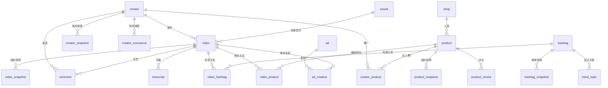

# TikTok R1 21 张表 schema 草案

> 状态：草案。待评审。未执行。
> 日期：2026-10-19。
> 配套方案：[【技术方案】TikTok采集能力R1-内容-电商-达人](./【技术方案】TikTok采集能力R1-内容-电商-达人.md)。
> 字段证据：[TikHub 31 个端点探测报告](./【探测报告】TikHub-TikTok-31端点-2026-10-19.md)。

## 1. 建模约定

### 1.1 ID

1. 所有平台 ID 用 `TEXT`。TikTok ID 超过 2^53，不能用 `BIGINT`。
2. `creator_id` 用 TikTok `uid`。`unique_id` 是 handle，只做展示与匹配，不能当主键。
3. `sec_uid` 单独存。用于需要 sec_uid 的端点。
4. `video_id` 用 `aweme_id`。
5. `comment_id` 用 `cid`。缺失时用派生键，并标 `derived_identity`。
6. `hashtag_id` 用 `challenge cid` 或 `ch_id`。缺失时用 `name:<normalized>`，并标 `derived_identity`。
7. `product_key` 用 `region:product_id`。商品按市场隔离。
8. `shop_key` 用 `shop_id`。缺失时用 `seller:<region>:<seller_id>`。
9. `ad_id` 带命名空间前缀：`ad_library:`、`creative_center:`、`tikhub:`。
10. `sound_id` 用 `musicId`。缺失时用 `sound_name:<normalized_title>|<normalized_author>`。

### 1.2 时间

1. 所有时间用 `TIMESTAMPTZ`。
2. 统一存 UTC。
3. 事件时间用 `*_at`。日期用 `*_date`。
4. `captured_at` 是采集时间。不能用内容发布时间代替。
5. 快照只在 `captured_at` 变化时新增。

### 1.3 数值

1. 计数用 `BIGINT`。不得为负。
2. 比率用 `NUMERIC(6,5)`。范围 0 到 1。
3. 金额用 `NUMERIC(18,4)`。另带 `currency`。
4. 时长用 `duration_ms`，单位毫秒。
5. 窗口用 `period_days`，取值 1、7、30、90、120。
6. 源返回百分数时除以 100。
7. 分母为 0 或缺失时写 `NULL`。
8. 禁止把格式化副本写入标准表。例如 `*_fz`、`*_str`。

### 1.4 缺失值

1. 不适用写 `NULL`。
2. 适用但源未提供写 `NULL`，并加 `quality_flags=field_unknown:<field>`。
3. 必须展示的文本字段写 `UNKNOWN`，同时加质量标记。
4. 禁止用 0、空串或推测值替代。
5. 估算值单独标记 `is_estimated=true`。

### 1.5 治理列

每张表统一带以下列：

| 列 | 类型 | 说明 |
|---|---|---|
| `workspace_id` | `UUID NOT NULL` | 工作区。 |
| `project_id` | `UUID NOT NULL` | 项目。 |
| `provider` | `TEXT NOT NULL` | `apify`、`tikhub`、`external`、`manual`。 |
| `endpoint_type` | `TEXT NOT NULL` | 端点或 Actor ID。 |
| `run_id` | `TEXT` | 内部 `TaskRun` 或异步任务 ID。 |
| `raw_ref` | `TEXT` | 原始响应 URI 或对象存储键。 |
| `schema_version` | `TEXT NOT NULL` | 例如 `tiktok.video.v1`。 |
| `captured_at` | `TIMESTAMPTZ NOT NULL` | 采集时间。 |
| `is_stale` | `BOOLEAN NOT NULL DEFAULT FALSE` | 是否过期。 |
| `quality_flags` | `JSONB NOT NULL DEFAULT '[]'` | 质量标记数组。 |

主数据表的 `captured_at` 表示最近一次观测时间。主数据表另带：

| 列 | 类型 | 说明 |
|---|---|---|
| `first_seen_at` | `TIMESTAMPTZ NOT NULL` | 首次发现。 |
| `last_updated_at` | `TIMESTAMPTZ NOT NULL` | 最近更新。 |

### 1.6 快照规则

1. 快照表只 `INSERT`。不 `UPDATE`。不 `DELETE`。
2. 修正写新行。
3. `snapshot_id` 用 `UUIDv5`。
4. UUIDv5 输入：实体键、`captured_at`、`provider`、`endpoint_type`、`run_id`。
5. 同一采集重跑必须得到同一 `snapshot_id`。
6. 同一实体同一时间同一 provider 同一端点只允许一行。

### 1.7 质量标记

受控词表：

`field_unknown:<field>`、`missing_required_field`、`derived_identity`、`identity_conflict`、`alias_unverified`、`duplicate_record`、`cross_provider_duplicate`、`no_results_sentinel`、`envelope_unwrapped`、`partial_response`、`raw_schema_drift`、`stale_source`、`capture_time_inferred`、`unit_coerced`、`currency_missing`、`formatted_value_dropped`、`metric_regression`、`metric_outlier`、`zero_denominator`、`sampled_subset`、`top_level_only`、`replies_truncated`、`region_mismatch`、`language_unknown`、`ad_organic_ambiguous`、`shop_seller_confused`、`product_region_conflict`、`room_id_reused_suspected`、`deleted_or_private_suspected`、`low_sample`、`unverified_creator_match`、`secret_redacted`。

## 2. 表清单

| 编号 | 表 | 类型 | 主键 |
|---|---|---|---|
| 1 | `creator` | 主数据 | `creator_id` |
| 2 | `creator_snapshot` | 快照 | `snapshot_id` |
| 3 | `video` | 主数据 | `video_id` |
| 4 | `video_snapshot` | 快照 | `snapshot_id` |
| 5 | `comment` | 主数据 | `comment_id` |
| 6 | `comment_snapshot` | 快照 | `snapshot_id` |
| 7 | `hashtag` | 主数据 | `hashtag_id` |
| 8 | `hashtag_snapshot` | 快照 | `snapshot_id` |
| 9 | `video_hashtag` | 关系快照 | `snapshot_id` |
| 10 | `trend_topic` | 快照 | `snapshot_id` |
| 11 | `sound` | 主数据 | `sound_id` |
| 12 | `transcript` | 快照 | `transcript_id` |
| 13 | `product` | 主数据 | `product_key` |
| 14 | `product_snapshot` | 快照 | `snapshot_id` |
| 15 | `shop` | 主数据 | `shop_key` |
| 16 | `product_review` | 主数据 | `review_id` |
| 17 | `creator_commerce` | 快照 | `snapshot_id` |
| 18 | `video_product` | 关系快照 | `snapshot_id` |
| 19 | `creator_product` | 关系快照 | `snapshot_id` |
| 20 | `ad` | 主数据 | `ad_id` |
| 21 | `ad_creative` | 快照 | `creative_id` |

### 2.1 关系图



## 3. 通用列 DDL

```sql
-- 所有表统一追加。主数据表另加 first_seen_at / last_updated_at。
workspace_id   UUID NOT NULL REFERENCES workspaces(id),
project_id     UUID NOT NULL REFERENCES projects(id),
provider       TEXT NOT NULL,
endpoint_type  TEXT NOT NULL,
run_id         TEXT,
raw_ref        TEXT,
schema_version TEXT NOT NULL,
captured_at    TIMESTAMPTZ NOT NULL,
is_stale       BOOLEAN NOT NULL DEFAULT FALSE,
quality_flags  JSONB NOT NULL DEFAULT '[]'::jsonb
```

## 4. creator

用途：达人主数据。作者与评论者共用。

主键：`creator_id`。

| 字段 | 类型 | 来源 | 说明 |
|---|---|---|---|
| `creator_id` | `TEXT` | Apify `authorMeta.id`；TikHub `uid` | TikTok uid。 |
| `sec_uid` | `TEXT` | TikHub `sec_uid`；Apify 部分 Actor | 需要 sec_uid 的端点使用。 |
| `unique_id` | `TEXT` | Apify `authorMeta.name`；TikHub `unique_id` | handle。可变。只做展示与匹配。 |
| `nickname` | `TEXT` | `authorMeta.nickName` | 展示名。 |
| `bio` | `TEXT` | `authorMeta.signature` | 简介。 |
| `avatar_url` | `TEXT` | `authorMeta.avatar` | 头像。 |
| `bio_link` | `TEXT` | `authorMeta.bioLink` | 主页链接。 |
| `region` | `TEXT` | profile-scraper `authorMeta.region` | 账号地区。 |
| `language` | `TEXT` | 内容语言推断 | BCP-47。 |
| `follower_count` | `BIGINT` | `authorMeta.fans` | 粉丝数。 |
| `following_count` | `BIGINT` | `authorMeta.following` | 关注数。 |
| `friend_count` | `BIGINT` | `authorMeta.friends` | 互关数。 |
| `video_count` | `BIGINT` | `authorMeta.video` | 作品数。 |
| `heart_count` | `BIGINT` | `authorMeta.heart` | 总获赞。 |
| `digg_count` | `BIGINT` | `authorMeta.digg` | 用户点赞总数（digg）。 |
| `is_verified` | `BOOLEAN` | `authorMeta.verified` | 认证。 |
| `is_private` | `BOOLEAN` | `authorMeta.privateAccount` | 私密账号。 |
| `is_seller` | `BOOLEAN` | `authorMeta.ttSeller` | 是否卖家。 |
| `commerce_user_info` | `JSONB` | `authorMeta.commerceUserInfo` | 带货信息。 |
| `account_created_at` | `TIMESTAMPTZ` | `authorMeta.createTime` | 待实测确认。 |
| `profile_url` | `TEXT` | `authorMeta.profileUrl` | 主页链接。 |
| `identity_quality` | `TEXT` | 内部 | `exact`、`alias`、`derived`。 |
| `first_seen_at` | `TIMESTAMPTZ` | 内部 | 首次发现。 |
| `last_updated_at` | `TIMESTAMPTZ` | 内部 | 最近更新。 |

索引：

1. `(workspace_id, project_id, unique_id)`。
2. `(workspace_id, project_id, sec_uid)`。
3. `(region, follower_count DESC)`。

## 5. creator_snapshot

用途：达人与粉丝指标时序。

主键：`snapshot_id`。

| 字段 | 类型 | 来源 | 说明 |
|---|---|---|---|
| `snapshot_id` | `TEXT` | UUIDv5 | 幂等快照 ID。 |
| `creator_id` | `TEXT` | `creator.creator_id` | 外键。 |
| `captured_at` | `TIMESTAMPTZ` | 内部 | 采集时间。 |
| `follower_count` | `BIGINT` | `authorMeta.fans` | 粉丝数。 |
| `following_count` | `BIGINT` | `authorMeta.following` | 关注数。 |
| `video_count` | `BIGINT` | `authorMeta.video` | 作品数。 |
| `heart_count` | `BIGINT` | `authorMeta.heart` | 总获赞。 |
| `digg_count` | `BIGINT` | `authorMeta.digg` | 用户点赞总数（digg）。 |
| `follower_delta` | `BIGINT` | 派生 | 本次减上次。 |
| `video_delta` | `BIGINT` | 派生 | 本次减上次。 |
| `engagement_rate` | `NUMERIC(6,5)` | 派生 | 互动率。 |

唯一约束：`(creator_id, captured_at, provider, endpoint_type)`。

索引：`(creator_id, captured_at DESC)`。

## 6. video

用途：视频主数据。

主键：`video_id`。

| 字段 | 类型 | 来源 | 说明 |
|---|---|---|---|
| `video_id` | `TEXT` | Apify `id`；TikHub `aweme_id` | 视频 ID。 |
| `creator_id` | `TEXT` | `authorMeta.id` | 作者。 |
| `caption` | `TEXT` | `text`；TikHub `desc` | 文案。 |
| `text_language` | `TEXT` | `textLanguage` | BCP-47。 |
| `published_at` | `TIMESTAMPTZ` | `createTimeISO` | 发布时间。 |
| `duration_ms` | `INTEGER` | `videoMeta.duration` 乘 1000 | 时长。 |
| `cover_url` | `TEXT` | `videoMeta.coverUrl` | 封面。 |
| `web_video_url` | `TEXT` | `webVideoUrl` | 稳定页面链接。 |
| `video_url` | `TEXT` | `videoMeta.downloadAddr` | 签名直链。会过期。 |
| `video_url_expires_at` | `TIMESTAMPTZ` | URL 参数解析 | 过期时间。 |
| `sound_id` | `TEXT` | `musicMeta.musicId` | 音乐 ID。 |
| `location_created` | `TEXT` | `locationCreated` 或 `locationMeta` | 发布地。待实测确认键名。 |
| `is_ad` | `BOOLEAN` | `isAd` | 广告标记。 |
| `is_sponsored` | `BOOLEAN` | `isSponsored` | 赞助标记。 |
| `ad_flag` | `TEXT` | 派生 | `natural`、`ad`、`unknown`。 |
| `is_slideshow` | `BOOLEAN` | `isSlideshow` | 图文。 |
| `is_pinned` | `BOOLEAN` | `isPinned` | 置顶。 |
| `is_story` | `BOOLEAN` | `isStory` | 故事。 |
| `has_shop_product` | `BOOLEAN` | `hasTikTokShopProduct` | 是否带货。 |
| `hashtags` | `JSONB` | `hashtags` | 只做展示与快速过滤。归因必须走 `video_hashtag`。 |
| `effect_stickers` | `JSONB` | `effectStickers` | 贴纸。 |
| `mentions` | `JSONB` | `mentions` | 提及。 |
| `detailed_mentions` | `JSONB` | `detailedMentions` | 详细提及。 |
| `slideshow_image_urls` | `JSONB` | `slideshowImageLinks` | 图文图片。 |
| `media_urls` | `JSONB` | `mediaUrls` | 媒体列表。 |
| `first_seen_at` | `TIMESTAMPTZ` | 内部 | 首次发现。 |
| `last_updated_at` | `TIMESTAMPTZ` | 内部 | 最近更新。 |

索引：

1. `(creator_id, published_at DESC)`。
2. `(sound_id)`。
3. `(published_at DESC)`。

## 7. video_snapshot

用途：视频指标时序。爆款判定依赖此表。

主键：`snapshot_id`。

| 字段 | 类型 | 来源 | 说明 |
|---|---|---|---|
| `snapshot_id` | `TEXT` | UUIDv5 | 幂等快照 ID。 |
| `video_id` | `TEXT` | `video.video_id` | 外键。 |
| `captured_at` | `TIMESTAMPTZ` | 内部 | 采集时间。 |
| `play_count` | `BIGINT` | `playCount` | 播放。 |
| `like_count` | `BIGINT` | `diggCount` | 点赞。 |
| `comment_count` | `BIGINT` | `commentCount` | 评论。 |
| `share_count` | `BIGINT` | `shareCount` | 分享。 |
| `collect_count` | `BIGINT` | `collectCount` | 收藏。 |
| `repost_count` | `BIGINT` | `repostCount` | 转发。 |
| `engagement_rate` | `NUMERIC(6,5)` | 派生 | 互动率。 |
| `save_rate` | `NUMERIC(6,5)` | 派生 | 收藏率。 |
| `share_rate` | `NUMERIC(6,5)` | 派生 | 分享率。 |
| `play_delta` | `BIGINT` | 派生 | 本次减上次。 |
| `like_delta` | `BIGINT` | 派生 | 本次减上次。 |
| `comment_delta` | `BIGINT` | 派生 | 本次减上次。 |
| `share_delta` | `BIGINT` | 派生 | 本次减上次。 |
| `collect_delta` | `BIGINT` | 派生 | 本次减上次。 |
| `repost_delta` | `BIGINT` | 派生 | 本次减上次。 |

唯一约束：`(video_id, captured_at, provider, endpoint_type)`。

索引：`(video_id, captured_at DESC)`。

指标公式：

1. `engagement_rate = (like_count + comment_count + share_count + collect_count) / play_count`。
2. `save_rate = collect_count / play_count`。
3. `share_rate = share_count / play_count`。
4. 分母为 0 时写 `NULL`。

## 8. comment

用途：评论主数据。支持回复树。

主键：`comment_id`。

字段来源：`parent_comment_id`、`is_pinned`、`creator_interacted` 由 TikHub `app/v3/fetch_video_comments` 与 `fetch_video_comment_replies` 提供。`clockworks/tiktok-comments-scraper` 不提供这三个字段。

| 字段 | 类型 | 来源 | 说明 |
|---|---|---|---|
| `comment_id` | `TEXT` | TikHub `cid`；Apify `cid` | 评论 ID。 |
| `video_id` | `TEXT` | `aweme_id` 或 `videoWebUrl` 解析 | 视频。 |
| `creator_id` | `TEXT` | 评论者 `uid` | 评论者。 |
| `author_unique_id` | `TEXT` | `uniqueId` | 评论者 handle。 |
| `author_nickname` | `TEXT` | TikHub `nickname` | 昵称。 |
| `parent_comment_id` | `TEXT` | TikHub `reply_id`；xtdata `reply_id` | 父评论。源返回 `0` 时归一为 `NULL`。 |
| `root_comment_id` | `TEXT` | 派生 | 根评论。 |
| `is_reply` | `BOOLEAN` | 派生 | 是否回复。 |
| `text` | `TEXT` | `text` | 原文。 |
| `text_language` | `TEXT` | `comment_language` | BCP-47。 |
| `is_pinned` | `BOOLEAN` | TikHub `author_pin`；xtdata `author_pin` | 置顶。 |
| `creator_interacted` | `BOOLEAN` | TikHub `is_author_digged` 或回复 | 作者是否互动。 |
| `creator_interaction_type` | `TEXT` | 派生 | `liked`、`replied`、`both`、`unknown`。 |
| `published_at` | `TIMESTAMPTZ` | `create_time` | 评论时间。 |
| `identity_quality` | `TEXT` | 内部 | `exact` 或 `derived`。 |
| `first_seen_at` | `TIMESTAMPTZ` | 内部 | 首次发现。 |
| `last_updated_at` | `TIMESTAMPTZ` | 内部 | 最近更新。 |

索引：

1. `(video_id, published_at DESC)`。
2. `(parent_comment_id)`。
3. `(creator_id)`。

派生键：

`sha1(video_id + author_id + published_at + text_hash)`。
派生时加 `quality_flags=derived_identity`。

## 9. comment_snapshot

用途：评论点赞与回复数时序。样本偏差必须标记。

主键：`snapshot_id`。

| 字段 | 类型 | 来源 | 说明 |
|---|---|---|---|
| `snapshot_id` | `TEXT` | UUIDv5 | 幂等快照 ID。 |
| `comment_id` | `TEXT` | `comment.comment_id` | 外键。 |
| `captured_at` | `TIMESTAMPTZ` | 内部 | 采集时间。 |
| `like_count` | `BIGINT` | `diggCount` | 点赞。 |
| `reply_count` | `BIGINT` | `replyCommentTotal` | 回复数。 |
| `list_rank` | `INTEGER` | 采集顺序 | 列表位置。 |
| `sample_method` | `TEXT` | 内部 | `top`、`recent`、`mixed`、`all`。 |

唯一约束：`(comment_id, captured_at, provider, endpoint_type)`。

索引：`(comment_id, captured_at DESC)`。

## 10. hashtag

用途：话题主数据。

主键：`hashtag_id`。

字段来源：Web `fetch_tag_detail` 的 `challengeInfo.challenge.id` 是 Web challengeID；App `fetch_hashtag_detail` 的 `ch_info.cid` 是 App `ch_id`。两者不能混用。

| 字段 | 类型 | 来源 | 说明 |
|---|---|---|---|
| `hashtag_id` | `TEXT` | `challenge cid` 或 `ch_id` | 话题 ID。 |
| `name_raw` | `TEXT` | `Hashtag` 或 `hashtags[].name` | 原始名称。 |
| `name_normalized` | `TEXT` | 派生 | NFKC + lowercase + trim。 |
| `description` | `TEXT` | `fetch_tag_detail` | 描述。 |
| `category` | `TEXT` | `Industries` 或 `industry` | 类目。 |
| `first_market` | `TEXT` | 首次采集国家 | 首次市场。 |
| `first_language` | `TEXT` | 首次采集语言 | 首次语言。 |
| `source_url` | `TEXT` | `TikTok URL` | 话题页。 |
| `identity_source` | `TEXT` | 内部 | `platform_id` 或 `name`。 |
| `identity_quality` | `TEXT` | 内部 | `exact` 或 `derived`。 |
| `first_seen_at` | `TIMESTAMPTZ` | 内部 | 首次发现。 |
| `last_updated_at` | `TIMESTAMPTZ` | 内部 | 最近更新。 |

索引：

1. `(name_normalized)`。
2. `(category)`。

## 11. hashtag_snapshot

用途：话题榜单与热度时序。

主键：`snapshot_id`。

| 字段 | 类型 | 来源 | 说明 |
|---|---|---|---|
| `snapshot_id` | `TEXT` | UUIDv5 | 幂等快照 ID。 |
| `hashtag_id` | `TEXT` | `hashtag.hashtag_id` | 外键。 |
| `hashtag_name_raw` | `TEXT` | 榜单 | 原始名称。 |
| `captured_at` | `TIMESTAMPTZ` | 内部 | 采集时间。 |
| `country_code` | `TEXT` | `Country Code` | ISO 3166-1 alpha-2。 |
| `period_days` | `INTEGER` | `Period` | 7、30、90。 |
| `rank` | `INTEGER` | `Rank` | 排名。 |
| `post_count` | `BIGINT` | `Posts` | 帖子数。 |
| `view_count` | `BIGINT` | `Video Views` | 播放量。 |
| `trend_state` | `TEXT` | `Trend Direction` | `up`、`down`、`stable`、`new`、`unknown`。 |
| `industry` | `TEXT` | `Industries` | 行业。 |
| `rank_change` | `INTEGER` | 派生 | 正数表示上升。 |
| `post_delta` | `BIGINT` | 派生 | 本次减上次。 |
| `view_delta` | `BIGINT` | 派生 | 本次减上次。 |
| `popularity_curve` | `JSONB` | `Trend Data` | 日曲线。 |
| `top_creator_ids` | `JSONB` | `Top Creators` | 头部作者。 |

唯一约束：`(hashtag_id, captured_at, provider, endpoint_type, country_code, period_days)`。

索引：

1. `(country_code, period_days, rank)`。
2. `(hashtag_id, captured_at DESC)`。

## 12. video_hashtag

用途：视频与话题的关系快照。禁止只查 `video.hashtags` JSON。

主键：`snapshot_id`。

| 字段 | 类型 | 来源 | 说明 |
|---|---|---|---|
| `snapshot_id` | `TEXT` | UUIDv5 | 幂等快照 ID。 |
| `video_id` | `TEXT` | `video.video_id` | 视频。 |
| `hashtag_id` | `TEXT` | `hashtags[].id` | 话题。 |
| `hashtag_name_raw` | `TEXT` | `hashtags[].name` | 原始名称。 |
| `hashtag_name_normalized` | `TEXT` | 派生 | 规范化名称。 |
| `position` | `INTEGER` | 出现顺序 | 位置。 |
| `match_method` | `TEXT` | 内部 | `exact_id`、`name_normalized`、`manual`。 |
| `confidence` | `NUMERIC(6,5)` | 内部 | 匹配置信度。 |

唯一约束：`(video_id, hashtag_id, position, captured_at, provider, endpoint_type)`。

索引：

1. `(hashtag_id, captured_at DESC)`。
2. `(video_id)`。

## 13. trend_topic

用途：选题需求与趋势话题。来源包括 Creator Search Insights、Creative Center。

主键：`snapshot_id`。

业务唯一键：`(topic_id, captured_at, country_code, time_window, language, provider, endpoint_type)`。

| 字段 | 类型 | 来源 | 说明 |
|---|---|---|---|
| `snapshot_id` | `TEXT` | UUIDv5 | 幂等快照 ID。 |
| `topic_id` | `TEXT` | `queryId` 或派生 | 带 source、type、country 命名空间。 |
| `topic_type` | `TEXT` | 内部 | `search_topic`、`sound`、`creator`、`video`、`category`。 |
| `topic_name` | `TEXT` | `queryText` 或 `topic` | 名称。 |
| `topic_name_normalized` | `TEXT` | 派生 | 规范化。 |
| `country_code` | `TEXT` | 参数 | 市场。 |
| `language` | `TEXT` | 参数 | 语言。 |
| `category_l1` | `TEXT` | `categoryL1` | 一级类目。 |
| `category_l2` | `TEXT` | `categoryL2` | 二级类目。 |
| `time_window` | `TEXT` | `timeWindow` | `4h`、`24h`、`48h`、`7d`、`30d`、`90d`。 |
| `period_days` | `INTEGER` | 派生 | 天数。 |
| `rank` | `INTEGER` | 榜单 | 排名。 |
| `rank_change` | `INTEGER` | 派生 | 正数表示上升。 |
| `popularity_score` | `NUMERIC(18,4)` | `popularityScore` | 热度分。 |
| `search_volume_label` | `TEXT` | `searchVolumeLabel` | 搜索量档位。 |
| `search_volume_index` | `NUMERIC(18,4)` | `popularity` | 搜索量指数。 |
| `growth_rate` | `NUMERIC(6,5)` | `trendGrowthPercent` | 增长率。 |
| `video_count` | `BIGINT` | `videoCount` | 视频数。 |
| `linked_hashtag_id` | `TEXT` | 源显式给出 | 关联话题。 |
| `related_topic_ids` | `JSONB` | `relatedTopics` | 相关话题。 |
| `related_video_ids` | `JSONB` | `relatedVideos` | 相关视频。 |
| `audience_json` | `JSONB` | `demographics` | 受众。 |
| `outline_json` | `JSONB` | `outline*` | 选题大纲。 |

索引：

1. `(country_code, time_window, rank)`。
2. `(topic_id, captured_at DESC)`。
3. `(linked_hashtag_id)`。

## 14. sound

用途：音乐主数据。

主键：`sound_id`。

| 字段 | 类型 | 来源 | 说明 |
|---|---|---|---|
| `sound_id` | `TEXT` | `musicMeta.musicId` | 音乐 ID。 |
| `title` | `TEXT` | `musicName` | 名称。 |
| `title_normalized` | `TEXT` | 派生 | NFKC + lowercase + trim。 |
| `author_name` | `TEXT` | `musicAuthor` | 作者。 |
| `author_id` | `TEXT` | TikHub music detail | 作者 ID。 |
| `duration_ms` | `INTEGER` | `duration` | 时长。 |
| `cover_url` | `TEXT` | `coverMediumUrl` | 封面。 |
| `audio_url` | `TEXT` | `playUrl` | 音频直链。会过期。 |
| `is_original` | `BOOLEAN` | `musicOriginal` | 原创。 |
| `is_commercial` | `BOOLEAN` | burbn `is_commercial` | 商用。 |
| `usage_count` | `BIGINT` | `usage_count` | 使用量。口径待确认。 |
| `video_count` | `BIGINT` | 派生 | 视频数。口径待确认。 |
| `first_seen_at` | `TIMESTAMPTZ` | 内部 | 首次发现。 |
| `last_updated_at` | `TIMESTAMPTZ` | 内部 | 最近更新。 |

索引：`(title_normalized)`。当前表未加 `title_normalized`，可在 R2 补。

## 15. transcript

用途：字幕与转写。

主键：`transcript_id`。

| 字段 | 类型 | 来源 | 说明 |
|---|---|---|---|
| `transcript_id` | `TEXT` | `sha1(video_id + language + source + content_hash)` | 幂等。 |
| `video_id` | `TEXT` | `video.video_id` | 视频。 |
| `language` | `TEXT` | `textLanguage` 或 `language` | BCP-47。 |
| `transcript_source` | `TEXT` | 内部 | `creator_caption`、`platform_asr`、`third_party_asr`、`manual`。 |
| `text` | `TEXT` | `text` | 正文。 |
| `segments_json` | `JSONB` | `segments` | 分段。 |
| `word_count` | `INTEGER` | 派生 | 词数。 |
| `duration_ms` | `INTEGER` | 视频时长 | 时长。 |
| `is_auto_generated` | `BOOLEAN` | 源 | 是否自动生成。 |
| `confidence` | `NUMERIC(6,5)` | 源 | 置信度。 |
| `content_hash` | `TEXT` | 内部 | 正文哈希。 |
| `source_url` | `TEXT` | 源 | 字幕文件。 |

唯一约束：`(video_id, language, transcript_source, content_hash)`。

索引：`(video_id)`。

## 16. product

用途：商品主数据。按市场隔离。

主键：`product_key = region:product_id`。

字段来源：主源是 `pratikdani/tiktok-shop-scraper`。TikHub `fetch_search_products_list_v2` 可补搜索发现。`fetch_product_detail_v3` 只回页面配置，不回商品字段，不能当详情源。

| 字段 | 类型 | 来源 | 说明 |
|---|---|---|---|
| `product_key` | `TEXT` | 派生 | `US:123`。 |
| `product_id` | `TEXT` | `product_id` | 平台商品 ID。 |
| `region` | `TEXT` | `region` 或 `country_code` | 市场。 |
| `shop_key` | `TEXT` | 派生 | 店铺键。 |
| `shop_id` | `TEXT` | `shop_id` | 店铺 ID。 |
| `seller_id` | `TEXT` | `seller_id` | 卖家 ID。 |
| `title` | `TEXT` | `product_name` 或 `title` | 标题。 |
| `description` | `TEXT` | `product_desc` | 描述。 |
| `brand` | `TEXT` | `brand` | 品牌。 |
| `category_l1` | `TEXT` | `category1` 或 `categories` | 一级类目。 |
| `category_l2` | `TEXT` | `category2` | 二级类目。 |
| `category_l3` | `TEXT` | `category3` | 三级类目。 |
| `category_path` | `TEXT` | `categories` | 类目路径。 |
| `product_url` | `TEXT` | `product_url` | 商品页。 |
| `image_urls` | `JSONB` | `images` | 图片。 |
| `sku_count` | `INTEGER` | `skus` 长度 | SKU 数。 |
| `skus_json` | `JSONB` | `skus` | SKU 明细。 |
| `currency` | `TEXT` | `currency` | ISO 4217。 |
| `is_active` | `BOOLEAN` | `product_status` | 是否在售。 |
| `identity_quality` | `TEXT` | 内部 | `exact` 或 `derived`。 |
| `first_seen_at` | `TIMESTAMPTZ` | 内部 | 首次发现。 |
| `last_updated_at` | `TIMESTAMPTZ` | 内部 | 最近更新。 |

唯一约束：`(region, product_id)`。

索引：

1. `(region, shop_key)`。
2. `(category_l1, category_l2)`。
3. `(title)`。

## 17. product_snapshot

用途：商品价格、销量、GMV、库存时序。

主键：`snapshot_id`。

| 字段 | 类型 | 来源 | 说明 |
|---|---|---|---|
| `snapshot_id` | `TEXT` | UUIDv5 | 幂等快照 ID。 |
| `product_key` | `TEXT` | `product.product_key` | 外键。 |
| `product_id` | `TEXT` | 冗余 | 商品 ID。 |
| `region` | `TEXT` | 冗余 | 市场。 |
| `captured_at` | `TIMESTAMPTZ` | 内部 | 采集时间。 |
| `price_amount` | `NUMERIC(18,4)` | `price` 或 `real_price` | 现价。 |
| `original_price_amount` | `NUMERIC(18,4)` | `original_price` | 原价。 |
| `min_price_amount` | `NUMERIC(18,4)` | `min_price` | 最低价。 |
| `max_price_amount` | `NUMERIC(18,4)` | `max_price` | 最高价。 |
| `avg_price_amount` | `NUMERIC(18,4)` | `avg_price` | 均价。 |
| `currency` | `TEXT` | `currency` | 币种。 |
| `discount_rate` | `NUMERIC(6,5)` | 派生 | 折扣率。 |
| `sale_count` | `BIGINT` | `sale_cnt` | 累计销量。 |
| `sale_count_30d` | `BIGINT` | `sale_30d_cnt` | 30 天销量。 |
| `sale_delta_7d` | `BIGINT` | 派生 | 7 天增量。 |
| `gmv_amount_30d` | `NUMERIC(18,4)` | `gmv_30d_amt` | 30 天 GMV。估算值。 |
| `commission_rate` | `NUMERIC(6,5)` | `commission` | 佣金率。 |
| `stock_count` | `BIGINT` | `total_stock_cnt` | 库存。 |
| `review_count` | `BIGINT` | `review_count` | 评论数。 |
| `rating` | `NUMERIC(3,2)` | `product_rating` 或 `rating` | 评分。 |
| `video_count_30d` | `BIGINT` | `video_30d_cnt` | 30 天视频数。 |
| `live_count_30d` | `BIGINT` | `live_30d_cnt` | 30 天直播数。 |
| `ifl_count_30d` | `BIGINT` | `ifl_30d_cnt` | 30 天种草数。 |
| `is_hot` | `BOOLEAN` | `is_hot` | 热卖。 |
| `free_shipping` | `BOOLEAN` | `free_shipping` | 包邮。 |
| `shipping_price` | `NUMERIC(18,4)` | `shipping_price` | 运费。 |
| `is_estimated` | `BOOLEAN` | 内部 | GMV 等估算值。 |

唯一约束：`(product_key, captured_at, provider, endpoint_type)`。

索引：

1. `(product_key, captured_at DESC)`。
2. `(region, sale_count_30d DESC)`。
3. `(region, gmv_amount_30d DESC)`。

## 18. shop

用途：店铺主数据。店铺与卖家分开。

主键：`shop_key`。

| 字段 | 类型 | 来源 | 说明 |
|---|---|---|---|
| `shop_key` | `TEXT` | 派生 | 店铺键。 |
| `shop_id` | `TEXT` | `shop_id` | 可空。 |
| `seller_id` | `TEXT` | `seller_id` | 卖家 ID。 |
| `shop_name` | `TEXT` | `shop_name` | 店铺名。 |
| `shop_type` | `TEXT` | `shop_type` | 店铺类型。 |
| `seller_type` | `TEXT` | `seller_type` | 卖家类型。 |
| `region` | `TEXT` | `region` | 市场。 |
| `logo_url` | `TEXT` | `shop_logo_privatization` | 标志。 |
| `rating` | `NUMERIC(3,2)` | `rating` | 评分。 |
| `follower_count` | `BIGINT` | `follower_count` | 粉丝。 |
| `product_count` | `BIGINT` | `total_products` | 商品数。 |
| `is_mall_recommended` | `BOOLEAN` | `is_mall_recommended` | 商城推荐。 |
| `shop_url` | `TEXT` | 派生 | 店铺页。 |
| `identity_quality` | `TEXT` | 内部 | `exact`、`partial`、`derived`。 |
| `first_seen_at` | `TIMESTAMPTZ` | 内部 | 首次发现。 |
| `last_updated_at` | `TIMESTAMPTZ` | 内部 | 最近更新。 |

唯一约束：

1. `(region, shop_id) WHERE shop_id IS NOT NULL`。
2. `(region, seller_id) WHERE shop_id IS NULL`。

注意：如果一个 seller 有多个店铺，不要只用 `seller_id` 唯一。此时 `shop_key` 加店铺名或平台子 ID。

## 19. product_review

用途：商品评论与口碑。

主键：`review_id`。

| 字段 | 类型 | 来源 | 说明 |
|---|---|---|---|
| `review_id` | `TEXT` | `review_id` | 评论 ID。 |
| `product_key` | `TEXT` | `product.product_key` | 外键。 |
| `product_id` | `TEXT` | 冗余 | 商品 ID。 |
| `region` | `TEXT` | 冗余 | 市场。 |
| `shop_id` | `TEXT` | 源 | 店铺。 |
| `sku_id` | `TEXT` | `sku_id` | SKU。 |
| `rating` | `INTEGER` | `review_rating` | 1 到 5。 |
| `text` | `TEXT` | `review_text` | 原文。 |
| `text_language` | `TEXT` | 源或推断 | BCP-47。 |
| `review_time` | `TIMESTAMPTZ` | `review_time` | 时间。 |
| `verified_purchase` | `BOOLEAN` | `is_verified_purchase` | 验证购买。 |
| `incentivized` | `BOOLEAN` | `is_incentivized_review` | 激励评论。 |
| `helpful_count` | `BIGINT` | `helpful_count` | 有用数。 |
| `images` | `JSONB` | `review_images` | 图片。 |
| `variant` | `TEXT` | `variant` | 变体。 |
| `sku_specification` | `TEXT` | `sku_specification` | 规格。 |
| `reviewer_name_masked` | `TEXT` | 源脱敏 | 评论者。 |
| `reviewer_avatar_url` | `TEXT` | 源 | 头像。 |
| `review_country` | `TEXT` | `review_country` | 国家。 |
| `first_seen_at` | `TIMESTAMPTZ` | 内部 | 首次发现。 |
| `last_updated_at` | `TIMESTAMPTZ` | 内部 | 最近更新。 |

索引：

1. `(product_key, review_time DESC)`。
2. `(rating)`。
3. `(verified_purchase, incentivized)`。

## 20. creator_commerce

用途：达人带货指标。30 天窗口。

主键：`snapshot_id`。

| 字段 | 类型 | 来源 | 说明 |
|---|---|---|---|
| `snapshot_id` | `TEXT` | UUIDv5 | 幂等快照 ID。 |
| `creator_id` | `TEXT` | `creator.creator_id` | 外键。 |
| `market` | `TEXT` | `region` | 市场。 |
| `captured_at` | `TIMESTAMPTZ` | 内部 | 采集时间。 |
| `window_start` | `TIMESTAMPTZ` | 派生 | 窗口开始。 |
| `window_end` | `TIMESTAMPTZ` | 派生 | 窗口结束。 |
| `period_days` | `INTEGER` | 固定 30 | 窗口。 |
| `gmv_amount` | `NUMERIC(18,4)` | `gmv.total` | GMV。 |
| `currency` | `TEXT` | `currency` | 币种。 |
| `units_sold` | `BIGINT` | `unitsSold` | 销量。 |
| `gpm_amount` | `NUMERIC(18,4)` | `gpm.amount` | 千次播放 GMV。 |
| `video_gpm_amount` | `NUMERIC(18,4)` | `videoGpm.amount` | 视频 GPM。 |
| `live_gpm_amount` | `NUMERIC(18,4)` | `liveGpm.amount` | 直播 GPM。 |
| `avg_commission_rate` | `NUMERIC(6,5)` | `avgCommission.value` | 平均佣金。 |
| `brand_collaboration_count` | `INTEGER` | `totalBrandCollaborations` | 品牌合作数。 |
| `promoted_product_count` | `INTEGER` | `promotedProducts` | 推广商品数。 |
| `avg_views` | `BIGINT` | `avgViews` | 平均播放。 |
| `avg_likes` | `BIGINT` | `avgLikes` | 平均点赞。 |
| `avg_comments` | `BIGINT` | `avgComments` | 平均评论。 |
| `avg_shares` | `BIGINT` | `avgShares` | 平均分享。 |
| `engagement_rate` | `NUMERIC(6,5)` | `engagementRate.video` | 互动率。 |
| `content_frequency` | `NUMERIC(18,4)` | `contentFrequency` | 更新频率。 |
| `post_rate` | `NUMERIC(18,4)` | `postRate` | 发布率。 |
| `rating` | `NUMERIC(3,2)` | `rating` | 评分。 |
| `promotion_performance_score` | `NUMERIC(18,4)` | `promotionPerformanceScore` | 推广表现。 |
| `follower_count` | `BIGINT` | `followers.total` | 粉丝。 |
| `top_brands` | `JSONB` | `topBrands` | 品牌。 |
| `category_list` | `JSONB` | `categoryList` | 类目。 |
| `audience_json` | `JSONB` | `topDemographics` | 受众。 |
| `gmv_distribution_json` | `JSONB` | `gmvDistribution` | GMV 分布。 |
| `is_estimated` | `BOOLEAN` | 内部 | 第三方估算。 |

唯一约束：`(creator_id, market, captured_at, provider, endpoint_type)`。

索引：`(creator_id, captured_at DESC)`。

## 21. video_product

用途：视频与商品的带货关系。

主键：`snapshot_id`。

| 字段 | 类型 | 来源 | 说明 |
|---|---|---|---|
| `snapshot_id` | `TEXT` | UUIDv5 | 幂等快照 ID。 |
| `video_id` | `TEXT` | `video.video_id` | 视频。 |
| `product_key` | `TEXT` | `product.product_key` | 商品。 |
| `product_id` | `TEXT` | 冗余 | 商品 ID。 |
| `region` | `TEXT` | 冗余 | 市场。 |
| `relation_type` | `TEXT` | 内部 | `tagged`、`sponsored`、`live_cart`、`creator_showcase`。 |
| `confidence` | `NUMERIC(6,5)` | 内部 | 置信度。 |
| `match_method` | `TEXT` | 内部 | `exact_id`、`product_url`、`related_videos`、`manual`。 |

唯一约束：`(video_id, product_key, relation_type, captured_at, provider, endpoint_type)`。

索引：

1. `(product_key)`。
2. `(video_id)`。

## 22. creator_product

用途：达人与商品的推广关系。

主键：`snapshot_id`。

| 字段 | 类型 | 来源 | 说明 |
|---|---|---|---|
| `snapshot_id` | `TEXT` | UUIDv5 | 幂等快照 ID。 |
| `creator_id` | `TEXT` | `creator.creator_id` | 达人。 |
| `product_key` | `TEXT` | `product.product_key` | 商品。 |
| `product_id` | `TEXT` | 冗余 | 商品 ID。 |
| `region` | `TEXT` | 冗余 | 市场。 |
| `relation_type` | `TEXT` | 内部 | `promoted`、`affiliate`、`showcase`。 |
| `confidence` | `NUMERIC(6,5)` | 内部 | 置信度。 |
| `match_method` | `TEXT` | 内部 | `exact_id`、`product_url`、`showcase`、`manual`。 |

唯一约束：`(creator_id, product_key, relation_type, captured_at, provider, endpoint_type)`。

索引：

1. `(creator_id)`。
2. `(product_key)`。

## 23. ad

用途：广告主数据。R1 建表，不采集。

主键：`ad_id`。

| 字段 | 类型 | 来源 | 说明 |
|---|---|---|---|
| `ad_id` | `TEXT` | 源 | 带命名空间。 |
| `ad_id_type` | `TEXT` | 内部 | `ad_library`、`creative_center`、`tikhub`。 |
| `advertiser_id` | `TEXT` | 源 | 广告主。 |
| `advertiser_tt_user_id` | `TEXT` | 源 | TikTok 用户 ID。 |
| `advertiser_name` | `TEXT` | 源 | 名称。 |
| `ad_title` | `TEXT` | 源 | 标题。 |
| `ad_text` | `TEXT` | 源 | 文案。 |
| `ad_type` | `TEXT` | 源 | 类型。 |
| `status` | `TEXT` | 源 | 状态。 |
| `audit_status` | `TEXT` | 源 | 审核状态。 |
| `rejection_info` | `TEXT` | 源 | 拒绝原因。 |
| `landing_url` | `TEXT` | 源 | 落地页。 |
| `start_date` | `DATE` | 源 | 开始。 |
| `end_date` | `DATE` | 源 | 结束。 |
| `region` | `TEXT` | 源 | 地区。 |
| `target_regions_json` | `JSONB` | 源 | 投放地区。 |
| `objective` | `TEXT` | 源 | 目标。 |
| `industry` | `TEXT` | 源 | 行业。 |
| `brand_name` | `TEXT` | 源 | 品牌。 |
| `duration_ms` | `INTEGER` | 源 | 时长。 |
| `first_seen_at` | `TIMESTAMPTZ` | 内部 | 首次发现。 |
| `last_updated_at` | `TIMESTAMPTZ` | 内部 | 最近更新。 |

## 24. ad_creative

用途：广告素材与效果。R1 建表，不采集。

主键：`creative_id`。

| 字段 | 类型 | 来源 | 说明 |
|---|---|---|---|
| `creative_id` | `TEXT` | `sha1(ad_id + format + asset_hash)` | 幂等。 |
| `ad_id` | `TEXT` | `ad.ad_id` | 广告。 |
| `asset_hash` | `TEXT` | 内部 | 素材内容哈希。不能用签名 URL 生成。 |
| `format` | `TEXT` | 源 | `video`、`image`、`carousel`。 |
| `video_url` | `TEXT` | 源 | 视频。 |
| `cover_url` | `TEXT` | 源 | 封面。 |
| `image_urls` | `JSONB` | 源 | 图片。 |
| `headline` | `TEXT` | 源 | 标题。 |
| `body_text` | `TEXT` | 源 | 正文。 |
| `cta_text` | `TEXT` | 源 | 行动文案。 |
| `landing_url` | `TEXT` | 源 | 落地页。 |
| `duration_ms` | `INTEGER` | 源 | 时长。 |
| `organic_video_id` | `TEXT` | 派生 | 自然视频 ID。待实测。 |
| `transcript_id` | `TEXT` | 派生 | 字幕。R2。 |
| `performance_score` | `NUMERIC(18,4)` | 源 | 表现分。 |
| `ctr` | `NUMERIC(6,5)` | 源 | 点击率。 |
| `likes` | `BIGINT` | 源 | 点赞。 |
| `comments` | `BIGINT` | 源 | 评论。 |
| `shares` | `BIGINT` | 源 | 分享。 |
| `cost_score` | `NUMERIC(18,4)` | 源 | 成本分。 |
| `is_spark_ad` | `BOOLEAN` | 源 | Spark Ads。 |
| `impressions_range_json` | `JSONB` | 源 | 曝光区间。 |
| `spend_tier` | `TEXT` | 源 | 花费档位。 |
| `period_days` | `INTEGER` | 源 | 窗口。 |

唯一约束：`(ad_id, format, asset_hash)`。

## 25. DDL 草案

以下 DDL 是草案。未执行。建表时按迁移顺序拆分。

```sql
-- 1. creator
CREATE TABLE creator (
    creator_id TEXT PRIMARY KEY,
    sec_uid TEXT,
    unique_id TEXT,
    nickname TEXT,
    bio TEXT,
    avatar_url TEXT,
    bio_link TEXT,
    region TEXT,
    language TEXT,
    follower_count BIGINT,
    following_count BIGINT,
    friend_count BIGINT,
    video_count BIGINT,
    heart_count BIGINT,
    digg_count BIGINT,
    is_verified BOOLEAN,
    is_private BOOLEAN,
    is_seller BOOLEAN,
    commerce_user_info JSONB,
    account_created_at TIMESTAMPTZ,
    profile_url TEXT,
    identity_quality TEXT NOT NULL DEFAULT 'exact',
    first_seen_at TIMESTAMPTZ NOT NULL,
    last_updated_at TIMESTAMPTZ NOT NULL,
    workspace_id UUID NOT NULL REFERENCES workspaces(id),
    project_id UUID NOT NULL REFERENCES projects(id),
    provider TEXT NOT NULL,
    endpoint_type TEXT NOT NULL,
    run_id TEXT,
    raw_ref TEXT,
    schema_version TEXT NOT NULL,
    captured_at TIMESTAMPTZ NOT NULL,
    is_stale BOOLEAN NOT NULL DEFAULT FALSE,
    quality_flags JSONB NOT NULL DEFAULT '[]'::jsonb
);
CREATE INDEX ix_creator_handle ON creator (workspace_id, project_id, unique_id);
CREATE INDEX ix_creator_sec_uid ON creator (workspace_id, project_id, sec_uid);
CREATE INDEX ix_creator_region_fans ON creator (region, follower_count DESC);

-- 2. creator_snapshot
CREATE TABLE creator_snapshot (
    snapshot_id TEXT PRIMARY KEY,
    creator_id TEXT NOT NULL REFERENCES creator(creator_id),
    captured_at TIMESTAMPTZ NOT NULL,
    follower_count BIGINT,
    following_count BIGINT,
    video_count BIGINT,
    heart_count BIGINT,
    digg_count BIGINT,
    follower_delta BIGINT,
    video_delta BIGINT,
    engagement_rate NUMERIC(6,5),
    workspace_id UUID NOT NULL REFERENCES workspaces(id),
    project_id UUID NOT NULL REFERENCES projects(id),
    provider TEXT NOT NULL,
    endpoint_type TEXT NOT NULL,
    run_id TEXT,
    raw_ref TEXT,
    schema_version TEXT NOT NULL,
    is_stale BOOLEAN NOT NULL DEFAULT FALSE,
    quality_flags JSONB NOT NULL DEFAULT '[]'::jsonb,
    UNIQUE (creator_id, captured_at, provider, endpoint_type)
);
CREATE INDEX ix_creator_snapshot_time ON creator_snapshot (creator_id, captured_at DESC);
```

其余 19 张表按同一模板建。字段清单见第 4 到 24 节。

## 26. 迁移顺序

1. 扩展 `task_runs`。加 `provider_run_id`、`cost_reserved_usd`、`cost_actual_usd`、`provider`、`endpoint_type`、`schema_version`。
2. 建主数据表：`creator`、`hashtag`、`sound`、`shop`、`product`。
3. 建内容表：`creator_snapshot`、`video`、`video_snapshot`、`comment`、`comment_snapshot`、`hashtag_snapshot`、`video_hashtag`、`trend_topic`、`transcript`。
4. 建电商表：`product_snapshot`、`product_review`、`creator_commerce`、`video_product`、`creator_product`。
5. 建广告空表：`ad`、`ad_creative`。
6. 建索引。
7. 回填 `raw_records`。
8. 开启写入开关。按模块启用。

## 27. 回填策略

1. 先回填主数据。来源是 `raw_records` 的 `content`。
2. 再回填快照。`captured_at` 取 `raw_records.collected_at`。
3. 回填时保留 `raw_ref`。
4. 回填后跑字段完整率检查。
5. 完整率低于 90% 的表不开放查询。
6. 回填不得覆盖线上新数据。
7. 回填脚本按 `run_id` 幂等。

## 28. 待验证项

| 编号 | 项 | 验证方法 |
|---|---|---|
| V1 | `creator.account_created_at` 来自 Apify | 用 profile-scraper 跑 10 个账号，确认 `authorMeta.createTime`。 |
| V2 | `creator.sec_uid` 来自 Apify | 用 xmolodtsov 或 TikHub 身份端点跑 10 个账号。 |
| V3 | `shop.rating`、`follower_count`、`product_count` | 用 pratikdani 跑 10 个店铺商品。 |
| V4 | `creator_commerce.creator_id` 是否 TikTok uid | 用 lemur 跑 10 个达人，与 profile 对比。 |
| V5 | `sound.video_count` 口径 | 用 clockworks sound 跑 10 个声音。 |
| V6 | `ad_creative.organic_video_id` | 用 datapeak 或 lexis 跑 10 条广告。 |
| V7 | `video.location_created` 键名 | 用 clockworks 跑 10 条视频，确认 `locationCreated` 或 `locationMeta`。 |
| V8 | 31 个 TikHub 端点字段 | 已完成 2026-10-19：25 个可用、4 个失败、2 个受限。见探测报告。 |
| V9 | `comment.parent_comment_id` | 用 TikHub `fetch_post_comment` 与 reply 跑 10 条视频。 |
| V10 | `product_review.sku_id` | 用 vistics 与 TikHub reviews 跑 10 个商品。 |

## 29. Alembic 迁移

| 项 | 值 |
|---|---|
| revision | `202610190045` |
| down_revision | `202607280044` |
| 文件 | `apps/api/alembic/versions/202610190045_tiktok_r1_canonical_tables.py` |
| 表数 | 21 |
| 外键数 | 64 |

验证结果：

1. `alembic upgrade 202607280044:202610190045 --sql` 生成 21 个 `CREATE TABLE`。
2. 临时 PostgreSQL 16 容器执行升级成功。
3. 执行降级成功，21 张表全部删除。
4. 未应用到项目数据库或生产库。

注意：

1. 表按模块分波启用。
2. 写入顺序必须先主数据，后快照。
3. `comment.parent_comment_id` 外键为 `DEFERRABLE INITIALLY DEFERRED`。
4. `trend_topic.language` 默认 `unknown`，避免唯一约束因 NULL 失效。

## 30. 变更记录

| 日期 | 变更 |
|---|---|
| 2026-10-19 | 初稿。21 张表。配套 R1 方案。 |
| 2026-10-19 | 新增 Alembic 迁移草案，并通过临时 PostgreSQL 升级/降级验证。 |
| 2026-10-19 | 回写 31 个 TikHub 端点探测结论：评论、话题、Shop、身份字段来源。 |
