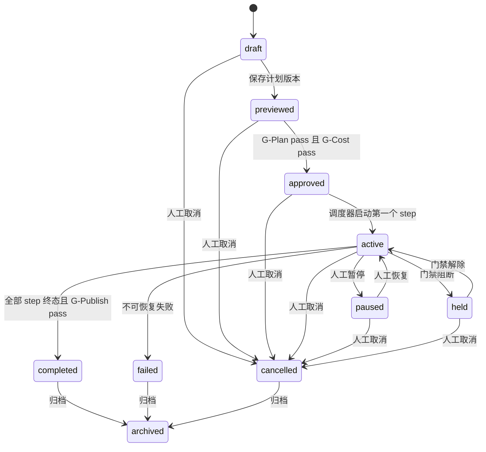
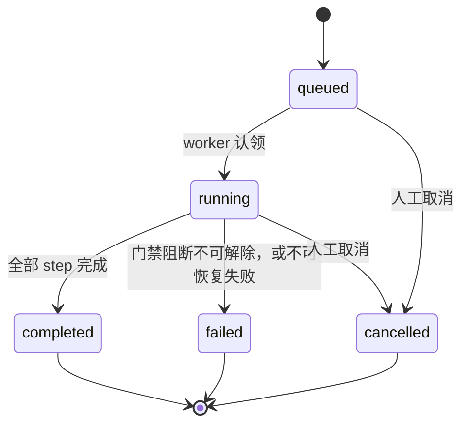
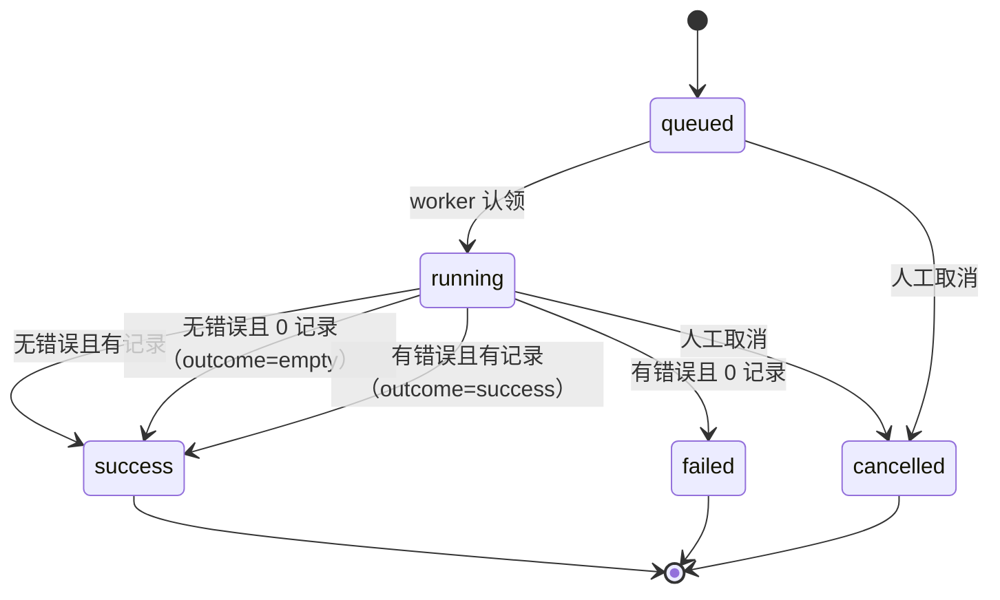
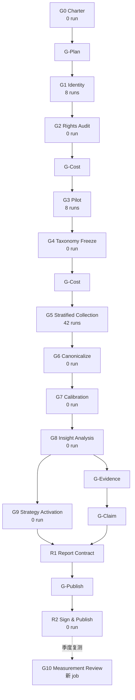

# DIH 自动化与门禁：工作流设计

> 状态：设计稿。未实施。
> 日期：2026-10-20。
> 范围：自动化工作流、门禁、运行账本、调度、失败处理、人工介入。
> 输入：PRD 第 4 节与 5.4.2；Playbook G0–G10；编排与数据模型清点。
> 边界：只读设计。未改代码，未改数据库，未执行采集。
> 契约以 [契约冻结 v1](./【契约冻结】v1-表名-枚举-接口.md) 为准。

## 0. 结论

### 0.1 设计主张

1. 保留现有采集主链。主链是 `quick_collect/task → collector_service → raw_records → normalization → signals → intelligence → reports`。
2. 在 `task_runs` 之上加一层任务执行层。新层负责计划、门禁、成本、证据等级与报告合同。
3. 继续使用 `workflow_planner` 做计划。不要使用 `workflow_execution` 做真实调用。
4. 门禁是硬阻断。门禁结果必须落表，必须可审计，必须失败关闭。
5. 调度器当前不适合长时间批量任务。开启前必须补租约续期与持久队列。
6. 新工作必须拆成独立服务。不得继续扩 `services/automation_service.py`。

### 0.2 术语与表映射

PRD 的 “TaskRun” 与现有数据库表 `task_runs` 不是同一个粒度。必须先统一术语，否则状态机与证据等级会算错。

| 概念 | 本设计的落表 | 粒度 | 说明 |
|---|---|---|---|
| 任务单 Task（七槽位） | `workbench_tasks`（新） | 一次业务问题 | 七槽位任务单；不记录执行状态 |
| 计划 Plan | `workflow_plans` + `workflow_versions` | 一个任务可有多版计划 | 计划单，复用现有表；不是任务单 |
| 执行运行 Run（PRD 5.4.2 的 TaskRun） | `runs`（新） | 一份计划执行一次 | 执行运行，不是任务单；有 `plan_id`、`plan_version`、`authorization_id`，不存七槽位；证据等级挂在这一层 |
| 单次采集 Run | `task_runs`（现有） | 一次 collector 调用 | run_ledger 的一行 |
| Step | `run_steps`（新） | 一个 G 阶段或渲染阶段 | 一个 step 可展开多个采集 run |
| Gate | `authorizations`（新增 `gate_status` 列） | 一次门禁判定 | 门禁状态写 `authorizations.gate_status`；不建门禁表 |
| Authorization | `authorizations`（新） | 一次人工批准 | 带范围、额度、有效期 |
| Claim | `claims`（新） | 一条结论 | 与 evidence 多对多 |
| Evidence | `evidences`（扩展）+ `claim_evidence`（新） | 一条证据 | 现有 `evidences` 缺 role、market、locale、grade |
| Report contract | `report_artifacts`（新） | 一份报告合同 | 两个渲染器共用 |

证据等级属于 `runs`，不属于单个工具。`task_runs.evidence_grade` 只记录该工具调用本次达到的等级；工具上限叫 `max_evidence_grade`，只存在于 `tool_catalog`。理由见第 6 节。

### 0.3 复用边界总表

| 模块 | 状态 | 现在能否用 | 证据 | 本设计的用法 |
|---|---|---|---|---|
| `services/collector_service.py` | reuse_as_is | 能 | 单元测试待复测；生产 scheduler tick `scanned=44` | 唯一采集执行入口 |
| `services/report_service.py` | reuse_as_is | 能 | 生产 `/api/reports` 返回 200；内存 SQLite 实测 generate 201、send 200 | 复用订阅、发送、审计、幂等 |
| `services/report_service.py::_render_daily_report` | extend | 不能直接复用 | 只输出三段（`report_service.py:1198`） | 新增合同渲染层 |
| `services/signal_service.py` | extend | 部分能用 | 生产 `/api/signals` 有数据；单测待复测 | 新增品类规则 |
| `services/normalization_service.py` | extend | 部分能用 | 只分派 7 类 `record_type`（`normalization_service.py:64-88`） | 新增 canonical 层 |
| `services/evidence_service.py` | reuse_as_is | 能 | 纯函数，`intelligence_service.py:169` 调用 | 现有情报链；claim 证据另建服务 |
| `services/llm_service.py` | extend | 不能用于真实文案 | 固定 `MockLLMAdapter`（`llm_service.py:12`） | 新增真实 adapter |
| `services/workflow_planner` | reuse_as_is | 能 | 测试待复测；生产 preview 200 | 计划生成 |
| `services/workflow_planner/persistence.py` | reuse_as_is | 能 | 测试待复测；生产 `/api/projects/{id}/workflow-plans` 200 | 计划保存与版本（计划单，不是任务单） |
| `services/collector_catalog.py` | reuse_as_is | 能 | 生产 `/api/collectors` 返回 99 行 | 配置白名单 |
| `services/workflow_execution` | fixture_only | 不能用于真实调用 | 路由已挂载（`origin/main:143`）；生产 workflow-runs 返回 200 且 `execution_mode=fixture`；schema 固定 fixture | 不复用运行面，不删除 |
| `api/routes/workflow_runs.py` | fixture_only | 仅 fixture | `origin/main:143` 已挂载；生产返回 200 且 `execution_mode=fixture` | 保留；不接真实执行 |
| `services/capability_governance/publication.py` | extend | 代码能用，路由不可达 | governance router 未挂载 | 先挂载或走受控脚本 |
| `scheduler/service.py` | reuse_as_is | 能，但有长任务缺陷 | 单测待复测；生产 `scheduler_enabled=true` | 复用 tick 与租约，补续期 |
| `services/task_schedule_policy.py` | reuse_as_is | 能 | outbound/scheduling/timeouts 测试待复测；scheduler 调用 | 重试与到期策略 |
| `api/routes/workflow_plans.py` | reuse_as_is | 能 | 生产 `/api/projects/{id}/workflow-plans` 返回 200；测试待复测 | 计划 CRUD 与版本（计划单，不是任务单） |
| `services/platform_credentials.py` | reuse_as_is | 能，但仅 workspace 级 | 单元测试待复测；页面 `/settings/credentials` 标 live | 现有凭据；项目级隔离另建 |
| `api/deps.py::get_auth_context` | extend | 不能用于真实审批 | 无 token 回退 demo workspace（`deps.py:67-79`） | 新增 fail-closed 依赖 |
| `services/automation_service.py` | extend | 不扩 | 13537 行、335 个函数 | 新工作另建服务 |

### 0.4 证据与边界

生产证据来自 2026-10-20 对 `https://scrapy.luteos.com` 的只读 GET 探测。探测包含 `/api/health`、`/api/tasks/scheduler/overview`、`/api/reports`、`/api/signals`、`/api/intelligence`、`/api/dashboard/overview`、`/api/collectors`、`/api/collectors/catalog`、`/api/capabilities/matrix`、`/api/toolkit`、`/api/tiktok/tools`、`/api/projects/{id}/workflow-plans`、`/api/projects/{id}/workflow-runs`。workflow-runs 返回 200 且 `execution_mode=fixture`；`/api/projects/{id}/workflow-plans` 复用现有计划表，返回计划单，不是任务单；其余返回 200。

本地测试证据来自 2026-10-20 全量实测：`pytest -q apps/api/tests/unit` → 1980 passed, 0 failed；`pytest -q apps/api/tests/integration` → 384 passed, 0 failed。分模块归属未单独复测。旧基线文件 `reports/live-sweep/baseline-pytest-failures.txt` 已作废，不再引用。引用测试数字时必须给出命令与输出。

integration 测试 2026-10-20 实测 384 passed, 0 failed（`pytest -q apps/api/tests/integration`）。旧基线文件已作废。不得把 integration 测试当作本次复用证据。

当前计划层有两个硬阻塞。第一，默认 capability catalog 的 35 条断言全部是 `candidate`（`services/fixtures/capability_catalog_overseas_v2.json`）。`capability_resolver.py:270-298` 对 `candidate` 一律拒绝。实测 planner preview 全部 `held`。第二，catalog 发布路由 `capability_governance.py` 未挂载（`main.py:90-115`）。运行中的应用无法把断言提升为 `verified`。

本设计不承诺以下能力：

1. 53 个 policy 拒绝的采集器。它们占 86 个注册项的 62%。
2. `workflow_execution` 的 fixture 运行。
3. 未挂载的 capability discovery / governance 专用路由。
4. 真实 LLM 文案。
5. 项目级 Provider 凭据隔离。
6. TikTok R1 的 21 张表。迁移 `202610190045` 未纳入 HEAD 跟踪。

## 1. 状态机

### 1.1 计划级状态机

计划级状态落在 `workflow_plans.status`。现有状态是 `draft`、`previewed`、`approved`、`active`、`paused`、`archived`。数据库检查约束见 `apps/api/alembic/versions/202607160031_workflow_template_lifecycle.py:21-24`，模型见 `apps/api/src/data_intelligence_hub/models/workflow_plan.py:91-94`。

本设计新增四个状态：`held`、`completed`、`failed`、`cancelled`。因此必须改检查约束、`WorkflowPlanStatus` 字面量与生命周期表。这是 `extend`，不是新建表。

`held` 只属于 `workflow_plans.status`。它不是 `runs.status`。

一个 `workflow_plan` 只承载一次交付任务。G10 复测必须克隆计划并新建 `run`。现有 clone 路由在 `api/routes/workflow_plans.py:640-673`。不得在原计划上直接重跑。



| 从 | 到 | 触发 | 守卫 | 写入方 | 审计 |
|---|---|---|---|---|---|
| `draft` | `previewed` | `POST /workflow-plans/{id}/versions` | 至少 1 个采集 step；`planning_status != held` | `workflow_planner/persistence.py:1328` | `workflow_plan_save_requests` |
| `previewed` | `approved` | 人工批准 | G-Plan 与 G-Cost 都为 pass；审批人已认证；授权未过期 | 新门禁服务 | `authorizations.gate_status` |
| `approved` | `active` | 调度器认领 | 同一计划版本没有运行中的 `run` | 新调度服务 | `runs` |
| `active` | `held` | 任一阶段门禁 blocked/fail | 门禁结果已落表 | 新门禁服务 | `authorizations.gate_status` |
| `active` | `completed` | 全部 step 完成 | G-Publish pass；报告 artifact 校验通过 | 新发布服务 | `report_artifacts` |
| `active` | `failed` | 不可恢复错误 | 连续 3 次基础设施错误，或数据丢失 | 新调度服务 | `runs` |
| 任意非终态 | `cancelled` | 人工取消 | 已认证用户；记录原因 | 新 API | `runs` + 审计 |

终态是 `completed`、`failed`、`cancelled`、`archived`。

`paused` 与 `held` 必须分开。`paused` 是人主动停。`held` 是系统因门禁停。两者不能合并。合并后无法区分“人不想跑”和“系统不让跑”。

现有 `CollectionTask` 还有一套执行单元状态。它是锁状态，不是产品任务状态。取值是 `draft`、`enabled`、`paused`、`running`。`status` 是 `String(20)`，没有数据库约束（`models/task.py:19-27`）。`execute_collection_task` 只接受 `enabled`（`collector_service.py:302-318`）。运行结束后它恢复原状态。`pause_task` 与 `resume_task` 改 `paused` 与 `enabled`（`services/task_service.py:62-84`）。新设计不改这套状态。新设计只在它上面加 `run_id` 与 `step_key` 关联。

### 1.2 运行级状态机

运行分两层。`runs` 是一份计划的一次执行运行（有 `plan_id`、`plan_version`、`authorization_id`，不存七槽位）。`task_runs` 是一次采集调用。两层状态必须分开写。

#### 1.2.1 `runs`

状态枚举：`queued`、`running`、`completed`、`failed`、`cancelled`。
结果枚举：`success`、`empty`、`config_gated`、`failed`。



终态是 `completed`、`failed`、`cancelled`。`runs.status` 只使用上述五值。门禁 blocked/fail 或成本阻断只停止当前 step：`runs.status` 保持 `running`，`authorizations.gate_status` 记 `blocked`，解除后继续。阻断不可解除时置 `failed`。

| 从 | 到 | 触发 | 守卫 |
|---|---|---|---|
| `queued` | `running` | worker 认领 | 计划状态是 `active`；门禁全部 pass；并发槽可用 |
| `queued` | `cancelled` | 人工取消 | 已认证用户 |
| `running` | `completed` | 全部 step 终态 | G-Publish pass；报告 artifact 校验通过 |
| `running` | `failed` | 门禁阻断不可解除，或不可恢复错误 | 门禁结果已落表；当前 step 已停止；连续 3 次基础设施错误，或数据丢失 |
| `running` | `cancelled` | 人工取消 | 已认证用户；保留已完成部分 |

`runs.outcome` 是四值聚合，取值 `success`、`empty`、`config_gated`、`failed`，在终态写入。`success` 表示至少一个可用 frame。`empty` 表示所有采集成功但 0 条合格记录。`config_gated` 表示凭据、授权或 grant 缺失。`failed` 表示执行失败。部分成功不单列：用 `run_steps.status=success`、`outcome=success` 与 `records_count > 0` 表达。

#### 1.2.2 `task_runs`

保留现有 `status` 取值口径，避免破坏 `/runs`、`/collect/[run_id]` 与现有测试；部分成功不单列状态，用 `success` 加 `records_count>0` 表达。新增 `outcome` 与 `failure_reason`。

状态枚举：`queued`、`running`、`success`、`failed`、`cancelled`。
结果枚举：`success`、`empty`、`config_gated`、`failed`。



现状是 `_run_status` 只返回成功、部分成功、失败三种取值（`services/collector_service.py:438-443`）。它不区分“成功但空”和“成功有数据”。新设计必须补 `outcome=empty`。它也不区分“凭据缺失”和“上游失败”。新设计必须补 `outcome=config_gated`。

| 条件 | status | outcome | failure_reason |
|---|---|---|---|
| 无 result errors，records > 0 | `success` | `success` | null |
| 无 result errors，records = 0 | `success` | `empty` | null |
| 有 result errors，records > 0 | `success` | `success` | 首个错误码 |
| 有 result errors，records = 0，鉴权或 grant 错误 | `failed` | `config_gated` | `auth_missing` 或 `policy_denied` |
| 有 result errors，records = 0，其他错误 | `failed` | `failed` | `timeout` / `rate_limited` / `provider_error` / `validation_failed` |
| 人工取消 | `cancelled` | `failed` | `cancelled` |
| 进程崩溃，超过超时 + 60 秒 | `failed` | `failed` | `orphaned` |

重试不修改旧行。重试创建新的 `task_runs` 行。旧行保持终态。新行带 `previous_run_id`、`attempt_number`、`retry_generation`。

### 1.3 状态落表

| 状态 | 表 | 列 | 状态 |
|---|---|---|---|
| 计划状态 | `workflow_plans` | `status` | extend |
| 计划版本状态 | `workflow_versions` | `planning_status` | reuse |
| 运行状态 | `runs` | `status`、`outcome` | new |
| Step 状态 | `run_steps` | `status` | new |
| 采集状态 | `task_runs` | `status`、`outcome` | extend |
| 门禁状态 | `authorizations` | `gate_status` | new |
| 授权状态 | `authorizations` | `expires_at`、`revoked_at` | new |
| 成本状态 | `run_ledger_entries` | `entry_kind`、`status` | new |
| 证据等级 | `run_evidence_grades` | `grade` | new |

### 1.4 状态机不变量

1. 同一个 `workflow_plan` 的同一个版本，最多有 1 个 `running` 的 `run`。
2. 同一个 `collection_task` 最多有 1 个 `running` 的 `task_run`。现有行锁在 `collector_service.py:302-318`。
3. 门禁状态写 `authorizations.gate_status`。修正授权必须新增 `authorizations` 行，不得覆盖旧行。
4. 任何状态迁移必须写审计行。审计行包含 actor、时间、原因、输入摘要。
5. 所有时间必须使用 UTC。数据库列必须是 `DateTime(timezone=True)`。
6. 终态不可回退。要重跑必须新建运行。

## 2. 门禁引擎

### 2.1 共同规则

1. 门禁是确定性函数。不得调用 LLM。
2. 门禁输入必须先序列化并计算 `inputs_digest`。同一输入重复判定必须得到同一结果。
3. 每次判定把门禁状态写入 `authorizations.gate_status`，不另建门禁表。判定记录包含 `gate_id`、`status`、`policy_version`、`inputs_digest`、`decision_json`、`owner_user_id`、`decided_at`、`expires_at`。
4. 门禁状态是 `pending`、`pass`、`fail`、`blocked`、`expired`。
5. 调度器在每个 step 开始前读取门禁状态。只有 `pass` 才能执行。`fail` 与 `blocked` 必须阻断当前 step，并写门禁状态 `blocked`；`runs.status` 保持 `running`，不新增运行状态。
6. 门禁失败必须返回稳定错误码。不得静默降级。
7. 质量门禁必须失败关闭。超时不得自动批准。

统一伪代码：

```text
function evaluate_gate(gate_id, context):
    inputs = build_inputs(gate_id, context)
    digest = sha256(canonical_json(inputs))
    cached = read_gate_status(gate_id, digest)
    if cached is not None:
        return cached
    decision = DECIDERS[gate_id](inputs)
    write_gate_status(gate_id, digest, decision)
    if decision.status in {"fail", "blocked"}:
        raise AutomationGateBlocked(gate_id, decision.code)
    return decision
```

### 2.2 G-Plan

判定输入：

1. 七个输入槽位。品牌、品类、市场、时间窗、决策问题必填。竞品 0–5 个。不回答清单可空。规则来自 Playbook 1.1。
2. 计划版本。必须有 `preview_fingerprint`、`catalog_snapshot_id`、`policy_version`。表见 `models/workflow_plan.py:216-223`。
3. `planning_status`。必须是 `resolved`。`held` 及其他非 `resolved` 取值不通过。枚举见 `schemas/workflow_planner.py:54-57`。
4. 路由计划。不得有 `status=held` 的 route。`capability_resolver.py:574-607` 会返回 held。
5. 身份歧义率。映射置信度低于 0.8 的条目占比不得超过 20%。规则来自 Playbook G1。
6. 审批授权。必须有 `authorizations` 记录。

伪代码：

```text
function decide_g_plan(inputs):
    if missing_required_slot(inputs): return fail("plan_input_missing")
    if inputs.plan_version is None: return fail("plan_version_missing")
    if inputs.planning_status != "resolved": return fail("plan_not_resolved")
    if any(route.status == "held" for route in inputs.routes):
        return fail("plan_route_held", exclusions=inputs.route_exclusions)
    if inputs.identity_ambiguity_ratio > 0.20:
        return fail("identity_ambiguity_over_threshold")
    if inputs.authorization is None:
        return blocked("plan_approval_required")
    if inputs.authorization.expires_at <= now():
        return blocked("authorization_expired")
    return pass()
```

阻断行为：计划不得从 `previewed` 进入 `approved`。调度器不得创建 `run`。
解除方式：有权限的用户批准计划。批准写入 `authorizations`。计划重新判定。

### 2.3 G-Cost

判定输入：

1. 计划估算总额 `estimate_total_usd`。来源是 `tool_catalog.cost_model` × 计划数量。
2. 授权上限 `authorization.max_cost_usd`。
3. 当日与当月剩余额度。来源是 `run_ledger_entries` 的累计值。
4. 每个工具的 `risk_level`。PRD 5.1 的决策表：low 直接执行，medium 超额需一次点击，high 总是需批准。

伪代码：

```text
function decide_g_cost(inputs):
    if inputs.estimate.state == "unknown":
        return fail("rate_card_missing")
    if inputs.estimate.total_usd > inputs.authorization.max_cost_usd:
        return blocked("cost_over_authorization")
    if inputs.estimate.total_usd > inputs.remaining_daily_usd:
        return blocked("daily_quota_exhausted")
    if inputs.estimate.total_usd > inputs.remaining_monthly_usd:
        return blocked("monthly_quota_exhausted")
    for tool in inputs.tools:
        if tool.risk_level == "high" and not inputs.authorization.allows_high_risk:
            return blocked("high_risk_not_approved")
    return pass()
```

阻断行为：不得发起任何付费调用。调度器必须在 `execute_collection_task` 之前检查。不得只依赖 Apify 的 `maxTotalChargeUsd`。该参数在 `collectors/apify_actor.py:438` 传入，只在上游侧生效，本地没有账本。
解除方式：提高额度、裁剪计划、或批准高风险工具。三种动作都必须产生新的计划版本或新的授权。

### 2.4 G-Evidence

判定输入：

1. `claims` 列表。每条 claim 必须有 `evidence_ids`、`counterevidence_text`、`claim_status`、`evidence_grade`。
2. `claim_evidence` 的 role：`support`、`counter`、`context`、`gap`。
3. 模板阈值。`required_n`、`required_window_days`、`required_source_count`。来源是 `report_templates`，必须与 PRD 5.4.2 表一致。
4. `run_evidence_grades` 的实际等级。

伪代码：

```text
function decide_g_evidence(inputs):
    if not inputs.claims: return fail("no_claims")
    for claim in inputs.claims:
        if not claim.evidence_ids: return fail("claim_without_evidence")
        if claim.counterevidence_text is None: return fail("counterevidence_missing")
        if claim.claim_status == "confirmed" and claim.evidence_grade != "L4_authorized_live":
            return fail("confirmed_requires_l4")
        if claim.claim_status in {"directional", "hypothesis"}:
            if claim.evidence_grade == "L0_unverified": return fail("grade_too_low")
        if claim.scope.sample_n < claim.required_n:
            return fail("sample_below_threshold", downgrade_to="directional")
        if claim.scope.window_days < claim.required_window_days:
            return fail("window_too_short", downgrade_to="directional")
        if claim.scope.source_count < claim.required_source_count:
            return fail("source_count_below_threshold", downgrade_to="directional")
    return pass()
```

每条 claim 的阈值来自它的 frame。T1 的 `required_n` 是每层 30 条，不是全局 30 条。`frame_key` 必须包含市场、变体、评分带、月份。

G-Evidence 必须按 claim 返回结果。全局 `fail` 只表示至少一个 claim 未通过。未通过的 claim 必须降级或移除。其他 claim 可以继续进入报告。

阻断行为：报告不得渲染该 claim。claim 必须降级，或补证据。
解除方式：补证据、扩大样本、延长时间窗、或降级为 `directional` / `hypothesis`。降级必须由系统执行并记录原因。

### 2.5 G-Claim

判定输入：

1. `claims.risk_flags`。至少包含 `medical`、`legal`、`recall`、`health`、`safety`。
2. claim 的文本与状态。
3. 人工复核记录。复核人、范围、结论、时间。

伪代码：

```text
function decide_g_claim(inputs):
    for claim in inputs.claims:
        risky = intersect(claim.risk_flags, {"medical", "legal", "recall"})
        if risky:
            review = get_latest_review(claim.id)
            if review is None or review.decision != "approved":
                return blocked("claim_review_required")
            if review.scope != claim.scope:
                return blocked("claim_review_scope_mismatch")
        if claim.claim_status == "confirmed" and claim.evidence_grade != "L4_authorized_live":
            return fail("confirmed_requires_l4")
        if contains_prohibited_words(claim.text):
            return fail("prohibited_wording")
    return pass()
```

阻断行为：涉及医疗、法务、召回的 claim 不得标记为 `confirmed`。报告可以发布，但该 claim 必须显示为 `hypothesis` 或 `blocked`。
解除方式：有权限的人复核并签字。签字写 `authorizations` 的 claim 范围记录与 `gate_status`。不另建签字表。

### 2.6 G-Publish

判定输入：

1. `report_artifacts.contract_json`。必须通过 `report_contract.schema.json` 校验。
2. 三个哈希。`contract_sha256`、`report_html_sha256`、`sop_html_sha256`。规则见 PRD 5.5.1。
3. 最低 `actual_grade`。
4. 所有门禁状态。
5. 签收记录。

合同顶层必须包含 `identity`、`decision`、`gates`、`coverage`、`metrics`、`claims`、`evidences`、`run_ledger`、`limits`、`unknowns`、`artifact`。缺一组即 `contract_schema_invalid`。字段定义见 PRD 5.5.1。`report_contract.schema.json` 当前不存在，必须新建（new）。

伪代码：

```text
function decide_g_publish(inputs):
    errors = validate_schema(inputs.contract, "report_contract.schema.json")
    if errors: return fail("contract_schema_invalid")
    if not inputs.artifact.hashes_complete: return fail("artifact_hash_missing")
    if inputs.min_grade < inputs.template.min_publish_grade:
        return fail("report_grade_below_publish_threshold")
    for gate in {"G-Plan", "G-Cost", "G-Evidence", "G-Claim"}:
        if gate_status(gate) != "pass": return fail("upstream_gate_not_passed")
    if inputs.signoff is None: return blocked("publish_signoff_required")
    if contains_prohibited_outputs(inputs.contract): return fail("prohibited_output_present")
    return pass()
```

阻断行为：报告保持 `draft`。不得创建分享链接。`send_report` 必须拒绝。
解除方式：补签收、修合同、或重新渲染。修正后必须生成新的 `report_artifacts` 行。

### 2.7 授权对象

`authorizations` 字段：

| 字段 | 类型 | 说明 |
|---|---|---|
| `id` | uuid | 主键 |
| `workspace_id` | uuid | 租户 |
| `project_id` | uuid | 项目 |
| `plan_id` | uuid | 计划 |
| `plan_version_id` | uuid | 计划版本 |
| `gate_id` | string | 授权的门禁，通常是 `G-Plan` 或 `G-Cost` |
| `gate_status` | string | 门禁状态：`pending` / `pass` / `fail` / `blocked` / `expired` |
| `scope_json` | json | 模板、市场、时间窗、工具范围 |
| `max_cost_usd` | numeric | 授权上限 |
| `allowed_risk_levels` | json | 允许的风险等级 |
| `approver_user_id` | uuid | 批准人 |
| `granted_at` | datetime | 批准时间 |
| `expires_at` | datetime | 过期时间 |
| `revoked_at` | datetime | 撤销时间，可空 |
| `idempotency_key_hash` | string | 幂等键哈希 |

规则：

1. 授权只能由已认证用户签发。不得使用 demo 回退身份。
2. 授权过期后不得用于新 run。规则来自 PRD 5.4.2。
3. 授权范围必须包含计划版本、市场、时间窗、工具集合。
4. 撤销必须写 `revoked_at`。门禁读取到 `revoked_at` 非空时返回 `blocked`。
5. 签发必须幂等。唯一约束是 `(workspace_id, approver_user_id, idempotency_key_hash)`。

### 2.8 与现有 planner gate 的关系

`capability_resolver` 已有 7 道 plan-time gate：状态、策略、认证、用途、区域、平台/资源/操作、字段契约、预算（`services/workflow_planner/capability_resolver.py:142-268`）。这些 gate 可以复用。它们回答“这个工具能不能进计划”。

它们不回答“这次调用能不能花钱”。`RouteCandidateDecision.approval_required` 只是提案标记（`schemas/workflow_planner.py:353-365`）。`execution_authorized` 在 schema 里固定为 `False`（`schemas/workflow_planner.py:397`、`:538`）。本设计不修改这个字面量。真实执行必须由 `authorizations` 单独授权。

## 3. 作业图

### 3.1 定义

1. Job 是一份计划的一次执行运行。落表 `runs`；`runs` 有 `plan_id`、`plan_version`、`authorization_id`，不存七槽位。
2. Step 是 G0–G10 或报告阶段。落表 `run_steps`。
3. 采集 Run 是一次采集调用。落表 `task_runs`。
4. 一个采集 step 可以展开多个 run。一个非采集 step 不产生 run。

### 3.2 T1 默认展开

示例输入来自 Playbook 2.2：

```text
品牌：Momcozy
品类：可穿戴吸乳器
竞品：Medela
市场：US / DE
时间窗：90 天
决策问题：Fit 与支撑，哪个是主要摩擦？
```

默认分层：2 个变体、3 个评分带、3 个月。工具集采用 Playbook 2.4 的可用主源，不含 Reddit 与备用 Amazon 源。

| 阶段 | Step 类型 | 采集 run 数 | 依赖 | 并行 | 门禁 / 人工点 |
|---|---|---|---|---|---|
| G0 Decision Charter | human | 0 | — | — | G-Plan |
| G1 Product Identity | collect | 8 | G-Plan pass | 8 个并行 | — |
| G2 Source & Rights Audit | human | 0 | G1 | — | 人工权利审计 |
| G3 Source Pilot | collect | 8 | G2 | 8 个并行 | G-Cost |
| G4 Taxonomy Freeze | human | 0 | G3 | — | 人工冻结 |
| G5 Stratified Collection | collect | 42 | G4 | 逐 run 并行，受并发上限 | G-Cost |
| G6 Canonicalize | analyze | 0 | G5 全部终态 | 单 step | — |
| G7 Coding Calibration | analyze + human | 0 | G6 | 单 step | 人工校准（G7） |
| G8 Insight Analysis | analyze | 0 | G7 | 单 step | G-Evidence |
| G9 Strategy Activation | human | 0 | G8 | — | 人工批准 |
| R1 Report Contract | render | 0 | G8、G9、G-Evidence、G-Claim | 单 step | G-Claim |
| R2 Sign & Publish | human | 0 | R1 | — | G-Publish |

G0–G10 是 Playbook 阶段编号。五道产品门禁是 G-Plan、G-Cost、G-Evidence、G-Claim、G-Publish。两者不是同一套编号。不得把 “G7” 写成 “G-7 门禁”。

合计：

1. 采集 run 58 个。计算是 8 + 8 + 42。
2. 非采集 step 9 个。G0、G2、G4、G6、G7、G8、G9、R1、R2。
3. 第一个 job 共 12 个 step。G10 是后续独立 job，不计入本次。

### 3.3 计数公式

```text
brands        = 1 + len(competitors)          # 1–6
markets       = len(markets)                  # 1–N
variants      = len(variants)                 # 输入槽位决定
months        = ceil(window_days / 30)
rating_bands  = 3                             # 1–2 星 / 3 星 / 4–5 星

R_G1 = brands * markets * 2                   # Amazon 商品页 + TikTok Shop 详情
R_G3 = 4 * markets                            # Amazon 评论主源 + Trustpilot + TikTok 评论 + TikTok Shop 详情
R_G5 = markets * variants * rating_bands * months
     + markets * 3                            # Trustpilot + TikTok 评论 + TikTok Shop 详情

R_total = R_G1 + R_G3 + R_G5
```

默认参数：`brands=2`、`markets=2`、`variants=2`、`months=3`。

```text
R_G1 = 2 * 2 * 2 = 8
R_G3 = 4 * 2 = 8
R_G5 = 2 * 2 * 3 * 3 + 2 * 3 = 36 + 6 = 42
R_total = 58
```

条件分支：

| 分支 | 增加 run | 触发条件 | 审批 |
|---|---|---|---|
| Amazon 备用源 | 最多 36 | 主源分层空结果或全空 | 人工批准，结果单列 |
| Reddit | 2 | 重测通过 | 人工批准 |
| 重试 | 每个失败 run 最多 2 次 | 可重试错误 | 自动，受重试预算 |

因此，默认基线是 58 个采集 run。启用全部条件分支后，最多 96 个采集 run。重试另计。

这些数字是设计默认值，不是生产实测。执行前必须把 `planned_run_count` 写入 `run_steps`。实际 run 数必须从 `task_runs` 统计。如果某工具在某市场不可用，计划必须在批准前排除该 run。实际数会低于 58。

### 3.4 DAG



依赖规则：

1. G1 依赖 G-Plan。G-Plan 未通过时 G1 不得开始。
2. G2 依赖 G1。G1 有 quarantine 时，G2 可以开始，但 quarantine 项不得进入 G5。
3. G3 依赖 G2 与 G-Cost。G-Cost 未通过时不得发起付费调用。
4. G4 依赖 G3。G3 全部 run 必须终态。
5. G5 依赖 G4 与 G-Cost。G5 是 42 个独立 run。
6. G6 依赖 G5 全部 run 终态。G6 不要求全部成功。它要求全部终态。
7. G7 依赖 G6。G7 未通过时所有 claim 必须是 `directional` 或更低。
8. G8 依赖 G7。G8 产出 claims。
9. G9 与 G-Evidence 可以并行。两者都完成才能进入 R1。
10. R1 依赖 G9、G-Evidence、G-Claim。
11. R2 依赖 R1 与 G-Publish。

### 3.5 并行与并发上限

1. 同一 step 内的 run 可以并行。不同 step 之间有依赖。
2. 全局并发默认 8。每个 provider 默认 4。每个 Apify actor 默认 2。
3. 当前 MCP governance 的限额是每分钟 120 次、并发 8、每日 500 次 collect（`core/config.py:59-73`）。自动化的并发不得绕过这组限额。
4. 单个 run 的超时沿用 `collector_service`。默认 300 秒。慢端点有单独上限，最高 1700 秒（`collector_service.py:45-67`）。
5. 同一 `collection_task` 不得并行。行锁会拒绝（`collector_service.py:302-318`）。
6. G5 的 42 个 run 在 8 并发下至少需要 6 个批次。计划单必须显示预计耗时。

### 3.6 条件分支与失败传播

1. 单个 run 失败不阻塞同 step 的其他 run。step 结束时聚合结果。
2. 一个 step 的失败率超过 50% 时，step 必须停止并置为 `failed`，不得自动进入下一 stage。
3. 空结果不是失败。空结果必须进入 G6，并记为 `gap`。
4. 备用源只在主源空结果时启用，且必须人工批准。不得自动 fallback。PRD 第 9 节把“跨供应商自动 fallback”列为非目标。
5. 重试只对可重试错误生效。见第 4 节。

## 4. 重试与幂等

### 4.1 可重试矩阵

| 步骤 | 错误类别 | 可重试 | 最大尝试 | 退避 | 写入方式 | 说明 |
|---|---|---|---|---|---|---|
| 采集 | `timeout`、`rate_limited`、HTTP 5xx、连接重置 | 是 | 3 次总计 | 15 分钟起，指数退避 | 新 `task_runs` 行 | 沿用 `task_schedule_policy.py:13-14` 的默认值 |
| 采集 | `policy_denied` | 否 | 0 | — | `outcome=config_gated` | `is_policy_failure` 已阻止重试（`task_schedule_policy.py:97-98`） |
| 采集 | 凭据缺失、HTTP 401/403、grant 缺失 | 否 | 0 | — | `outcome=config_gated` | 必须先修配置 |
| 采集 | 配置校验失败、URL 非法、字段非法 | 否 | 0 | — | `outcome=failed`，`validation_failed` | 代码错误 |
| 采集 | 成功但 0 条 | 否 | 0 | — | `outcome=empty` | 空结果是事实状态 |
| 规范化 | 单条记录形状不符 | 否 | 0 | — | 记 `quarantine` 或 `gap` | 不因单条记录重跑整批 |
| 规范化 | 数据库临时错误 | 是 | 2 | 5 秒 | 重试同一事务 | 只重试事务，不重跑采集 |
| LLM 分析 | 超时、5xx | 是 | 2 | 30 秒 | 相同输入摘要，缓存结果 | 不得重复计费 |
| LLM 分析 | 4xx、内容策略拒绝 | 否 | 0 | — | 记 `failed`，人工处理 | — |
| 报告渲染 | 模板错误 | 否 | 0 | — | 修复代码后重跑 | — |
| 报告发送 | 网络错误 | 是 | 2 | 60 秒 | 沿用现有审计幂等 | `report_service.py:899-999` |
| 门禁判定 | 任何错误 | 否 | 0 | — | 重新判定，不改旧行 | 判定必须确定性 |
| 人工 step | 超时 | 否 | 0 | — | `run_steps.status=pending`，门禁 `blocked` | 见第 9 节 |

现有重试是调度层重试。`update_retry_state_after_run` 只在 `status=failed` 时累加（`task_schedule_policy.py:69-86`）。`next_run_at` 返回下一次重试时间（`:108-111`）。下一次重试由 `scheduler/service.py:140-151` 创建新的 `TaskRun`。这个模型可以复用。前提是“一个 step 对应一个 `CollectionTask`”。不得把多个 step 塞进同一个 `CollectionTask`。

### 4.2 幂等键设计

幂等键必须覆盖“同一工作单元重复提交”的所有路径。

```text
scope = "automation.step_run.v1"
key_material = join("|", [
    workspace_id,
    project_id,
    plan_id,
    plan_version_id,
    run_id,
    step_key,
    stratum_key,
    attempt_generation,
])
idempotency_key_hash = sha256(key_material)
```

规则：

1. `task_runs` 新增 `idempotency_key_hash` 列。唯一约束是 `(workspace_id, idempotency_key_hash)`。
2. `run_ledger_entries` 的预留行使用 `side_effect_key_hash`。唯一约束是 `(workspace_id, side_effect_key_hash)`。重复请求返回已有预留，不新增扣费。
3. `runs` 的创建使用 `Idempotency-Key` 请求头。唯一约束是 `(workspace_id, idempotency_key_hash)`。
4. 计划保存沿用 `workflow_plan_save_requests` 的唯一约束（`models/workflow_plan.py:371-378`）。
5. 报告发送沿用 `report_audit_events` 的幂等键（`report_service.py:899-999`）。
6. 重复调用返回已有对象。响应必须带 `idempotency_replayed=true`。不得返回 500。

现有手动任务幂等只把哈希写在 `task_runs.logs`，没有唯一约束，也没有索引（`services/task_service.py:86-158`）。并发同 key 请求可能各建一次 run。新设计必须改为列加唯一约束。

### 4.3 重复计费防护

```text
function run_paid_step(step, attempt):
    reservation = reserve_budget(step, attempt)
    if reservation.status == "replayed":
        return reservation.existing_run
    if reservation.status == "blocked":
        raise CostBlocked(reservation.code)
    try:
        run = execute_collection_task(...)
        settle_budget(reservation, run)
        return run
    except RetryableError:
        release_or_reuse_reservation(reservation, attempt)
        raise
```

规则：

1. `reserve` 先写账本，再调用 provider。不得先调用后记账。
2. 如果调用前失败，释放预留。不产生成本。
3. 如果调用已发出但结果未知，标记 `accrued`。通过 `provider_run_id` 对账。不得直接再次调用。
4. Apify 的 `run_id` 必须写入 `task_runs.provider_run_id`。当前 `apify_actor.py:440-460` 已拿到 `run_id`，但没有落库。
5. Provider 返回 `usageTotalUsd` 时，以它作为 `settled`。没有时用 `rate_card × quantity`，并标 `cost_source=estimated`。
6. 同一 `task_run` 的同一 `entry_kind` 只能写一次。唯一约束在 `(task_run_id, entry_kind)` 上。结算行只允许一行。

### 4.4 崩溃恢复

当前 `execute_collection_task` 没有崩溃恢复。进程在 `running` 状态退出后，`CollectionTask.status` 会停留在 `running`。后续运行会收到 `TaskAlreadyRunningError`。

新设计必须增加恢复扫描：

```text
function recover_orphaned_runs(now):
    runs = find task_runs where status="running"
           and heartbeat_at < now - timeout - 60s
    for run in runs:
        run.status = "failed"
        run.outcome = "failed"
        run.failure_reason = "orphaned"
        run.finished_at = now
        restore_collection_task_status(run)
        release_budget_reservation(run)
        mark_automation_step_retryable(run)
```

规则：

1. 每个运行中的 `task_run` 必须每 30 秒写 `heartbeat_at`。
2. 恢复扫描由调度器每 5 分钟执行一次。
3. 恢复不得自动重跑。它只把旧 run 置为 `failed`，由重试策略决定下一次。
4. 报告订阅也必须防重复。当前到期查询没有 `FOR UPDATE`（`repositories/reports.py:223-241`），调度器也没有按周期幂等键。新设计必须给每个订阅周期写唯一 run key。

## 5. 成本控制

### 5.1 三口径

| 口径 | 何时算 | 写入 | 用途 | 数据源 |
|---|---|---|---|---|
| estimate | 计划版本创建时 | `run_ledger_entries.entry_kind=estimate` | 批准前展示 | `tool_catalog.cost_model` × 计划数量 |
| accrued | 执行中每次轮询 | `entry_kind=accrued` | 长任务预警 | provider 返回的用量，或按已用时估算 |
| settled | 调用结束后 | `entry_kind=settle` | 账单与审计 | provider 实际用量，或 rate card |

三口径不得混用。报告里的 `total_cost_usd` 必须是 `settled`。计划单里的成本必须是 `estimate`。

### 5.2 estimate

执行节点：计划版本创建。调用链是 `create_workflow_version`（`workflow_planner/persistence.py:1328`）。

```text
function estimate_plan_cost(plan_version):
    total = 0
    for step in plan_version.collect_steps:
        tool = tool_catalog.get(step.tool_id)
        if tool.cost_model is None:
            return Unknown("rate_card_missing", step.tool_id)
        qty = plan_version.expected_quantity(step)
        total += tool.cost_model.estimate(qty)
    return Estimate(total_usd=total, currency="USD")
```

规则：

1. 没有 rate card 的工具不得进计划。规则来自 PRD 5.6.2。
2. 估算必须写到计划版本，并进入 `run_ledger_entries`。
3. 计划编辑后必须重算。旧 estimate 行保留，新增一行。
4. `BudgetSummary` 现有字段只表达单位成本（`schemas/workflow_planner.py:452-457`）。它不够。必须新增 `estimate_total_usd` 与 `estimate_breakdown`。这是 `extend`。

### 5.3 accrued

执行节点：采集适配器轮询。Apify 当前每 5 秒轮询一次（`collectors/apify_actor.py:34`）。轮询响应里有 run 数据，但当前只读取 `status` 与 `defaultDatasetId`（`:452-478`）。

```text
function accrue_budget(task_run, provider_run_data):
    usage = provider_run_data.usageTotalUsd
    if usage is None:
        return
    write_ledger(entry_kind="accrued",
                 task_run_id=task_run.id,
                 amount_usd=usage,
                 cost_source="provider_reported")
    if usage > reservation.amount_usd * 0.8:
        emit_alert("cost_80_percent")
    if usage > reservation.amount_usd:
        abort_provider_run_if_possible(task_run)
        raise CostExceeded("accrued_over_reservation")
```

规则：

1. 80% 触发预警。100% 触发阻断。
2. 阻断后必须尝试中止 provider run。Apify 支持 abort API。中止失败时，记录 `settled` 并阻止后续 run。
3. 预警与阻断都写 `run_ledger_entries` 与通知。

当前 `apify_actor` 在 `collect()` 内部启动并等待 run（`collectors/apify_actor.py:420-478`）。外部拿不到中间状态。要实现 accrued，必须把“启动 run”与“等待 run”拆成两个方法，或在 `collect()` 中接受进度回调。回调写入 `task_runs.provider_run_id` 与 `run_ledger_entries` 的 `accrued` 行。不得只在上游侧设置 `maxTotalChargeUsd`。

### 5.4 settled

执行节点：`execute_collection_task` 返回后。新执行服务读取 provider 用量并结算。

```text
function settle_budget(task_run):
    if exists_settlement(task_run.id):
        return existing
    actual = task_run.provider_cost_usd
    source = "provider_reported"
    if actual is None:
        actual = rate_card.estimate(task_run.quantity)
        source = "estimated"
    write_ledger(entry_kind="settle",
                 task_run_id=task_run.id,
                 amount_usd=actual,
                 cost_source=source)
    update_task_run(cost_actual_usd=actual)
```

规则：

1. `settled` 只写一次。重复调用返回已有行。
2. `total_cost_usd` 进入 `report_artifacts.contract.run_ledger[]`。
3. 失败调用按 0 计。PRD 5.6.2 规定非 2xx 归零。Provider 仍可能收费。如果 provider 报告了费用，必须记录，并在 `limits` 说明差异。
4. 2xx 但空结果按实际调用计费。报告里标 `gap`。

### 5.5 阻断点

成本阻断必须发生在三层：

| 层 | 位置 | 阻断对象 | 现状 |
|---|---|---|---|
| 计划层 | G-Cost | 计划批准 | 新增 |
| 调度层 | 每个采集 run 之前 | provider 调用 | 新增 |
| Provider 层 | Apify `maxTotalChargeUsd` | 单次 actor 运行 | 已有，见 `apify_actor.py:438` |

只有 Provider 层不够。Provider 层不可审计，不可跨 run 汇总，不可按项目隔离。本地账本才是事实源。

超额阻断点必须在 `automation_run_executor` 调用 `execute_collection_task` 之前。不得在采集器内部阻断。采集器内部阻断会让 `task_runs` 留下半成品记录。

### 5.6 账本表

`run_ledger_entries` 字段：

按契约 §2.7.1，账本表的列集固定为八列。

| 列 | 类型 | 说明 |
|---|---|---|
| `id` | uuid | 主键 |
| `run_id` | uuid | 外键 |
| `step_id` | uuid? | 步骤 |
| `entry_kind` | string | `estimate` / `reserve` / `accrued` / `settle` / `release` / `block` |
| `amount_usd` | numeric(12,6) | 金额 |
| `balance_after_usd` | numeric(12,6) | 余额 |
| `idempotency_key` | string | 唯一 |
| `created_at` | datetime | — |

唯一约束：`idempotency_key`。账本只追加。修正写负数 `release` 行。

上游的租户、项目、计划、provider、数量、单价等字段不落在账本里。
它们在 `run_steps` 与 `task_runs` 上，通过 `step_id` 关联。
理由：账本是金额流水，不是调用明细。两表混写会造成重复计费口径。

## 6. 证据等级计算

### 6.1 计算节点

证据等级在 **G6 完成之后、G7 开始之前** 计算。一个 `run` 可以包含多个 frame。每个 frame 算一行。报告取最低等级。

不得在计划阶段计算。计划阶段只能写 `target_grade`。不得在报告阶段计算。报告阶段只能读取。

不得由 LLM 声明等级。规则来自 PRD 5.4.2。

### 6.2 输入

| 字段 | 来源 | 说明 |
|---|---|---|
| `live_call` | `task_runs.live_call` | 必须为真实 provider 调用。offline 模式为 false |
| `authorization_id` | `authorizations.id` | 未过期、未撤销 |
| `sample_n` | `raw_records`（过 G6 过滤） | 过 G6 后的合格记录数。不是 raw record 数 |
| `required_n` | `report_templates` | 模板阈值。T1 是每层 30 条 |
| `window_days` | `raw_records.captured_at` | 合格记录的实际覆盖天数 |
| `required_window_days` | `report_templates` | T1 是 60 天 |
| `source_count` | `raw_records.source_tool_id` | frame 内有效数据源数 |
| `required_source_count` | `report_templates` | T1 是 2 |
| `tool_max_grade` | `tool_catalog.max_evidence_grade` | 工具能达到的上限。不得越过 |

授权过期或撤销时，`authorization_id` 必须按空处理。等级回落到 L3。规则来自 PRD 5.4.2。

`live_call` 的判定必须严格：

```text
live_call = (
    settings.effective_collection_network_mode == "restricted"
    and task_run.provider_call_attempted
    and task_run.http_requests_sent > 0
)
```

当前 `collection_network_mode` 在 `core/config.py:79-87`。`http_requests_sent` 已写在 `outbound_policy_checked` 日志里（`collector_service.py:133-143`），但没有独立列。新设计必须把它提到 `task_runs.http_requests_sent`。

### 6.3 规则

```text
function compute_grade(inputs):
    if not inputs.live_call:
        grade = "L2_fixture_local"
    elif inputs.authorization_id is None:
        grade = "L3_live_single"
    elif inputs.sample_n < inputs.required_n:
        grade = "L3_live_single"
    elif inputs.window_days < inputs.required_window_days:
        grade = "L3_live_single"
    elif inputs.source_count < inputs.required_source_count:
        grade = "L3_live_single"
    else:
        grade = "L4_authorized_live"
    return min(grade, inputs.tool_max_grade)
```

这个规则与 PRD 5.4.2 完全一致。不得增加“模型觉得可信”的条件。一个 frame 使用多个工具时，`tool_max_grade` 必须取各工具上限的最小值。

各模板阈值必须来自 PRD 5.4.2。`report_templates` 的首版数据如下：

| 模板 | `required_n` | 口径 | `required_window_days` | `required_source_count` |
|---|---|---|---|---|
| T1 VOC | 每层 30 条 | 帧成员数 | 60 | 2 |
| T2 竞品 | 每 brand×market 20 条商品 | 规范记录数 | 30 | 2 |
| T3 选品 | 每价格带 50 条商品 | 规范记录数 | 90 | 2 |
| T4 达人 | 20 个达人，每人 20 条评论 | 可用评论数 | 30 | 2 |
| T5 合规 | 命中或未匹配均需 12 个月窗 | — | 365 | 2 |

`report_templates` 是唯一事实源。Playbook、渲染器与门禁都必须读这张表。不得在代码里再写一份。表字段至少包含：

| 字段 | 说明 |
|---|---|
| `template_id` | `t1_voc` / `t2_competitor` / `t3_selection` / `t4_creator` / `t5_compliance` |
| `version` | 语义化版本 |
| `required_n` | 样本阈值 |
| `required_n_basis` | 计数口径 |
| `required_window_days` | 时间窗 |
| `required_source_count` | 数据源数 |
| `min_publish_grade` | 发布最低等级 |
| `evidence_rules` | JSON，完整规则 |

### 6.4 写入

1. 每个 frame 写一行 `run_evidence_grades`。
2. `run_evidence_grades.run_id` 关联 `runs.id`。不是 `task_runs.id`。理由见 0.2 的术语映射。
3. `run_evidence_grades.task_run_ids` 用 JSON 记录证据链。
4. `runs.evidence_grade` 取所有 frame 的最低等级。
5. `claims.evidence_grade` 在 claim 创建时写入。取值是 claim 证据子集的最低等级与运行等级的低者。
6. `report_artifacts.contract.claims[].evidence_grade` 读 claim 等级。
7. `report_artifacts.contract.run_ledger[].evidence_grade` 读 `task_runs.evidence_grade`。

`run_ledger[]` 的物理载体是扩展后的 `task_runs`。一行对应一次采集调用。写入时机是 run 终态。字段映射如下：

| `report_contract.run_ledger` 字段 | 来源 |
|---|---|
| `run_id` | `task_runs.id` |
| `tool_id` | `task_runs.tool_id`，创建 run 时按 5.1 规则生成 |
| `endpoint_type` | `task_runs.endpoint_type` |
| `actor_id` | `task_runs.actor_id` |
| `unit` | `task_runs.unit` |
| `quantity` | `task_runs.quantity` |
| `unit_price` | `task_runs.unit_price` |
| `total_cost_usd` | `task_runs.cost_actual_usd` |
| `authorization_id` | `task_runs.authorization_id` |
| `evidence_grade` | `task_runs.evidence_grade` |
| `started_at` / `finished_at` | `task_runs.started_at` / `finished_at` |
| `outcome` | `task_runs.outcome` |

写入顺序必须是：采集结束 → 计算 `outcome` → 写成本 `settle` → 计算 `evidence_grade` → 写 `task_runs`。四步在同一个事务内完成。报告渲染只读，不再计算。

`task_runs.evidence_grade` 的计算：

```text
if not live_call: grade = "L2_fixture_local"
elif authorization_id is None: grade = "L3_live_single"
else: grade = "L3_live_single"   # L4 只在 run 层判定
```

L4 需要样本量、时间窗、来源数三个条件。单个工具调用无法满足来源数。所以 L4 只在任务执行层判定。

### 6.5 与 claim 的关系

1. `claims` 是新表。不得用 `intelligence_items` 代替。`intelligence_items` 没有 `claim_status`、`evidence_grade`、`counterevidence_text`、`owner`（`models/intelligence.py:21-47`）。
2. `claim_evidence` 是多对多。主键只有 `(claim_id, evidence_id)` 两列；`role` 是普通列（`support` / `counter` / `context` / `gap`），不进主键。
3. `evidences` 必须扩展 `workspace_id`、`source_tool_id`、`market`、`locale`、`evidence_grade`、`captured_at`。`intelligence_id` 必须改为可空。现状见 `models/intelligence.py:50-70`。
4. 每条 claim 至少 1 条 evidence。只有 `gap` 证据时，状态必须是 `hypothesis`、`evidence_gap` 或 `blocked`。规则来自 PRD 5.4.1。
5. 反证字段必须非空。可以写“未发现反证”，但字段必须存在。

报告首屏必须同时显示三项：最低 `actual_grade`、`gate_status`、claim 分布。三项不得合并成一个“可信度”数字。规则来自 PRD 5.4.2 与 7.3.1。

### 6.6 现有缺口

1. 现有 `evidences` 没有 role。role 是 claim 与 evidence 的关系，不是 evidence 自身的属性。必须新建 join 表。
2. 现有 `normalization_service` 只支持 7 类 `record_type`（`normalization_service.py:64-88`）。Apify 的 `amazon_product`、`tiktok_video` 不会生成 entity 或 snapshot。G6 的 canonical 层必须补这些类型。
3. 现有 dedupe 是 `source_id + content_hash`（`collector_service.py:340-360`，唯一约束见 `alembic/versions/202606110004_raw_records.py:40`）。同一评论经两个工具采集会生成两条 raw record。canonical 层必须按业务键去重，例如 `review_id`、`url`、`market + author + text_hash`。
4. `quick_collect` 每次新建 Source（`api/routes/quick_collect.py:973-1000`）。跨调用不去重。自动化必须复用固定 Source。一个 `(project, tool_id, market)` 一个 Source。

## 7. 调度与触发

### 7.1 现状

1. `scheduler_enabled` 默认 `False`（`core/config.py:77`）。
2. `main.py:59-66` 只在 `scheduler_enabled=true` 时启动调度器。
3. `configs/deploy/scrapy/docker-compose.yml:74` 默认 `false`。`configs/deploy/scrapy-new/docker-compose.yml:74` 默认 `true`。生产 A 的 health 记录 `scheduler_enabled=true`。
4. 调度器扫描 `status=enabled` 的 `CollectionTask`（`scheduler/service.py:254-282`）。它跳过 `quick_collect` 任务与 policy failure（`:130-133`）。
5. 调度器用 `scheduler_leases` 行锁做互斥。租约 TTL 是 `max(3×poll, 300)` 秒（`scheduler/service.py:86-88`、`:315-349`）。
6. 调度器在 API 进程内运行。没有独立 worker。
7. `scheduler/cron.py:26-47` 只支持 `*`、`*/N`、精确分钟/小时、每日。月、日、星期字段会抛 `UnsupportedCronExpression`。调度器把它计为 `skipped_invalid_schedule`（`scheduler/service.py:135-145`）。
8. `quick_collect` 的异步路径用 `BackgroundTasks`（`api/routes/quick_collect.py:1027-1071`）。进程重启会丢任务。

### 7.2 触发矩阵

| 任务 | 触发 | 间隔 | 机制 | 说明 |
|---|---|---|---|---|
| T1 新品 VOC | 人工发起 | 按需 | `runs.trigger=manual` | 首次交付 |
| T1 复测 | 定时 | 季度（2160 小时） | `auto_freshness` | 不能用 cron 的月份字段 |
| T2 竞品追踪 | 定时 | 月度（720 小时） | `auto_freshness` | 价格与 offer 漂移 |
| T3 选品验证 | 定时 | 季度（2160 小时） | `auto_freshness` | 价格带变化 |
| T4 达人复盘 | 人工 / webhook | 每次投放后 | `manual` / webhook | 不做固定周期 |
| T5 合规预警 | 定时 | 每周（168 小时） | `auto_freshness` | 需要 4 条 public_feed grant + 2 条 generic_web grant |
| 报告订阅 | 定时 | 每日 | `report_subscriptions` | 现有 `schedule_time` + `timezone` |
| 成本对账 | 定时 | 15 分钟 | 新调度钩子 | 扫描未结算 run |
| 孤儿 run 恢复 | 定时 | 5 分钟 | 新调度钩子 | 见 4.4 |
| 目录健康刷新 | 定时 | 每日 | 新调度钩子 | 更新 `tool_catalog.health_status` |

`auto_freshness` 的计算是 `last_run_at + freshness_target_hours`（`task_schedule_policy.py:112-114`）。它支持任意小时数。月度、季度、周度都用它。不要写 `0 0 1 * *` 这类表达式。调度器会静默跳过。

### 7.3 安全开启步骤

1. 确认数据库 schema 是当前 head。`/api/health` 的 `schema_revision` 必须等于 `alembic heads`。
2. 所有主机先设 `SCHEDULER_ENABLED=false`。
3. 选一台主机作为调度主机。其他主机保持 `false`。
4. 在调度主机设 `SCHEDULER_POLL_INTERVAL_SECONDS=60`。
5. 配置 `COLLECTION_HTTP_GRANTS`。T5 没有 grant 时必然拒绝执行。
6. 配置 `SCRAPY_MCP_TOKEN`。空值时 MCP 中间件放行（`mcp_runtime/auth.py:20-23`）。
7. 新建的自动化任务全部设为 `paused`。
8. 先手动跑一个低成本端点。确认 `task_runs` 有记录，`run_ledger_entries` 有 `settle`。
9. 打开 `SCHEDULER_ENABLED=true`。检查 `/api/tasks/scheduler/overview`（`api/routes/tasks.py:57-63`）。
10. 检查 `scheduler_ticks` 的 `scanned`、`due`、`started`、`task_errors`。连续 3 个 tick 有 `task_errors>0` 时必须回滚。
11. 逐个启用任务。第一次只启用 1 个 T1 任务。稳定后再加 T2/T5。
12. 回滚：设 `SCHEDULER_ENABLED=false`，重启 API，暂停新任务。租约最多 300 秒后失效。

### 7.4 调度器必须修复的缺陷

1. 租约没有续期。tick 开始时获取租约，整个 tick 期间不续期。TTL 是 300 秒。慢端点单个 run 可到 1700 秒。多个实例时，第二个实例可能在第一个 tick 未结束时拿到租约。
2. tick 串行等待每个任务（`scheduler/service.py:140-151`）。一个慢任务会阻塞整个 tick。
3. 到期报告订阅查询没有 `FOR UPDATE`（`repositories/reports.py:223-241`）。两个 tick 可能同时选中同一订阅。
4. 报告订阅的计划执行没有周期幂等键。重启或重叠可能重复发送。
5. `BackgroundTasks` 不持久。自动化不得使用它。

修复要求：

1. 调度器每 60 秒续期租约。续期失败时停止认领新任务。
2. 新增长任务 worker。worker 用 `SELECT ... FOR UPDATE SKIP LOCKED` 认领 `run_steps`。一次只认领一个 step。
3. 报告订阅按 `(subscription_id, period_start)` 写唯一 key。重复 tick 返回已有 run。
4. 所有长任务必须写 `heartbeat_at`。
5. 在新的 worker 完成前，不得给 T1 配置自动调度。T1 只能人工触发。

### 7.5 外部触发

1. MCP 的 `collect` 工具直接调用 `quick_collect` 服务（`mcp_runtime/collect_service.py:13-24`）。它不经过新门禁。自动化不得复用这条路径。
2. 新入口必须是 `/api/runs`。它必须校验 `Idempotency-Key` 与授权。
3. Webhook 触发必须验签。T4 的投放回调用这个入口。
4. 外部触发不得绕过 G-Plan 与 G-Cost。所有入口必须调用同一个门禁服务。

## 8. 失败处理

### 8.1 八种失败场景

| # | 场景 | 检测点 | 自动动作 | 运行状态 | 人工动作 | 解除条件 | 报告写法 |
|---|---|---|---|---|---|---|---|
| 1 | 数据源全空 | G3/G5 全部 `task_runs.outcome=empty` | 停止洞察链。生成方法报告。写 `gap` | `runs.outcome=empty` | 决定扩窗、换源或接受方法报告 | 新计划版本 | “0 条合格记录。门禁未解除，不表示没有反馈” |
| 2 | 样本不足 | G6 后任一必需层 `<30` 条 | 该层不进 prevalence。claim 降到 `directional` | `running`，G-Evidence fail | 扩时间窗、扩市场、或接受 Directional | G-Evidence pass | “样本不足，仅给方向性结论” |
| 3 | 校准不过 | G7 任一核心维度一致性 `<0.6` | 阻断 G7。所有 claim 降为 `directional` | `running`，G7 阻断 | 重写维度定义或缩减维度 | 重新校准通过 | “校准未通过，结论仅方向性” |
| 4 | 成本超限 | G-Cost estimate 超授权，或 accrued 超预留 | 阻断付费调用。尝试中止 provider run | `running`，G-Cost blocked | 提额或裁剪计划 | 新授权或新计划版本 | “成本门禁阻断，未执行” |
| 5 | 凭据或授权缺失 | `CollectionPolicyDenied`、HTTP 401/403、缺 env key、缺 grant | 记 `outcome=config_gated`。不重试 | `completed`，`outcome=config_gated` | 配置凭据、grant、项目级 key | 重新跑成功 | “该源缺少配置（X），已列在限制里” |
| 6 | 上游故障 | 同一工具连续 3 次失败 | 记 `outcome=failed`。健康度 `degraded`。停止重试 | `failed`（上游故障） | 换替代源或延后 | 新计划版本或上游恢复 | “采集受阻。原因：X。已列在限制里” |
| 7 | 身份歧义 | G1 映射置信度 `<0.8` 的条目 `>20%` | G1 阻断。歧义项进 `quarantine` | `running`，G1 阻断 | 人工清理身份、确认 ASIN/变体 | 歧义率降到 20% 以下 | “身份未确认，相关记录未进入分析” |
| 8 | 权利不清 | G2 源 `rights_status != cleared` | 该源退出。写 `gap` | 继续，`run_steps.status=success` 且 `records_count>0` | 法务确认或移除源 | 权利状态 cleared | “该源无商用授权，已退出本次分析” |

补充规则：

1. 失败不是异常信封。每种失败必须落到四种运行结果之一：有结果、空结果、配置缺失、失败。Playbook 1.4 的规则必须执行。
2. `config_gated` 不是失败。不得重试。不得写成空结果。
3. `empty` 不是失败。不得写成“没有需求”。
4. 上游连续失败的健康度信号可以复用 `detect_data_quality_anomaly`（`signal_service.py:153-205`）。但它只在 `run.status=failed` 且有 snapshot 时生效。没有 snapshot 的源不会产生信号。新 worker 必须自己记录健康度。

### 8.2 错误码

| 错误码 | 含义 | 重试 | 运行结果 |
|---|---|---|---|
| `collection_timeout` | 采集超时 | 是 | `failed` |
| `http_rate_limited` | 上游限流 | 是 | `failed` |
| `http_5xx` | 上游 5xx | 是 | `failed` |
| `collection_policy_denied` | 外访策略拒绝 | 否 | `config_gated` |
| `outbound_domain_denied` | 域名未授权 | 否 | `config_gated` |
| `outbound_budget_exceeded` | 外访预算超限 | 否 | `config_gated` |
| `provider_auth_missing` | Provider key 缺失 | 否 | `config_gated` |
| `apify_run_failed` | Actor 失败 | 视状态而定 | `failed` |
| `apify_run_aborted` | Actor 因成本中止 | 否 | `failed` |
| `validation_failed` | 配置或字段非法 | 否 | `failed` |
| `empty_records` | 成功但 0 条 | 否 | `empty` |
| `orphaned` | 进程崩溃 | 由重试策略决定 | `failed` |
| `cost_blocked` | 成本门禁阻断 | 否 | `failed` |

## 9. 人工介入点

### 9.1 清单

| # | 动作 | 门禁 | 页面 | API | 角色 | 超时 | 超时行为 |
|---|---|---|---|---|---|---|---|
| 1 | 确认决策单与停止条件 | G-Plan | `/workbench`（新） | `POST /api/workbench/plans/{id}/charter`（待登记） | owner | 72 小时 | 计划保持 `previewed`；门禁 `expired`；必须重新预览 |
| 2 | 处理身份歧义与 quarantine | G1 | `/workbench` 右侧证据抽屉（新） | `POST /api/runs/{id}/quarantine/{item}/decide` | analyst | 2 个工作日 | 该项保持排除；报告标 `unreviewed` |
| 3 | 确认来源权利 | G2 | `/workbench`（新） | `POST /api/workbench/plans/{id}/rights`（待登记） | legal | 3 个工作日 | 该源退出；报告写 gap |
| 4 | 批准付费试采 | G-Cost | `/workbench`（新） | `POST /api/authorizations` | owner | 24 小时 | 授权过期；不得付费调用 |
| 5 | 冻结编码本 | G4 | `/workbench`（新） | `POST /api/runs/{id}/taxonomy/freeze` | analyst | 2 个工作日 | job 保持 `running`，门禁保持 `blocked` |
| 6 | 裁决边界与医疗项 | G7 | `/workbench`（新） | `POST /api/runs/{id}/calibration/adjudicate` | reviewer | 3 个工作日 | claim 降为 `hypothesis` 或 `blocked` |
| 7 | 验证 claim 解释 | G-Evidence | `/reports/[id]`（新） | `POST /api/reports/{id}/claims/{claim_id}/review` | reviewer | 3 个工作日 | job 保持 `running`，门禁保持 `blocked` |
| 8 | 批准计划 | G-Plan | `/workbench`（新） | `POST /api/workbench/plans/{id}/approve` | owner | 72 小时 | 计划保持 `previewed` |
| 9 | 提高额度或裁剪计划 | G-Cost | `/workbench`（新） | `PATCH /api/authorizations/{id}` | owner | 24 小时 | 保持 `blocked` |
| 10 | 补证据或降级 claim | G-Evidence | `/reports/[id]`（新） | `POST /api/reports/{id}/claims/{claim_id}/downgrade` | reviewer | 3 个工作日 | job 保持 `running`，门禁保持 `blocked` |
| 11 | 医疗、法务、召回签字 | G-Claim | `/reports/[id]`（新） | `POST /api/reports/{id}/claims/{claim_id}/sign` | legal | 3 个工作日 | claim 强制为 `hypothesis` 或 `blocked` |
| 12 | 签收报告 | G-Publish | `/reports/[id]`（新） | `POST /api/reports/{id}/signoff` | owner | 7 天 | 报告保持 `draft`；不得分享 |
| 13 | 处理失败（配置、上游） | 失败处理 | `/workbench`（新）；`/runs` 为其下钻（现有） | `POST /api/runs/{id}/retry` | operator | 24 小时 | job 保持 `running`，门禁保持 `blocked`；进入每日摘要 |
| 14 | 决定 scale / revise / stop | G10 | `/reports/[id]`（新） | `POST /api/runs/{id}/g10-decision` | owner | 7 天 | 报告标 `stale`；不自动扩量 |
| 15 | 配置凭据与 grant | 配置 | `/settings/credentials`（现有） | 现有 `PUT /api/settings/platform-credentials` | admin | 24 小时提醒 | 不解除；job 保持 `running`，门禁保持 `blocked` |
| 16 | 取消运行 | — | `/workbench`（新） | `POST /api/runs/{id}/cancel` | owner | 立即 | 保留已完成部分；状态 `cancelled` |
| 17 | 人工重试 | — | `/workbench`（新）；`/runs` 为其下钻（现有） | `POST /api/runs/{id}/retry` | operator | 立即 | 新 run；旧 run 保持终态 |

⚠ 未在契约 §3.1 登记，实现前须先补契约：`POST /api/runs/{id}/quarantine/{item}/decide`、`POST /api/runs/{id}/taxonomy/freeze`、`POST /api/runs/{id}/calibration/adjudicate`、`POST /api/runs/{id}/retry`、`POST /api/runs/{id}/g10-decision`。

其余未在契约 §3.1 登记的新端点同样须先补契约：`POST /api/authorizations`、`PATCH /api/authorizations/{id}`、`POST /api/reports/{id}/claims/{claim_id}/review`、`POST /api/reports/{id}/claims/{claim_id}/downgrade`、`POST /api/reports/{id}/claims/{claim_id}/sign`、`POST /api/reports/{id}/signoff`。

### 9.2 UI 入口现状

| 页面 | 现状 | 本设计的用法 |
|---|---|---|
| `/workbench` | 不存在。控制台现有 16 个页面，没有工作台页面 | 新建。左中右三栏，见 PRD 6.4 |
| `/reports` | 不存在公网路由。`apps/web` 有报告组件，但 edge 只代理 console:3001 | 新建。可复用 `apps/web/src/components/reports/report-detail-panel.tsx`，必须抽掉 API 调用 |
| `/reports/[id]` | 不存在公网路由 | 新建。章节锚点、证据抽屉、claim 复核、签收 |
| `/settings/credentials` | 现有，live | 复用 |
| `/runs` | 现有，live | 作为 `/workbench` 下钻复用。增加 `outcome`、`failure_reason`、成本、证据等级列 |
| `/collect/[run_id]` | 现有，live | 复用。显示 raw records |
| `/platforms` | 现有，live | 保留。能力目录逐步迁到 `/capabilities` |
| `/capabilities` | 不存在 | 新建。见 PRD 6.2 |
| `/dashboard` | 现有，live，但侧栏没有入口 | 合并到 `/workbench`，不进一级导航 |

### 9.3 超时策略

1. 所有门禁超时都失败关闭。不得自动批准。
2. 超时后必须发通知。通知走现有 `notification_service`（`services/notification_service.py:160`）。
3. 24 小时未处理的阻断必须进入每日摘要。
4. 超时时间可配置。v1 使用固定值。不得让用户把超时设为 0。
5. 超时事件必须写 `authorizations.gate_status` 与审计。

### 9.4 权限

1. 现有 `User` 没有角色字段（`models/user.py:15-21`）。
2. `WorkspaceMember.role` 存在，默认 `owner`（`models/workspace.py:46-54`），但没有权限校验。
3. 门禁审批必须检查角色。至少需要 `owner`、`reviewer`、`legal` 三种。
4. 治理发布复用 `CapabilityGovernanceMembership` 的 `can_read` / `can_review` / `can_publish`（`services/capability_governance/authority.py:26-47`）。
5. 所有审批接口必须使用 fail-closed 依赖。不得使用 `get_auth_context`。它的 demo 回退会让匿名请求成为 demo owner（`api/deps.py:67-79`）。

## 10. 与现有 planner / execution 的改造映射

### 10.1 模块映射

| 现有模块 | 状态 | 决定 | 改造内容 | 新接口 |
|---|---|---|---|---|
| `services/workflow_planner/planner.py` | reuse_as_is | 保留 | 计划装配管线不变（`:477-535`） | `build_workflow_plan_result` |
| `services/workflow_planner/candidate_expansion.py` | extend | 保留接口，换实现 | 现在是 fixture adapter（`:49-114`）。新增真实语义扩展 adapter | `CandidateExpansionAdapter` |
| `services/workflow_planner/capability_resolver.py` | reuse_as_is | 保留 | 7 道 gate 不变。增加成本估算输出 | `resolve_route_plans` |
| `services/capability_catalog.py` | extend | 换事实源 | 现在读静态 fixture（`:23-29`）。必须改读 `tool_catalog` 的已发布快照 | `resolve_current_capability_catalog` |
| `services/capability_governance/publication.py` | extend | 挂载或脚本化 | 发布逻辑已有（`:434-529`）。router 未挂载（`main.py:90-115`） | `publish_capability_catalog` |
| `services/workflow_planner/persistence.py` | reuse_as_is | 保留 | 计划、版本、幂等、状态迁移都可用 | `create_workflow_version` / `transition_workflow_plan_status` |
| `models/workflow_plan.py` | extend | 扩状态 | 增加 `held`、`completed`、`failed`、`cancelled` | 迁移 + `WorkflowPlanStatus` |
| `services/workflow_execution/state_machine.py` | fixture_only | 复制模式 | 状态迁移表可参考（`:20-44`）。不复用运行面 | 新 `automation_execution/state_machine.py` |
| `services/workflow_execution/execution.py` | fixture_only | 不使用 | fixture-only。`create_workflow_fixture_run` 不能做 live | 新执行服务 |
| `services/workflow_execution/budget.py` | fixture_only | 复制模式 | 哈希链账本可参考（`:426-563`）。表约束禁止真实调用 | 新 `run_ledger_entries` |
| `api/routes/workflow_runs.py` | fixture_only | 保留挂载 | `origin/main:143` 已挂载；生产返回 200 且 `execution_mode=fixture`。不接真实执行 | 不新增；自动化走 `/api/runs` |
| `services/collector_service.py` | reuse_as_is | 保留 | 增加 `outcome`、成本、证据上限、`provider_run_id`、`run_id` 等列 | 同一入口 |
| `services/task_schedule_policy.py` | reuse_as_is | 保留 | 重试计数不变。新增 `config_gated` 不重试 | `update_retry_state_after_run` |
| `services/report_service.py` | reuse_as_is | 保留订阅与发送 | 替换 `_render_daily_report`。新增合同构建与 artifact | 新 `report_contract_service` |
| `services/evidence_service.py` | reuse_as_is | 保留 | 现有 `build_evidences_for_signal` 不变。claim 证据走新服务 | `build_evidences_for_signal` |
| `api/deps.py` | extend | 加 fail-closed 依赖 | 保留 `get_current_user`。新增 `get_authenticated_context` | `Depends(get_authenticated_context)` |
| `scheduler/service.py` | extend | 加续期与 worker | 租约续期、`SKIP LOCKED` 认领、报告订阅幂等 | 新 `automation_dispatcher` |
| `api/routes/quick_collect.py` | extend | 自动化不用它建 Source | 自动化复用固定 Source。`BackgroundTasks` 不用于持久任务 | 新 `automation_run_executor` |

### 10.2 分阶段落地

| 阶段 | 内容 | 依赖 | 验收 |
|---|---|---|---|
| P0 | schema、fail-closed 鉴权、`authorizations.gate_status`、授权表 | 无 | 无 token 返回 401；`authorizations.gate_status` 可写；状态机单测通过 |
| P1 | `tool_catalog`、已发布 catalog、planner 真实候选 | P0；governance 发布路径 | planner preview 不再全部 held；catalog 三处一致 |
| P2 | `runs`、`run_steps`、执行器、成本账本 | P1 | 一次真实 T1 采集；run 有单价、总价、剩余额度；`settled` 可对账 |
| P3 | canonical 层、`run_evidence_grades`、claims、claim_evidence | P2 | 样本阈值单测；L4 只在三条件满足时出现；claim 可点回原文 |
| P4 | report contract、两个渲染器、artifact、share | P3 | 改合同一个数字，两份输出都变；哈希齐全 |
| P5 | 调度 worker、租约续期、T1 首个自动任务 | P2、P4 | 调度器连续 10 个 tick 无 `task_errors`；重启不丢任务 |

对应 PRD 里程碑：P0 → M0；P1 → M1/M1.5/M2；P2 → M3；P3 → M2.5/M4；P4 → M5；P5 → M6/M7a。

### 10.3 验收判据

1. 门禁阻断时，provider 调用数为 0。用 mock provider 计数。
2. 同一 `Idempotency-Key` 重复提交，返回同一 `task_run_id`，raw record 数不增加。
3. 成本账本的 `settled` 总和与 provider 账单偏差不超过 5%。
4. L4 只在 `live_call=true`、授权有效、`sample_n>=required_n`、`window_days>=required_window_days`、`source_count>=required_source_count` 同时成立时出现。
5. 没有签收时，`G-Publish` 必须返回 `blocked`，`send_report` 必须拒绝。
6. 没有 `authorization_id` 的 run 不得写 `L4`。
7. 孤儿 run 在超时后 5 分钟内必须置为 `failed`，并释放任务锁。
8. 报告合同通过 schema 校验。故意删除必填字段时必须报错。
9. 所有审批接口在无 token 时返回 401。demo 回退只能用于 demo 路由。
10. 调度器租约在长任务期间持续续期。两个实例不得同时执行同一 step。

### 10.4 不做的事

1. 不删除 `workflow_runs` 路由；保持 fixture-only，不接真实执行。
2. 不修改 `workflow_execution` 的 fixture 语义。
3. 不把 `execution_authorized` 改成 `true`。
4. 不把门禁判定交给 LLM。
5. 不做跨供应商自动 fallback。
6. 不继续扩 `automation_service.py`。
7. 不做移动端编辑。
8. 不做实时流式采集。

## 附录 A 新增与扩展表

| 表 | 类型 | 关键字段 | 用途 |
|---|---|---|---|
| `workbench_tasks` | new | 七槽位、`project_id`、`owner_id`、`status` | 七槽位任务单；不记录执行状态 |
| `runs` | new | `plan_id`、`plan_version`、`authorization_id`、`status`、`outcome`（四值聚合：`success` / `empty` / `config_gated` / `failed`）、`evidence_grade` | 执行运行；不存七槽位，不是任务单 |
| `run_steps` | new | `run_id`、`step_key`、`stage`、`tool_id`、`task_run_id`、`status`、`depends_on`、`unit_price`、`total_cost_usd` | 执行步骤；不存计划正文 |
| `authorizations` | new | `scope_json`、`max_cost_usd`、`expires_at`、`revoked_at`、`gate_status` | 人工授权 |
| `run_ledger_entries` | new | `entry_kind`、`amount_usd`、`side_effect_key_hash` | 三口径账本 |
| ~~`canonical_records`~~ | 不建表 | — | G6 合格记录数由 `raw_records` 加过滤条件派生，不落独立表。契约 §1.1 未登记该表 |
| `run_evidence_grades` | new | `run_id`、`frame_key`、`grade`、`sample_n` | 证据等级 |
| `claims` | new | `claim_status`、`evidence_grade`、`counterevidence_text`、`risk_flags` | 结论 |
| `claim_evidence` | new | 主键 `(claim_id, evidence_id)`；`role` 普通列 | 多对多 |
| ~~`claim_reviews`~~ | 不建表 | — | 签字写 `authorizations.gate_status` 与 `authorizations` 的 claim 范围记录。契约 §1.1 未登记该表 |
| `report_artifacts` | new | `contract_json`、`report_html`、`sop_html`、三个哈希 | 报告合同 |
| `report_shares` | new | `report_id`、`token_hash`、`expires_at` | 分享 |
| `tool_catalog` | new | `tool_id`、`cost_model`、`risk_level`、`max_evidence_grade`、`verified_at` | 工具合同 |
| `report_templates` | new | `template_id`、`required_n`、`required_window_days`、`required_source_count` | 模板阈值 |
| `workflow_plans` | extend | `status` 增加 `held`、`completed`、`failed`、`cancelled` | 计划状态（计划单，不是任务单） |
| `task_runs` | extend | `outcome`、`failure_reason`、`tool_id`、`provider_run_id`、成本列、`evidence_grade`、`run_id`、`idempotency_key_hash` | 采集运行与账本 |
| `evidences` | extend | `workspace_id`、`source_tool_id`、`market`、`locale`、`evidence_grade`；`intelligence_id` 可空 | 证据 |
| `reports` | extend | `artifact_id`、`report_type` 扩枚举 | 报告 |
| `report_audit_events` | extend | `event_type` 增加 `approved`、`published`、`signed` | 审计 |

## 附录 B 关键文件索引

| 主题 | 文件与行号 |
|---|---|
| 采集执行入口 | `apps/api/src/data_intelligence_hub/services/collector_service.py:73` |
| 采集行锁 | `apps/api/src/data_intelligence_hub/services/collector_service.py:302-318` |
| 原始记录去重 | `apps/api/src/data_intelligence_hub/services/collector_service.py:335-365` |
| 规范化调用 | `apps/api/src/data_intelligence_hub/services/collector_service.py:379` |
| 信号检测调用 | `apps/api/src/data_intelligence_hub/services/collector_service.py:381` |
| 运行状态计算 | `apps/api/src/data_intelligence_hub/services/collector_service.py:438-443` |
| 重试规则 | `apps/api/src/data_intelligence_hub/services/task_schedule_policy.py:13-14`、`:69-114` |
| 调度器 tick | `apps/api/src/data_intelligence_hub/scheduler/service.py:91-223` |
| 租约 | `apps/api/src/data_intelligence_hub/scheduler/service.py:315-349` |
| cron 限制 | `apps/api/src/data_intelligence_hub/scheduler/cron.py:26-47` |
| 调度默认值 | `apps/api/src/data_intelligence_hub/core/config.py:77` |
| MCP 限额 | `apps/api/src/data_intelligence_hub/core/config.py:59-73` |
| 网络模式 | `apps/api/src/data_intelligence_hub/core/config.py:79-87` |
| 计划模型 | `apps/api/src/data_intelligence_hub/models/workflow_plan.py:34-230` |
| 计划状态约束 | `apps/api/alembic/versions/202607160031_workflow_template_lifecycle.py:21-24` |
| 计划生命周期 | `apps/api/src/data_intelligence_hub/services/workflow_planner/lifecycle.py:12-19` |
| 计划迁移服务 | `apps/api/src/data_intelligence_hub/services/workflow_planner/persistence.py:1069-1157` |
| 路由解析 | `apps/api/src/data_intelligence_hub/services/workflow_planner/capability_resolver.py:67-268` |
| 预算 gate | `apps/api/src/data_intelligence_hub/services/workflow_planner/capability_resolver.py:435-475` |
| `execution_authorized` | `apps/api/src/data_intelligence_hub/schemas/workflow_planner.py:397`、`:538` |
| 静态 catalog | `apps/api/src/data_intelligence_hub/services/capability_catalog.py:23-29` |
| catalog fixture | `apps/api/src/data_intelligence_hub/services/fixtures/capability_catalog_overseas_v2.json` |
| 报告生成 | `apps/api/src/data_intelligence_hub/services/report_service.py:647-709` |
| 报告发送 | `apps/api/src/data_intelligence_hub/services/report_service.py:729-872` |
| 报告订阅执行 | `apps/api/src/data_intelligence_hub/services/report_service.py:536-644` |
| 报告渲染器 | `apps/api/src/data_intelligence_hub/services/report_service.py:1198` |
| 报告发送幂等 | `apps/api/src/data_intelligence_hub/services/report_service.py:899-999` |
| 证据构建 | `apps/api/src/data_intelligence_hub/services/evidence_service.py:13-102` |
| 证据模型 | `apps/api/src/data_intelligence_hub/models/intelligence.py:21-70` |
| 信号规则 | `apps/api/src/data_intelligence_hub/services/signal_service.py:118-205`、`:252-320` |
| 规范化类型 | `apps/api/src/data_intelligence_hub/services/normalization_service.py:64-88` |
| quick collect | `apps/api/src/data_intelligence_hub/api/routes/quick_collect.py:860-1071` |
| 认证依赖 | `apps/api/src/data_intelligence_hub/api/deps.py:28-79` |
| 路由挂载 | `apps/api/src/data_intelligence_hub/main.py:90-116` |
| fixture-only workflow_runs（已挂载） | `apps/api/src/data_intelligence_hub/api/routes/workflow_runs.py:170` |
| 未挂载 governance | `apps/api/src/data_intelligence_hub/api/routes/capability_governance.py:79` |
| fixture 状态机 | `apps/api/src/data_intelligence_hub/services/workflow_execution/state_machine.py:20-44` |
| fixture 边界 | `apps/api/src/data_intelligence_hub/models/workflow_execution.py:64-68`、`:110-115` |
| 预算哈希链 | `apps/api/src/data_intelligence_hub/services/workflow_execution/budget.py:426-563` |
| 平台凭据 | `apps/api/src/data_intelligence_hub/services/platform_credentials.py:172-189` |
| 工作区回退 | `apps/api/src/data_intelligence_hub/repositories/workspaces.py:35-36` |
| 报告到期查询 | `apps/api/src/data_intelligence_hub/repositories/reports.py:223-241` |
| 计划保存幂等 | `apps/api/src/data_intelligence_hub/models/workflow_plan.py:369-401` |
