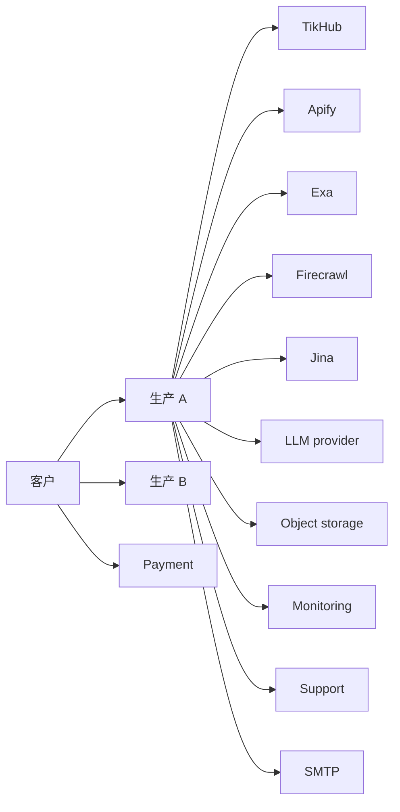

# Governed Task Platform O0/PG0 External Evidence Implementation Plan

> **For agentic workers:** REQUIRED SUB-SKILL: Use superpowers:subagent-driven-development (recommended) or superpowers:executing-plans to implement this plan task-by-task. Steps use checkbox (`- [ ]`) syntax for tracking.

**Goal:** 在 PG0 评审前取得、归档并签核设计 §8.2 与 §10.2 要求的外部书面证据，关闭没有证据的能力、市场和客户范围，交付可签署的 PG0 评审包。

**Architecture:** O0 是独立运营工作流，不改产品代码。它用证据登记册、受限原始件库、仓库脱敏副本和追溯矩阵组织 14 个证据域。每项证据有唯一 ID、原始件 SHA-256、范围、有效期和验收状态。PG0 评审包只引用状态为 `accepted` 的证据。代码切片 C0–C14 和 PG1 实际试点 O1 不在本计划内。

**Tech Stack:** Markdown、CSV、JSON、SHA-256（`shasum -a 256`）、git、只读 `curl`、只读 `ssh`、AWS CLI v2（S3 API 与对象锁）、Python 3 标准库。

**Status:** O0 未启动。没有未解决的内部阻塞；外部证据未取得时 PG0 门禁保持 `open`。Task 1–10 可与 C0–C14 并行；Task 11–12 依赖 C0–C14 的运行产物和 C14 验收结果；Task 13 依赖 Task 4 的隐私矩阵、C2 链头导出与 C11 迁移 067 在生产 A 落地；Task 14 依赖 Task 2–13 的证据状态；Task 15 依赖全部 Task。Task 12 和 Task 15 还依赖 C1 当前契约登记；Task 15 的开关观察依赖 PG0 发布批次记录和 C14 只读验收结果，O0 不执行发布。

## 设计批准记录

| 字段 | 值 |
|---|---|
| 设计文档 | `docs/superpowers/specs/2026-10-21-tikhub-governed-task-platform-design.md` |
| 版本 | v1.0 |
| 状态 | 设计已批准，待实施规划 |
| 批准日期 | 2026-10-21 |
| 本计划关系 | 设计 §11 要求的实施规划文档之一，覆盖 O0（PG0 外部取证） |

## 工作流命名与边界

| 标识 | 含义 | 本计划关系 |
|---|---|---|
| C0–C14 | 代码实施切片最终结构 | 另立代码实施计划。本计划只消费其运行产物 |
| O0 | PG0 外部取证与评审包 | 本计划 |
| O1 | PG1 实际试点 | 另立试点计划 |
| 产品阶段 P0/P1/P2 | 设计 §8.1 的阶段 | 只在产品阶段语境使用 |
| 契约实施阶段 P0–P8 | 契约冻结 §2 的阶段 | 本计划不使用 |

规则：

- 本计划统一写 PG0/PG1。不得写“P0 试点准入”或“P1 商业 Go/No-Go”来指门禁。
- 需要引用产品阶段时，写“产品阶段 P0/P1/P2”。
- 需要引用契约实施阶段时，写“契约实施阶段 P0–P8”。
- 本计划不命名、不拆分、不实施 C0–C14 切片。

## 时间盒

| 日期 | 里程碑 |
|---|---|
| 2026-10-23 | Task 1 完成；Task 2、Task 4、Task 5 的请求和事实查询启动 |
| 2026-10-27 | 全部外部书面请求发出；`request-log.csv` 记录 `requested` |
| 2026-11-06 | 催办截止；未回复项改为 `follow_up` 或 `rejected` |
| 2026-11-13 | 证据冻结；Task 2–14 完成；Task 13 的审计链头 WORM 证据完成；`due_date` 到期 |
| 2026-11-18 | PG0 评审；Task 15 完成六方签核和决议 |

## Global Constraints

- 设计基线：`docs/superpowers/specs/2026-10-21-tikhub-governed-task-platform-design.md` v1.0，状态“设计已批准，待实施规划”。
- 契约前置：本计划引用的每个新 path、table、column、error、audit action 或 audit subject 必须先由 `docs/superpowers/plans/2026-10-22-governed-task-platform-c1-contract-v1-1.md` 的当前版本登记。O0 不新增契约对象。C1 未登记时记录 `blocked`，对应 PG0 门禁不得 `pass`。
- 开关观察：O0 只读观察四个 PG0 开关 `BUDGET_ENFORCEMENT_ENABLED`、`STRICT_PRICE_ENABLED`、`RUN_EXECUTION_CONVERGENCE_ENABLED`、`RETENTION_CLEANUP_ENABLED`。翻转只属于 PG0 发布批次；O0 不写 `.env.production`、不改 compose、不重启容器、不调用任何写开关的接口。
- 客观证据最小集：Task 12 必须包含同工作区 member 跨项目负向矩阵（tasks、claims、assets、reports、delivery，成功数为 0）、报告语义负向检查、交付 manifest schema 校验与 C8 质量回环。Task 15 必须包含统一审计覆盖矩阵（缺失事件数为 0）和 PG0 发布批次后的四开关只读状态。
- 本计划只执行 O0。不得修改产品代码、迁移、生产 schema、生产配置或客户数据；受治理运行数据除外。
- O0 只做 PG0 书面取证与内部验收。O0 不执行客户付费任务、不收款、不开票、不向客户交付报告或数据集；实际付费试点只属于 O1。
- 计划窗口：2026-10-23 至 2026-11-13 为证据请求、收集和冻结；2026-11-18 为 PG0 评审日。所有日期使用 ISO 日期 `YYYY-MM-DD`。
- 登记册 `status` 列只用：`not_requested`、`requested`、`follow_up`、`received`、`accepted`、`rejected`、`expired`、`superseded`、`not_applicable`。PG0 只接受 `accepted`。
- 证据 ID 格式：`O0-` 加 AREA 加三位序号，例如 `O0-UP-TIKHUB-001`。AREA 只用：`GOV`、`UP-TIKHUB`、`UP-PROVIDER`、`PRIV-DPA`、`PRIV-XB`、`PRIV-LLM`、`INFRA`、`FIN`、`MKT`、`COMMIT`、`PILOT-GOLD`、`PILOT-ACC`、`AUDIT`、`RISK`、`PG0`。
- 每个外部 `accepted` 证据必须有：原始件、SHA-256、授予主体、范围、生效日、失效日、复核人、复核日、脱敏副本。`GOV` 内部治理文件例外：必须有文件路径和 git 提交，`confidence` 写 `internal_control`。
- 登记册 `gate_effect` 规则：本计划证据行写 `required_for_pg0`。PG1 预警项只在追溯矩阵中写 `PG1`，证据行仍是 PG0 必需。`due_date` 默认 `2026-11-13`。
- 追溯矩阵 `status` 只用 `open`、`closed`、`blocked`。
- 原始件只放受限库：`${DIH_EVIDENCE_VAULT:-$HOME/dih-evidence/o0-pg0}/upstream-rights/O0-UP-TIKHUB-001/` 是布局示例；每个 AREA 一个目录，每个证据 ID 一个子目录。仓库只放脱敏摘要、登记册和哈希。受限库目录权限 `0700`，文件权限 `0600`。
- 仓库证据根：`docs/evidence/o0-pg0/`。不得把合同正文、个人邮箱、账户 ID、签名图片、API key、Cookie 或客户个人数据提交到 git。
- 书面许可必须来自有权签署的主体。邮件许可必须来自可验证的公司域名邮箱，并保留完整邮件头。DPA 不等于转售许可。公开条款不等于书面许可，除非法务在复核记录中明确接受。
- 没有 TikHub 书面许可：不向客户交付 TikHub 派生结果。没有 provider 书面条件：该 provider 从模板来源矩阵移除。没有 DPA 和子处理者覆盖：不处理客户个人数据。没有 LLM 零保留和禁止训练条款：客户任务不调用 LLM。没有市场覆盖和单位成本：该市场不对外列为正式支持。没有财务签核：不报价。
- PG0 没有 Conditional Pass。必需证据缺失、过期或范围不足时，PG0 结果为 `fail`，相关能力保持关闭。
- 合成黄金路径和内部验收只使用合成数据或内部非客户数据。不得使用客户个人数据、客户 Cookie 或客户 Seller Center 登录态。
- 所有金额同时记录原币和 USD。USD 换算使用 ECB 参考汇率，记录 `fx_date` 和 `fx_source`。账本实际成本只取 `entry_kind in ('settle','release')`。
- O0 采样预算上限：Quick 覆盖采样每市场 USD 100；Standard 成本采样每市场 USD 500，只做 US、DE、GB 三个市场。O0 采样总上限 USD 2,860，含 10% 预备金。超出前必须由财务书面批准。
- 生产默认只读。O0 的 SSH 和事实查询只读。市场采样和内部验收只能通过受治理 API 写入 `runs`、`run_steps`、`run_ledger_entries` 和审计数据；不得直写 SQL，不得修改 schema、配置、迁移或客户数据，不得重启容器。Task 13 只读取 C2 已生成的每日链头文件，不在生产上运行导出命令，不改生产调度。
- 审计链头 WORM 存储必须与生产 A/B 的云账号和对象存储账号独立。桶启用对象锁；默认保留模式为 `COMPLIANCE`，保留期不少于 730 天。O0 只上传 C2 导出的链头 JSON，不上传原始审计事件、事件正文或个人数据。
- WORM 凭证只放 `$HOME/.dih-worm/worm.env`，权限 `0600`；链头 HMAC 密钥只放 `$HOME/.dih-worm/audit-chain-head.key`，权限 `0600`。两者不得进入 git、日志、命令输出或证据副本。证据只记录 `hmac_verified=yes`。
- 发送任何外部请求前，由 O0 owner 和法务确认收件人、措辞和授权。不得以客户名义发送。
- 提交信息只用 `docs(evidence): ...`。一个 Task 一个提交。提交前运行 `git diff --check` 和本 Task 的验证命令。
- 每个 Task 提交前运行 `node .gitnexus/run.cjs detect-changes --scope all --repo .`；`partial` 与 `truncated` 必须为 `false`。文档变更不豁免该检查。每个提交代码块都重复该命令。命令输出出现 `partial: true` 或 `truncated: true` 时，立即停止并重跑；不得执行后续 `git commit`。

## File Structure

- `docs/evidence/o0-pg0/register/`：证据登记册、追溯矩阵、元数据字段和复核日历。Task 1 创建，Task 2–14 追加。
- `docs/evidence/o0-pg0/upstream-rights/`：TikHub、Apify、Exa、Firecrawl、Jina 和 Actor 的书面条件、请求日志和来源清单。Task 2、Task 3 创建。
- `docs/evidence/o0-pg0/privacy/`：DPA、子处理者、角色矩阵、跨境数据流和 LLM 条款。Task 4、Task 6、Task 7 创建。
- `docs/evidence/o0-pg0/infrastructure/`：生产区域、备份、安全资质和构建基线。Task 5 创建。
- `docs/evidence/o0-pg0/finance/`：财务定义、单位经济和对账。Task 8 创建。
- `docs/evidence/o0-pg0/markets/`：11 市场覆盖、来源矩阵、采样协议和单位成本。Task 9 创建。
- `docs/evidence/o0-pg0/commitments/`：付费承诺、企业采购需求和刷新意愿。Task 10 创建。
- `docs/evidence/o0-pg0/pilot/`：合成黄金路径、内部 Quick 和 Standard 验收。Task 11、Task 12 创建。
- `docs/evidence/o0-pg0/audit/`：审计链头 WORM 桶配置、上传、读取和不可覆盖验证。Task 13 创建。
- `docs/evidence/o0-pg0/risk/`：风险台账和严重风险复核。Task 14 创建。
- `docs/evidence/o0-pg0/pg0-review/`：门禁矩阵、签核表、决议和评审包。Task 15 创建。
- `${DIH_EVIDENCE_VAULT:-$HOME/dih-evidence/o0-pg0}/`：受限原始件库。按 AREA 和证据 ID 分目录，保存 `original.*`、`sha256.txt`、`metadata.json`、`redacted.md`。

## 证据状态、ID 与归档规则

### 状态机

| 状态 | 含义 | 计入 PG0 |
|---|---|---|
| `not_requested` | 尚未发出请求 | 否 |
| `requested` | 请求已发出，未收到回复 | 否 |
| `follow_up` | 已催办，等待明确书面回复 | 否 |
| `received` | 原始件已入库并计算哈希，尚未复核 | 否 |
| `accepted` | 复核通过，范围和有效期满足要求 | 是 |
| `rejected` | 明确拒绝，或条款不满足要求 | 否 |
| `expired` | 超过 `valid_until` | 否 |
| `superseded` | 被新版本替代 | 否 |
| `not_applicable` | 经法务或财务书面确认不适用 | 是，仅限非必需项 |

### 字段状态

模板中的字段状态是明确的生命周期值，不是占位符。`accepted` 前必须替换为实际值或书面结论。

| 字段状态 | 含义 |
|---|---|
| `not_recorded` | 尚未记录实际值 |
| `not_verified` | 有声明，但未验证 |
| `not_received` | 外部文件或回复未收到 |
| `not_sampled` | 尚未采样 |
| `not_measured` | 尚未计量 |
| `not_reviewed` | 尚未复核 |
| `not_signed` | 尚未签署 |
| `not_selected` | 尚未选择 |
| `not_tested` | 尚未测试 |
| `not_interviewed` | 尚未访谈 |
| `not_assigned` | 尚未分配 |
| `not_run` | 尚未运行 |
| `not_written` | 尚未写入披露文本 |
| `not_checked` | 尚未检查 |
| `not_accepted` | 尚未接受为证据 |
| `not_met` | 条款未满足 |
| `not_available` | 不可用 |
| `not_approved` | 未批准 |
| `not_held` | 未持有 |
| `not_claimed` | 不声称 |
| `not_applicable` | 不适用 |

### 证据 ID 分配

| AREA | 范围 | 本计划 ID |
|---|---|---|
| `GOV` | 登记册、追溯矩阵、复核日历 | `O0-GOV-001` 至 `O0-GOV-004` |
| `UP-TIKHUB` | TikHub 书面商业许可 | `O0-UP-TIKHUB-001` 至 `008` |
| `UP-PROVIDER` | Apify、Exa、Firecrawl、Jina、Actor | `O0-UP-PROVIDER-001` 至 `005` |
| `PRIV-DPA` | DPA、子处理者、数据保护角色 | `O0-PRIV-DPA-001` 至 `002` |
| `PRIV-XB` | 跨境传输 | `O0-PRIV-XB-001` |
| `PRIV-LLM` | LLM 零保留、禁止训练、区域 | `O0-PRIV-LLM-001` |
| `INFRA` | 生产区域、备份、安全资质 | `O0-INFRA-001` 至 `003` |
| `FIN` | 财务口径、单位经济、对账 | `O0-FIN-001` 至 `002` |
| `MKT` | 11 市场覆盖、单位成本 | `O0-MKT-001` 至 `002` |
| `COMMIT` | 付费承诺、企业采购、刷新意愿 | `O0-COMMIT-001` 至 `004` |
| `PILOT-GOLD` | 合成黄金路径 | `O0-PILOT-GOLD-001` |
| `PILOT-ACC` | 内部 Quick 与 Standard 验收 | `O0-PILOT-ACC-001` 至 `002` |
| `AUDIT` | 审计链头 WORM 存档与不可覆盖验证 | `O0-AUDIT-001` |
| `RISK` | 风险台账 | `O0-RISK-001` |
| `PG0` | PG0 评审包与签核 | `O0-PG0-001` |

### 受限库布局

```text
${DIH_EVIDENCE_VAULT:-$HOME/dih-evidence/o0-pg0}/
  register/
  upstream-rights/
    O0-UP-TIKHUB-001/
      original.pdf
      sha256.txt
      metadata.json
      redacted.md
  privacy/
  infrastructure/
  finance/
  markets/
  commitments/
  pilot/
  audit/
    O0-AUDIT-001/
      source.json
      sha256.txt
      readback.json
      retention.json
      metadata.json
      redacted.md
  risk/
  pg0-review/
```

`metadata.json` 必须包含以下字段：

| 字段 | 规则 |
|---|---|
| `evidence_id` | 与登记册一致 |
| `title` | 证据标题 |
| `grantor_legal_name` | 授予主体法定名称 |
| `recipient_legal_name` | 接收主体法定名称 |
| `scope` | 分号分隔，值来自本 Task 的范围表 |
| `valid_from` | ISO 日期 |
| `valid_until` | ISO 日期；无期限时写合同终止规则 |
| `sha256` | 原始件小写十六进制 SHA-256 |
| `received_from` | 公司域名邮箱或签署人 |
| `received_at` | UTC 时间，格式 `YYYY-MM-DDTHH:MM:SSZ` |
| `reviewer` | 复核人角色 |
| `reviewed_at` | ISO 日期 |
| `confidence` | `written_signed`、`written_email`、`public_terms`、`internal_control`、`verbal` 或 `none` |
| `status` | 状态机中的值 |
| `redacted_path` | 仓库脱敏副本路径 |
| `notes` | 限制、例外和后续动作 |

### 脱敏规则

- 删除个人邮箱、手机号、账户 ID、API key、Cookie、签名图片、银行账号和价格明细。
- 保留授予主体、授予范围、生效日、失效日、限制条款和签署人职务。
- 保留完整邮件头时，只把个人邮箱替换为 `redacted@example.com`，保留域名和日期。
- 脱敏副本必须能单独支持复核结论。不能只写“已获批准”。

### 证据验收规则

一条证据只有同时满足以下条件才是 `accepted`：

1. 授予主体有权签署，或邮件来自可验证的公司域名。
2. 范围覆盖本 Task 范围表中的全部必需项。
3. 有效期覆盖 PG0 评审日和计划中的首个客户交付日。
4. 原始件已入库，SHA-256 已写入登记册。
5. 复核人已在登记册签字，脱敏副本已提交。
6. 没有把 DPA、公开条款、口头说明或销售承诺当作商业许可。

---

### Task 1: 建立 O0 证据治理基线

**Files:**
- Create: `docs/evidence/o0-pg0/README.md`
- Create: `docs/evidence/o0-pg0/register/evidence-register.csv`
- Create: `docs/evidence/o0-pg0/register/traceability-matrix.csv`
- Create: `docs/evidence/o0-pg0/register/metadata-fields.md`
- Create: `docs/evidence/o0-pg0/register/review-calendar.csv`
- Create: `${DIH_EVIDENCE_VAULT:-$HOME/dih-evidence/o0-pg0}/` 下的 11 个证据域目录

**Interfaces:**
- Consumes: 设计 §8.2、§10.2、§11；契约冻结 §2.8 门禁 ID。
- Produces: `evidence-register.csv` 表头；`traceability-matrix.csv` 表头；状态词表；证据 ID 表；受限库布局；`review-calendar.csv` 表头。Task 2–14 只追加行，不改表头。

**Archive:** 仓库 `docs/evidence/o0-pg0/register/`；受限库 `${DIH_EVIDENCE_VAULT:-$HOME/dih-evidence/o0-pg0}/register/`。

**Acceptance:** 两个 CSV 表头与本 Task 完全一致；证据 ID 唯一；状态值都在词表内；追溯矩阵覆盖 11 项 PG0 门禁（设计 §8.2 的 10 项要求，其中内部 Quick 和 Standard 拆成两项）和 14 项 §10.2 外部取证项；受限库目录权限为 `0700`。

- [ ] **Step 1: 创建目录和权限**

```bash
cd "$(git rev-parse --show-toplevel)"
umask 077
mkdir -p docs/evidence/o0-pg0/{register,upstream-rights,privacy,infrastructure,finance,markets,commitments,pilot,audit,risk,pg0-review}
VAULT="${DIH_EVIDENCE_VAULT:-$HOME/dih-evidence/o0-pg0}"
mkdir -p "$VAULT"/{register,upstream-rights,privacy,infrastructure,finance,markets,commitments,pilot,audit,risk,pg0-review}
chmod 700 "$VAULT"
find "$VAULT" -maxdepth 1 -type d -exec chmod 700 {} \;
```

- [ ] **Step 2: 写 `README.md`**

```markdown
# O0 / PG0 Evidence Archive

## Purpose

本目录保存 PG0 外部取证的可复核摘要、登记册和哈希。原始合同、DPA、邮件和截图保存在受限库 `DIH_EVIDENCE_VAULT`。仓库不保存合同正文和个人数据。

## Scope

- O0 只覆盖 PG0 外部取证与评审包。
- C0–C14 代码切片和 O1 实际试点不在本目录。
- 产品阶段写 P0/P1/P2；契约实施阶段写 P0–P8；门禁写 PG0/PG1。

## Status

| Status | Meaning | Counts for PG0 |
|---|---|---|
| not_requested | 尚未发出请求 | 否 |
| requested | 请求已发出 | 否 |
| follow_up | 已催办 | 否 |
| received | 原始件已入库并哈希 | 否 |
| accepted | 复核通过 | 是 |
| rejected | 拒绝或条款不满足 | 否 |
| expired | 超过有效期 | 否 |
| superseded | 被新版本替代 | 否 |
| not_applicable | 书面确认不适用 | 仅限非必需项 |

`GOV` 内部治理文件使用 `confidence=internal_control`，不要求受限库原始件。其他证据必须满足受限库和哈希规则。

## Evidence ID

`O0-` 加 AREA 加三位序号。AREA：GOV、UP-TIKHUB、UP-PROVIDER、PRIV-DPA、PRIV-XB、PRIV-LLM、INFRA、FIN、MKT、COMMIT、PILOT-GOLD、PILOT-ACC、AUDIT、RISK、PG0。

## Archive

仓库：`docs/evidence/o0-pg0/`。
受限库：`${DIH_EVIDENCE_VAULT:-$HOME/dih-evidence/o0-pg0}/`。
每个证据目录包含 `original.*`、`sha256.txt`、`metadata.json`、`redacted.md`。

## Redaction

删除个人邮箱、手机号、账户 ID、API key、Cookie、签名图片、银行账号和价格明细。保留授予主体、范围、生效日、失效日、限制和签署人职务。

## Gate Rule

PG0 只接受 `accepted`。必需证据缺失、过期或范围不足时，PG0 为 `fail`，相关能力保持关闭。PG0 没有 Conditional Pass。

## Commit Rule

一个 Task 一个提交。提交信息使用 `docs(evidence): ...`。提交前运行 `git diff --check`。
```

- [ ] **Step 3: 写 `evidence-register.csv` 表头和治理行**

```bash
cat > docs/evidence/o0-pg0/register/evidence-register.csv <<'CSV'
evidence_id,area,requirement_ref,title,owner,requested_from,request_date,response_date,due_date,status,confidence,scope,valid_from,valid_until,original_location,original_sha256,redacted_path,reviewer,review_date,gate_effect,notes
O0-GOV-001,GOV,§11.1,Evidence register and status vocabulary,O0 owner,,,,2026-10-23,accepted,internal_control,governance,2026-10-22,2027-10-22,docs/evidence/o0-pg0/register/evidence-register.csv,not_applicable,docs/evidence/o0-pg0/register/evidence-register.csv,O0 owner,2026-10-22,required_for_pg0,治理基线
O0-GOV-002,GOV,§11.1,Traceability matrix,O0 owner,,,,2026-10-23,accepted,internal_control,governance,2026-10-22,2027-10-22,docs/evidence/o0-pg0/register/traceability-matrix.csv,not_applicable,docs/evidence/o0-pg0/register/traceability-matrix.csv,O0 owner,2026-10-22,required_for_pg0,需求到证据映射
O0-GOV-003,GOV,§10.2,Evidence metadata fields,O0 owner,,,,2026-10-23,accepted,internal_control,governance,2026-10-22,2027-10-22,docs/evidence/o0-pg0/register/metadata-fields.md,not_applicable,docs/evidence/o0-pg0/register/metadata-fields.md,O0 owner,2026-10-22,required_for_pg0,字段和哈希规则
O0-GOV-004,GOV,§10.2,Evidence review calendar,O0 owner,,,,2026-10-23,accepted,internal_control,governance,2026-10-22,2027-10-22,docs/evidence/o0-pg0/register/review-calendar.csv,not_applicable,docs/evidence/o0-pg0/register/review-calendar.csv,O0 owner,2026-10-22,required_for_pg0,到期复核
CSV
```

- [ ] **Step 4: 写 `traceability-matrix.csv`**

```bash
cat > docs/evidence/o0-pg0/register/traceability-matrix.csv <<'CSV'
requirement_id,spec_section,requirement_text,design_decision,metric_or_acceptance,evidence_ids,gate,owner,status
PG0-01,§8.2,合成数据黄金路径端到端通过,合成夹具加受治理运行,全部阶段 pass 且产物哈希校验通过,O0-PILOT-GOLD-001,PG0,Engineering,open
PG0-02,§8.2,一份内部 Quick 通过端到端验收,内部 Quick 全流程,质量门槛、审核和交付全部通过,O0-PILOT-ACC-001,PG0,Data Quality,open
PG0-03,§8.2,一份内部 Standard 通过端到端验收,内部 Standard 全流程,质量门槛、审核和交付全部通过,O0-PILOT-ACC-002,PG0,Data Quality,open
PG0-04,§8.2,工作区、项目、密钥和客户工具边界生效,身份与密钥治理,跨工作区成功访问为 0；同工作区 member 跨项目成功访问为 0；白名单外调用为 0,O0-PILOT-ACC-001;O0-PILOT-ACC-002,PG0,Security,open
PG0-05,§8.2,价格簿、预算和账本能够对账,预算与账本,账本不平为 0；重复结算为 0；预算阻断 100%；`BUDGET_ENFORCEMENT_ENABLED` 与 `STRICT_PRICE_ENABLED` 只读 true,O0-FIN-001;O0-FIN-002,PG0,Finance,open
PG0-06,§8.2,逐市场质量、证据、Claim、报告和交付闭环生效,任务包闭环,Claim 证据绑定率 100%；报告合同校验 100%；报告语义负向 0 命中；manifest schema 与 C8 质量回环通过,O0-PILOT-GOLD-001;O0-PILOT-ACC-001;O0-PILOT-ACC-002,PG0,Data Quality,open
PG0-07,§8.2,伪名化、导出遮蔽、保留、删除和审计生效,隐私与审计,PII 违规发布 0；关键操作缺失审计 0；`RETENTION_CLEANUP_ENABLED` 只读 true,O0-PRIV-DPA-001;O0-PRIV-XB-001;O0-PILOT-GOLD-001;O0-AUDIT-001,PG0,Security,open
PG0-08,§8.2,TikHub 及实际使用来源具备书面商业依据,上游书面许可,所有模板来源有 accepted 书面许可,O0-UP-TIKHUB-001;O0-UP-TIKHUB-002;O0-UP-TIKHUB-003;O0-UP-TIKHUB-004;O0-UP-TIKHUB-005;O0-UP-TIKHUB-006;O0-UP-TIKHUB-007;O0-UP-TIKHUB-008;O0-UP-PROVIDER-001;O0-UP-PROVIDER-002;O0-UP-PROVIDER-003;O0-UP-PROVIDER-004;O0-UP-PROVIDER-005,PG0,Legal,open
PG0-09,§8.2,至少 3 份可执行的书面付费试点承诺,付费承诺,3 份 executable 且有签署和付款路径,O0-COMMIT-001;O0-COMMIT-002;O0-COMMIT-003,PG0,Finance,open
PG0-10,§8.2,目录、MCP 工具和生产构建事实基线冻结,事实基线,目录 digest、工具数、构建 revision 和镜像 digest 已记录,O0-INFRA-001;O0-INFRA-002,PG0,Engineering,open
PG0-11,§8.2,没有未处置的严重风险,风险台账,所有 high 和 critical 风险有 owner、缓解、退出条件和复核日,O0-RISK-001,PG0,O0 owner,open
EXT-01,§10.2,3–5 家伙伴的预算、决策人和付费承诺,付费承诺,3 份 executable 承诺,O0-COMMIT-001;O0-COMMIT-002;O0-COMMIT-003,PG1,Finance,open
EXT-02,§10.2,Quick、Standard 和月度刷新的支付意愿,付费承诺,每份承诺记录包型、价格和刷新意愿,O0-COMMIT-001;O0-COMMIT-002;O0-COMMIT-003,PG1,Finance,open
EXT-03,§10.2,TikHub 派生交付、Agency 分享、缓存、存储、署名和查询数据书面许可,TikHub 许可,8 个范围全部 accepted,O0-UP-TIKHUB-001;O0-UP-TIKHUB-002;O0-UP-TIKHUB-003;O0-UP-TIKHUB-004;O0-UP-TIKHUB-005;O0-UP-TIKHUB-006;O0-UP-TIKHUB-007;O0-UP-TIKHUB-008,PG0,Legal,open
EXT-04,§10.2,Apify、Actor、Exa、Firecrawl、Jina 等来源的商业条件,Provider 许可,每个实际来源有 accepted 条件,O0-UP-PROVIDER-001;O0-UP-PROVIDER-002;O0-UP-PROVIDER-003;O0-UP-PROVIDER-004;O0-UP-PROVIDER-005,PG0,Legal,open
EXT-05,§10.2,11 个市场的真实覆盖和单位成本,市场覆盖,11 个市场有覆盖状态和单位成本模型,O0-MKT-001;O0-MKT-002,PG0,Data Quality,open
EXT-06,§10.2,欧洲市场的跨境机制,跨境,每条个人数据流有 verified 机制或书面关闭,O0-PRIV-XB-001,PG0,Legal,open
EXT-07,§10.2,品牌、Agency、终端品牌和平台的数据保护角色,角色矩阵,每个角色有 controller 或 processor 结论,O0-PRIV-DPA-002,PG0,Legal,open
EXT-08,§10.2,LLM 零保留、禁止训练和数据区域,LLM 条款,书面零保留和禁止训练；区域已披露,O0-PRIV-LLM-001,PG0,Security,open
EXT-09,§10.2,实际生产、备份和监控区域,基础设施,两套环境区域、备份区域和监控区域已记录,O0-INFRA-001;O0-INFRA-002,PG0,Ops,open
EXT-10,§10.2,实际持有的安全认证、渗透测试和保险,安全资质,每项写 held、not_held 或 not_verified,O0-INFRA-003,PG0,Security,open
EXT-11,§10.2,发票、退款、抵扣、收入确认和汇率口径,财务口径,财务负责人签核的定义,O0-FIN-001;O0-FIN-002,PG0,Finance,open
EXT-12,§10.2,企业客户对 SSO、IP 白名单、驻留、审计和保险的要求,企业采购,每个付费伙伴的需求矩阵已记录,O0-COMMIT-004,PG0,Product,open
EXT-13,§10.2,Quick 2 小时容量和正式版 24 小时容量与审核可行性,内部验收,两份验收记录包含耗时和审核签字,O0-PILOT-ACC-001;O0-PILOT-ACC-002,PG0,Ops,open
EXT-14,§10.2,月度刷新是否产生持续价值,付费承诺,3 份承诺记录刷新意愿和价格,O0-COMMIT-001;O0-COMMIT-002;O0-COMMIT-003,PG1,Product,open
CSV
```

- [ ] **Step 5: 写 `metadata-fields.md`**

```markdown
# Evidence Metadata Fields

| Field | Required | Rule |
|---|---:|---|
| evidence_id | 是 | 与 evidence-register.csv 一致 |
| title | 是 | 证据标题 |
| grantor_legal_name | 是 | 授予主体法定名称 |
| recipient_legal_name | 是 | 接收主体法定名称 |
| scope | 是 | 分号分隔，值来自 Task 范围表 |
| valid_from | 是 | ISO 日期 |
| valid_until | 是 | ISO 日期或合同终止规则 |
| confidence | 是 | written_signed、written_email、public_terms、internal_control、verbal 或 none |
| sha256 | 是 | 原始件小写十六进制 SHA-256 |
| received_from | 是 | 公司域名邮箱或签署人 |
| received_at | 是 | UTC 时间，YYYY-MM-DDTHH:MM:SSZ |
| reviewer | 是 | 复核人角色 |
| reviewed_at | 是 | ISO 日期 |
| status | 是 | 状态词表中的值 |
| redacted_path | 是 | 仓库脱敏副本路径 |
| notes | 否 | 限制、例外和后续动作 |

规则：

1. 原始件写入受限库后立即计算 SHA-256。哈希写入 `sha256.txt` 和登记册。
2. 脱敏副本写入仓库。不得包含个人邮箱、账户 ID、签名图片或价格明细。
3. `accepted` 行的 `original_location` 必须指向受限库路径，`original_sha256` 必须非空。`GOV` 内部治理文件例外：`confidence=internal_control`，`original_location` 指向仓库文件，`original_sha256` 可写 `not_applicable`。
4. 没有 `valid_until` 的证据不能是 `accepted`，除非合同明确写“永久有效”并附条款号。
```

- [ ] **Step 6: 写 `review-calendar.csv` 表头**

```bash
cat > docs/evidence/o0-pg0/register/review-calendar.csv <<'CSV'
evidence_id,valid_until,review_due,owner,review_action,last_reviewed_at,status,notes
CSV
```

- [ ] **Step 7: 验证治理基线**

```bash
cd "$(git rev-parse --show-toplevel)"
python3 - <<'PY'
import csv
from pathlib import Path

reg = Path('docs/evidence/o0-pg0/register/evidence-register.csv')
mat = Path('docs/evidence/o0-pg0/register/traceability-matrix.csv')
reg_header = 'evidence_id,area,requirement_ref,title,owner,requested_from,request_date,response_date,due_date,status,confidence,scope,valid_from,valid_until,original_location,original_sha256,redacted_path,reviewer,review_date,gate_effect,notes'.split(',')
mat_header = 'requirement_id,spec_section,requirement_text,design_decision,metric_or_acceptance,evidence_ids,gate,owner,status'.split(',')

with reg.open(encoding='utf-8') as f:
    rows = list(csv.DictReader(f))
    assert f.seek(0) == 0
    assert next(csv.reader(reg.open(encoding='utf-8'))) == reg_header
assert rows, 'register has no rows'
ids = [r['evidence_id'] for r in rows]
assert len(ids) == len(set(ids)), 'duplicate evidence_id'
allowed = {'not_requested','requested','follow_up','received','accepted','rejected','expired','superseded','not_applicable'}
assert all(r['status'] in allowed for r in rows), 'invalid status'

with mat.open(encoding='utf-8') as f:
    mrows = list(csv.DictReader(f))
    assert next(csv.reader(mat.open(encoding='utf-8'))) == mat_header
assert len(mrows) == 25, len(mrows)
assert sum(1 for r in mrows if r['requirement_id'].startswith('PG0-')) == 11
assert sum(1 for r in mrows if r['requirement_id'].startswith('EXT-')) == 14
print(f'register={len(rows)} traceability={len(mrows)} OK')
PY
! grep -RInE 'T[B]D|T[O]DO|待[填]|待[补]|FIX[M]E|XX[X]' docs/evidence/o0-pg0
git diff --check
```

预期：打印 `register=4 traceability=25 OK`，`grep` 无输出，`git diff --check` 无输出。

- [ ] **Step 8: 提交治理基线**

```bash
git add docs/evidence/o0-pg0/README.md docs/evidence/o0-pg0/register
node .gitnexus/run.cjs detect-changes --scope all --repo .
git commit -m "docs(evidence): establish O0 PG0 evidence register"
```

---

### Task 2: 取得 TikHub 书面商业许可

**Files:**
- Create: `docs/evidence/o0-pg0/upstream-rights/tikhub-rights.md`
- Create: `docs/evidence/o0-pg0/upstream-rights/tikhub-request-email.md`
- Create: `docs/evidence/o0-pg0/upstream-rights/request-log.csv`
- Modify: `docs/evidence/o0-pg0/register/evidence-register.csv`

**Interfaces:**
- Consumes: Task 1 的登记册表头和状态词表。
- Produces: `O0-UP-TIKHUB-001` 至 `008`；`tikhub-rights.md` 的 8 行范围矩阵；`request-log.csv` 的请求记录；TikHub 回复原始件和脱敏副本。

**Archive:** 仓库 `docs/evidence/o0-pg0/upstream-rights/`；受限库 `${DIH_EVIDENCE_VAULT:-$HOME/dih-evidence/o0-pg0}/upstream-rights/O0-UP-TIKHUB-001/` 至 `008/`。

**Acceptance:** 8 个范围全部 `accepted`；授予主体、生效日、失效日、署名和范围明确；DPA 没有被当作商业许可；任一必需范围缺失时，`tikhub_*` 客户交付能力保持关闭。

- [ ] **Step 1: 写 `tikhub-rights.md` 模板**

```markdown
# TikHub Written Commercial Permission

| Field | Value |
|---|---|
| Evidence IDs | O0-UP-TIKHUB-001 至 O0-UP-TIKHUB-008 |
| Grantor legal name | not_received |
| Recipient legal name | Data Intelligence Hub 运营主体 |
| Grant date | not_received |
| Effective date | not_received |
| Expiry date | not_received |
| Original SHA-256 | not_received |
| Reviewer | Legal |
| Review date | not_received |
| Status | not_requested |

## Scope Matrix

| scope_id | scope | required | question | response_summary | evidence_id | status | allowed_capability | closed_capability |
|---|---|---:|---|---|---|---|---|---|
| TIK-01 | derived_delivery | yes | 是否允许把 TikHub 派生后的归一化记录、Claim 和报告放入付费客户交付 | not_received | O0-UP-TIKHUB-001 | not_requested | not_recorded | not_recorded |
| TIK-02 | agency_share | yes | 是否允许 Agency 客户把交付分享给终端品牌 | not_received | O0-UP-TIKHUB-002 | not_requested | not_recorded | not_recorded |
| TIK-03 | cache_raw_30d | yes | 是否允许原始响应缓存 30 天 | not_received | O0-UP-TIKHUB-003 | not_requested | not_recorded | not_recorded |
| TIK-04 | cache_normalized_12m | yes | 是否允许标准化数据集保存 12 个月 | not_received | O0-UP-TIKHUB-004 | not_requested | not_recorded | not_recorded |
| TIK-05 | store_backup_30d | yes | 是否允许派生数据和备份保存 30 天 | not_received | O0-UP-TIKHUB-005 | not_requested | not_recorded | not_recorded |
| TIK-06 | attribution | yes | 要求的署名文本、位置和链接是什么 | not_received | O0-UP-TIKHUB-006 | not_requested | not_recorded | not_recorded |
| TIK-07 | query_data | yes | 许可是否覆盖搜索结果和查询派生数据，而不只是原始响应 | not_received | O0-UP-TIKHUB-007 | not_requested | not_recorded | not_recorded |
| TIK-08 | resale_boundary | yes | 是否允许转售原始 JSON 或提供 API 访问；边界是什么 | not_received | O0-UP-TIKHUB-008 | not_requested | not_recorded | not_recorded |

## Acceptance Rules

1. `accepted` 只用于明确写出“允许”的范围。沉默、转交销售、引用 DPA 或引用公开条款都不算。
2. 必须记录授予主体、生效日、失效日、署名人和限制。
3. TIK-01 至 TIK-07 任一为 `not_requested`、`requested`、`follow_up` 或 `rejected` 时，TikHub 派生客户交付保持关闭。
4. TIK-08 只用于确认转售边界。如果回复允许转售，也不自动允许裸 API 业务；裸 API 仍是首期非目标。
5. DPA 只证明数据处理关系，不证明派生交付或 Agency 分享权利。

## Closed Capability

如果许可范围不足，关闭以下能力：

- `tikhub_*` 端点进入客户任务包。
- TikHub 派生数据进入客户数据集、Claim、报告和 manifest。
- Agency 向终端品牌分享含 TikHub 派生数据的交付包。

关闭记录写入 `docs/evidence/o0-pg0/pg0-review/decision.md` 的 `Closed capabilities` 段。
```

- [ ] **Step 2: 写 `tikhub-request-email.md`**

```markdown
# TikHub Written Permission Request

## Recipient

TikHub 官方商务、法务或客户成功联系人。收件人必须来自 `tikhub.io` 域名，或在合同和账户后台中有明确授权记录。

## Subject

Written confirmation request: commercial use of TikHub API outputs in paid task packages

## Body

Hello TikHub team,

This request is sent by the Data Intelligence Hub operating entity. Our contracting entity, TikHub account ID, sender name, title and company email are in the email signature and account profile.

We use the TikHub API to produce paid governed task packages for cross-border brands and agencies. We request written confirmation on eight scopes:

1. Derived delivery: may we include TikHub-derived normalized records, claims and reports in paid customer deliverables?
2. Agency sharing: may our Agency customer share the deliverables with its end brand?
3. Raw cache: may we cache raw responses for 30 days?
4. Normalized cache: may we store normalized datasets for 12 months?
5. Storage and backup: may we store derived data and backups for 30 days?
6. Attribution: what exact attribution text, placement and link do you require?
7. Query data: does this permission cover search results and query-derived data, not only raw API responses?
8. Resale boundary: may we resell raw JSON or provide API access? We do not plan to sell raw API access. Please confirm the boundary.

Please confirm:

- the legal entity granting permission;
- the effective date and term;
- any per-endpoint, per-platform or per-market restrictions;
- whether this permission is separate from the DPA;
- termination and notice terms.

A signed letter or an email from an authorized TikHub legal or commercial representative is acceptable. Please reply to this email.

## Signature Requirements

邮件签名必须包含：法定名称、TikHub 账户 ID、发件人姓名、职务、公司域名邮箱、日期。发送前由法务复核收件人和措辞。
```

- [ ] **Step 3: 写 `request-log.csv` 表头并发送请求**

```bash
cat > docs/evidence/o0-pg0/upstream-rights/request-log.csv <<'CSV'
request_id,evidence_id,recipient,recipient_domain,channel,sent_at,subject,attachment_sha256,follow_up_due,response_at,response_from,response_sha256,status,notes
CSV
```

发送邮件后追加一行。示例字段值：

```csv
REQ-TIK-001,O0-UP-TIKHUB-001,TikHub Legal,tikhub.io,email,2026-10-23T09:00:00Z,Written confirmation request: commercial use of TikHub API outputs in paid task packages,,2026-11-06,,,,requested,首次请求
```

`response_sha256` 在收到回复后填写。`status` 使用 Task 1 的状态词表。

- [ ] **Step 4: 收到回复后入库并计算哈希**

```bash
cd "$(git rev-parse --show-toplevel)"
EVID=O0-UP-TIKHUB-001
VAULT="${DIH_EVIDENCE_VAULT:-$HOME/dih-evidence/o0-pg0}"
mkdir -p "$VAULT/upstream-rights/$EVID"
chmod 700 "$VAULT/upstream-rights/$EVID"
# 先把收到的附件保存为 $HOME/Downloads/tikhub-permission.pdf。
cp "$HOME/Downloads/tikhub-permission.pdf" "$VAULT/upstream-rights/$EVID/original.pdf"
chmod 600 "$VAULT/upstream-rights/$EVID/original.pdf"
shasum -a 256 "$VAULT/upstream-rights/$EVID/original.pdf" | tee "$VAULT/upstream-rights/$EVID/sha256.txt"
```

对 `O0-UP-TIKHUB-002` 至 `008` 重复。每封邮件保存为 `.eml`，每份附件保存为原始格式。文件名使用 `original.eml`、`original.pdf` 或 `original.png`。

- [ ] **Step 5: 写脱敏副本并更新矩阵**

```bash
cd "$(git rev-parse --show-toplevel)"
VAULT="${DIH_EVIDENCE_VAULT:-$HOME/dih-evidence/o0-pg0}"
EVID=O0-UP-TIKHUB-001
# 在编辑器中复制原始件内容，删除个人邮箱、账户 ID、签名图片和价格。
# 保存为 docs/evidence/o0-pg0/upstream-rights/O0-UP-TIKHUB-001-redacted.md
```

脱敏副本必须保留：授予主体、范围、生效日、失效日、限制和签署人职务。更新 `tikhub-rights.md` 的 `response_summary`、`status`、`allowed_capability` 和 `closed_capability`。

- [ ] **Step 6: 更新登记册**

在 `evidence-register.csv` 追加 8 行。`confidence` 使用 `written_signed` 或 `written_email`；`valid_from` 和 `valid_until` 使用实际日期；`original_location` 使用受限库路径；`original_sha256` 使用 Step 4 的哈希；`redacted_path` 使用 Step 5 的仓库路径；`reviewer` 写 `Legal`；`status` 写 `accepted` 或实际状态。

- [ ] **Step 7: 验证 TikHub 证据**

```bash
cd "$(git rev-parse --show-toplevel)"
python3 - <<'PY'
import csv
from pathlib import Path

p = Path('docs/evidence/o0-pg0/register/evidence-register.csv')
rows = [r for r in csv.DictReader(p.open(encoding='utf-8')) if r['area'] == 'UP-TIKHUB']
assert len(rows) == 8, len(rows)
for r in rows:
    if r['status'] == 'accepted':
        assert r['original_sha256'] and len(r['original_sha256']) == 64, r['evidence_id']
        assert r['valid_from'] and r['valid_until'], r['evidence_id']
        assert r['reviewer'] == 'Legal', r['evidence_id']
        assert r['confidence'] in {'written_signed', 'written_email'}, r['evidence_id']
print(f'tikhub rows={len(rows)} accepted={sum(1 for r in rows if r["status"]=="accepted")}')
PY
test "$(grep -c '^| TIK-' docs/evidence/o0-pg0/upstream-rights/tikhub-rights.md)" -eq 8
! grep -RInE 'T[B]D|T[O]DO|待[填]|待[补]|FIX[M]E|XX[X]' docs/evidence/o0-pg0/upstream-rights
git diff --check
```

预期：8 行；`accepted` 数量等于实际通过数；矩阵 8 行；无占位符；`git diff --check` 无输出。如果 `accepted` 少于 8，PG0 的 EXT-03 和 PG0-08 保持 `open`。

- [ ] **Step 8: 提交 TikHub 证据**

```bash
git add docs/evidence/o0-pg0/upstream-rights/tikhub-rights.md docs/evidence/o0-pg0/upstream-rights/tikhub-request-email.md docs/evidence/o0-pg0/upstream-rights/request-log.csv docs/evidence/o0-pg0/upstream-rights/O0-UP-TIKHUB-001-redacted.md docs/evidence/o0-pg0/register/evidence-register.csv
node .gitnexus/run.cjs detect-changes --scope all --repo .
git commit -m "docs(evidence): record TikHub written commercial scope"
```

---

### Task 3: 取得 Apify、Exa、Firecrawl、Jina 和实际 Actor 的书面条件

**Files:**
- Create: `docs/evidence/o0-pg0/upstream-rights/provider-rights.md`
- Create: `docs/evidence/o0-pg0/upstream-rights/provider-scope.csv`
- Create: `docs/evidence/o0-pg0/upstream-rights/provider-request-emails.md`
- Create: `docs/evidence/o0-pg0/upstream-rights/source-inventory.csv`
- Create: `docs/evidence/o0-pg0/upstream-rights/apify-actors.csv`
- Modify: `docs/evidence/o0-pg0/register/evidence-register.csv`

**Interfaces:**
- Consumes: Task 1 登记册；Task 2 的 TikHub 边界；`apps/api/src/data_intelligence_hub/collectors/endpoint_catalog.py` 的实际端点映射。
- Produces: `O0-UP-PROVIDER-001` 至 `005`；`source-inventory.csv`；`apify-actors.csv`；`provider-scope.csv`；每个 provider 的书面条件摘要。

**Archive:** 仓库 `docs/evidence/o0-pg0/upstream-rights/`；受限库 `${DIH_EVIDENCE_VAULT:-$HOME/dih-evidence/o0-pg0}/upstream-rights/O0-UP-PROVIDER-001/` 至 `005/`。

**Acceptance:** 实际使用的每个 provider 有 `accepted` 书面条件；每个实际 Actor 有条款检查和限制记录；没有书面条件的 Actor 从模板来源矩阵移除；source inventory 覆盖 `endpoint_catalog.py` 中的全部 provider 前缀。

- [ ] **Step 1: 从实际代码生成 source inventory**

```bash
cd "$(git rev-parse --show-toplevel)"
python3 - <<'PY'
import csv
import re
from pathlib import Path

src = Path('apps/api/src/data_intelligence_hub/collectors/endpoint_catalog.py').read_text(encoding='utf-8')
prefixes = ('tikhub_', 'apify_', 'exa_', 'firecrawl_', 'jina_')
names = sorted({m for m in re.findall(r'"([a-z0-9_]+)"', src) if m.startswith(prefixes)})
provider = {'tikhub': 'TikHub', 'apify': 'Apify', 'exa': 'Exa', 'firecrawl': 'Firecrawl', 'jina': 'Jina'}
out = Path('docs/evidence/o0-pg0/upstream-rights/source-inventory.csv')
with out.open('w', newline='', encoding='utf-8') as f:
    w = csv.writer(f)
    w.writerow(['endpoint_type', 'provider', 'in_template_scope', 'capability_id', 'notes'])
    for n in names:
        w.writerow([n, provider[n.split('_')[0]], 'yes', n, 'generated from endpoint_catalog.py'])
print(f'endpoint_types={len(names)}')
PY
```

- [ ] **Step 2: 从实际代码生成 Apify Actor 清单**

```bash
cd "$(git rev-parse --show-toplevel)"
python3 - <<'PY'
import csv
import re
from pathlib import Path

src = Path('apps/api/src/data_intelligence_hub/collectors/endpoint_catalog.py').read_text(encoding='utf-8')
block = src.split('_APIFY_ENDPOINT_DEFAULTS', 1)[1]
actors = sorted(set(re.findall(r'"([A-Za-z0-9_.-]+/[A-Za-z0-9_.-]+)"', block)))
out = Path('docs/evidence/o0-pg0/upstream-rights/apify-actors.csv')
with out.open('w', newline='', encoding='utf-8') as f:
    w = csv.writer(f)
    w.writerow(['actor_id', 'owner', 'terms_url', 'terms_checked', 'restrictions', 'status', 'evidence_id', 'notes'])
    for a in actors:
        w.writerow([a, a.split('/')[0], f'https://apify.com/{a}', 'no', 'not_reviewed', 'not_requested', '', 'generated from _APIFY_ENDPOINT_DEFAULTS'])
print(f'actors={len(actors)}')
PY
```

生成后把每行 `evidence_id` 写 `O0-UP-PROVIDER-005`。`terms_checked` 保持 `no`，直到完成条款检查。

- [ ] **Step 3: 写 `provider-scope.csv` 并填写 provider 和 Actor 行**

```bash
cat > docs/evidence/o0-pg0/upstream-rights/provider-scope.csv <<'CSV'
scope_id,provider,service,actor_id,terms_url,terms_version,clause_ref,derived_delivery,agency_share,cache,store,attribution,resale,query_data,status,evidence_id,notes
P-001,Apify,actor platform,,https://apify.com/terms,not_checked,not_checked,not_requested,not_requested,not_requested,not_requested,not_requested,not_requested,not_requested,not_requested,O0-UP-PROVIDER-001,平台条款
P-002,Exa,search API,,https://exa.ai/terms,not_checked,not_checked,not_requested,not_requested,not_requested,not_requested,not_requested,not_requested,not_requested,not_requested,O0-UP-PROVIDER-002,搜索和 contents
P-003,Firecrawl,web extraction,,https://www.firecrawl.dev/terms,not_checked,not_checked,not_requested,not_requested,not_requested,not_requested,not_requested,not_requested,not_requested,not_requested,O0-UP-PROVIDER-003,scrape 和 crawl
P-004,Jina,reader and search,,https://jina.ai/terms,not_checked,not_checked,not_requested,not_requested,not_requested,not_requested,not_requested,not_requested,not_requested,not_requested,O0-UP-PROVIDER-004,reader 和 search
CSV
```

再为 `apify-actors.csv` 中的每个 Actor 追加一行到 `provider-scope.csv`。`scope_id` 使用 `P-101` 起的三位序号；`provider` 写 `Apify Actor`；`actor_id` 写实际值；`evidence_id` 写 `O0-UP-PROVIDER-005`。不要手工抄 Actor 名，使用 Step 2 生成的文件。

- [ ] **Step 4: 写 `provider-rights.md`**

```markdown
# Provider Written Conditions

| Provider | Evidence ID | Required scopes | Status | Closed capability |
|---|---|---|---|---|
| Apify | O0-UP-PROVIDER-001 | derived_delivery; agency_share; cache; store; attribution; resale_boundary; query_data | not_requested | 全部 apify_* 端点 |
| Exa | O0-UP-PROVIDER-002 | derived_delivery; agency_share; cache; store; attribution; resale_boundary; query_data | not_requested | 全部 exa_* 端点 |
| Firecrawl | O0-UP-PROVIDER-003 | derived_delivery; agency_share; cache; store; attribution; resale_boundary; query_data | not_requested | 全部 firecrawl_* 端点 |
| Jina | O0-UP-PROVIDER-004 | derived_delivery; agency_share; cache; store; attribution; resale_boundary; query_data | not_requested | 全部 jina_* 端点 |
| Apify Actors | O0-UP-PROVIDER-005 | actor terms; actor restrictions; derived_delivery; agency_share | not_requested | 对应 Actor |

## Acceptance Rules

1. Provider 级书面条件必须覆盖派生交付、Agency 分享、缓存、存储、署名和查询数据。
2. Actor 级检查必须记录 `terms_url`、条款版本或日期、限制和结论。第三方 Actor 的条款不等于 Apify 平台条款。
3. Actor 没有书面条件或限制不明时，`status=rejected`，该 Actor 从模板来源矩阵移除。
4. 公开条款只有在法务明确接受时才能作为 `confidence=public_terms` 的证据。否则必须取得书面确认。
5. 任何 provider 的 `rejected` 或 `not_requested` 都关闭对应数据域，不进入客户交付。

## Closed Capability

- `apify_*`、`exa_*`、`firecrawl_*`、`jina_*` 端点进入客户任务包。
- 对应来源进入市场覆盖矩阵的 `pass` 状态。
- 对应数据进入 Claim、报告、数据集和 manifest。
```

- [ ] **Step 5: 写 `provider-request-emails.md`**

```markdown
# Provider Written Condition Requests

## Common Questions

每封请求必须包含以下问题：

1. May we include provider-derived normalized records, claims and reports in paid customer deliverables?
2. May our Agency customer share the deliverables with its end brand?
3. May we cache raw responses for 30 days and normalized datasets for 12 months?
4. May we store derived data and backups for 30 days?
5. What exact attribution text, placement and link do you require?
6. Does the permission cover search results and query-derived data, not only raw API responses?
7. May we resell raw JSON or provide API access? We do not plan to sell raw API access. Please confirm the boundary.
8. What are the effective date, term, termination and notice terms?
9. Which legal entity grants the permission?
10. Are there per-endpoint, per-Actor, per-platform or per-market restrictions?

## Apify

Subject: Written confirmation request: commercial use of Apify Actor outputs in paid task packages

Body: 使用 Common Questions。列出 `apify-actors.csv` 中实际使用的 Actor ID。要求 Apify 平台条款和每个第三方 Actor 的限制分别确认。

## Exa

Subject: Written confirmation request: commercial use of Exa search outputs in paid task packages

Body: 使用 Common Questions。说明用途是跨境品牌任务包中的公开网页搜索和内容提取。

## Firecrawl

Subject: Written confirmation request: commercial use of Firecrawl extraction outputs in paid task packages

Body: 使用 Common Questions。说明用途是公开网页抓取、批量和 crawl 结果。

## Jina

Subject: Written confirmation request: commercial use of Jina reader and search outputs in paid task packages

Body: 使用 Common Questions。说明用途是公开网页 reader 和 search 结果。

## Signature Requirements

邮件签名必须包含法定名称、发件人姓名、职务、公司域名邮箱和日期。发送前由法务复核收件人和措辞。
```

- [ ] **Step 6: 发送、入库、脱敏并更新登记册**

每封请求发送后，在 `request-log.csv` 追加一行，记录 `request_id`、`evidence_id`、收件人、域名、渠道、发送时间、主题和 `follow_up_due`。每个 provider 一个证据目录：

```bash
cd "$(git rev-parse --show-toplevel)"
VAULT="${DIH_EVIDENCE_VAULT:-$HOME/dih-evidence/o0-pg0}"
for EVID in O0-UP-PROVIDER-001 O0-UP-PROVIDER-002 O0-UP-PROVIDER-003 O0-UP-PROVIDER-004 O0-UP-PROVIDER-005; do
  mkdir -p "$VAULT/upstream-rights/$EVID"
  chmod 700 "$VAULT/upstream-rights/$EVID"
done
```

收到回复后，把原始邮件保存为 `original.eml`，附件保存为原始格式，运行 `shasum -a 256`，把哈希写入 `sha256.txt` 和登记册。脱敏副本保存到 `docs/evidence/o0-pg0/upstream-rights/O0-UP-PROVIDER-001-redacted.md`，其他证据按 ID 替换文件名。

- [ ] **Step 7: 更新追溯矩阵状态**

在 `traceability-matrix.csv` 中更新 `EXT-04` 和 `PG0-08`。只有全部实际 provider 和 Actor 为 `accepted` 时，`EXT-04` 才能改为 `closed`。`PG0-08` 还需要 Task 2 的 8 个 TikHub 范围全部 `accepted`。

- [ ] **Step 8: 验证 provider 证据**

```bash
cd "$(git rev-parse --show-toplevel)"
python3 - <<'PY'
import csv
from pathlib import Path

inv = list(csv.DictReader(Path('docs/evidence/o0-pg0/upstream-rights/source-inventory.csv').open(encoding='utf-8')))
actors = list(csv.DictReader(Path('docs/evidence/o0-pg0/upstream-rights/apify-actors.csv').open(encoding='utf-8')))
scopes = list(csv.DictReader(Path('docs/evidence/o0-pg0/upstream-rights/provider-scope.csv').open(encoding='utf-8')))
assert inv, 'source inventory empty'
assert actors, 'actor inventory empty'
assert scopes, 'provider scope empty'
assert all(r['terms_checked'] in {'yes', 'no'} for r in actors)
assert all(r['status'] in {'not_requested','requested','follow_up','received','accepted','rejected','expired','superseded','not_applicable'} for r in scopes)
print(f'endpoints={len(inv)} actors={len(actors)} scopes={len(scopes)}')
PY
! grep -RInE 'T[B]D|T[O]DO|待[填]|待[补]|FIX[M]E|XX[X]' docs/evidence/o0-pg0/upstream-rights
git diff --check
```

预期：三个计数都不为 0；`terms_checked` 只有 `yes` 或 `no`；状态值合法；无占位符。

- [ ] **Step 9: 提交 provider 证据**

```bash
git add docs/evidence/o0-pg0/upstream-rights/provider-rights.md docs/evidence/o0-pg0/upstream-rights/provider-scope.csv docs/evidence/o0-pg0/upstream-rights/provider-request-emails.md docs/evidence/o0-pg0/upstream-rights/source-inventory.csv docs/evidence/o0-pg0/upstream-rights/apify-actors.csv docs/evidence/o0-pg0/register/evidence-register.csv docs/evidence/o0-pg0/register/traceability-matrix.csv
node .gitnexus/run.cjs detect-changes --scope all --repo .
git commit -m "docs(evidence): record provider and actor written conditions"
```

---

### Task 4: 建立 DPA、子处理者清单和数据保护角色矩阵

**Files:**
- Create: `docs/evidence/o0-pg0/privacy/dpa-status.md`
- Create: `docs/evidence/o0-pg0/privacy/dpa-checklist.md`
- Create: `docs/evidence/o0-pg0/privacy/subprocessors.csv`
- Create: `docs/evidence/o0-pg0/privacy/roles-matrix.csv`
- Modify: `docs/evidence/o0-pg0/register/evidence-register.csv`

**Interfaces:**
- Consumes: Task 3 的 `source-inventory.csv` 和 `provider-scope.csv`；实际部署配置中的数据库、对象存储、邮件、监控和支付服务。
- Produces: `O0-PRIV-DPA-001` 子处理者清单和 DPA 状态；`O0-PRIV-DPA-002` 数据保护角色矩阵；`dpa-checklist.md` 的 14 项检查。

**Archive:** 仓库 `docs/evidence/o0-pg0/privacy/`；受限库 `${DIH_EVIDENCE_VAULT:-$HOME/dih-evidence/o0-pg0}/privacy/O0-PRIV-DPA-001/` 和 `O0-PRIV-DPA-002/`。

**Acceptance:** 子处理者清单覆盖实际调用链；每行有 `dpa_status`；没有 `open` 行；角色矩阵对品牌、Agency、终端品牌和平台给出 controller 或 processor 结论；DPA 没有被当作转售许可。

- [ ] **Step 1: 生成基础设施和服务候选键**

```bash
cd "$(git rev-parse --show-toplevel)"
python3 - <<'PY'
import re
from pathlib import Path

roots = [Path('apps/api/src'), Path('configs')]
keys = set()
pattern = re.compile(r'\b(?:TIKHUB|APIFY|EXA|FIRECRAWL|JINA|OPENAI|ANTHROPIC|DEEPSEEK|SMTP|SENTRY|STRIPE|COS|S3|POSTGRES|DATABASE_URL)[A-Z0-9_]*\b')
for root in roots:
    for p in root.rglob('*'):
        if not p.is_file() or p.suffix not in {'.py', '.json', '.yaml', '.yml', '.toml'}:
            continue
        try:
            text = p.read_text(encoding='utf-8')
        except UnicodeDecodeError:
            continue
        keys.update(pattern.findall(text))
for k in sorted(keys):
    print(k)
PY
```

该命令输出候选键，不直接生成清单。按实际调用链补充云主机、数据库、对象存储、监控、客服、邮件和支付服务。

- [ ] **Step 2: 写 `subprocessors.csv`**

```bash
cat > docs/evidence/o0-pg0/privacy/subprocessors.csv <<'CSV'
subprocessor_id,legal_name,service,purpose,data_categories,personal_data,processing_country,processing_region,transfer_mechanism,dpa_status,dpa_effective_date,notice_days,security_contact,evidence_id,last_verified,status,notes
S-001,TikHub,social and commerce API,采集公开帖子和商品数据,公开帖子、评论、商品,yes,not_verified,not_verified,not_verified,not_requested,,30,not_recorded,O0-PRIV-DPA-001,not_verified,open,商业许可见 Task 2
S-002,Apify,actor platform,运行 Actor 采集公开数据,公开帖子、评论、商品,yes,not_verified,not_verified,not_verified,not_requested,,30,not_recorded,O0-PRIV-DPA-001,not_verified,open,Actor 清单见 Task 3
S-003,Exa,search API,网页搜索和内容提取,公开网页,yes,not_verified,not_verified,not_verified,not_requested,,30,not_recorded,O0-PRIV-DPA-001,not_verified,open,
S-004,Firecrawl,web extraction,网页抓取和 crawl,公开网页,yes,not_verified,not_verified,not_verified,not_requested,,30,not_recorded,O0-PRIV-DPA-001,not_verified,open,
S-005,Jina,reader and search,网页 reader 和 search,公开网页,yes,not_verified,not_verified,not_verified,not_requested,,30,not_recorded,O0-PRIV-DPA-001,not_verified,open,
S-006,Tencent Cloud,IaaS,生产主机和网络,全部业务数据,yes,not_verified,not_verified,not_verified,not_requested,,30,not_recorded,O0-PRIV-DPA-001,not_verified,open,生产 A 和 B
S-007,PostgreSQL,database,业务数据库,全部业务数据,yes,not_verified,not_verified,not_verified,not_requested,,30,not_recorded,O0-PRIV-DPA-001,not_verified,open,自托管
S-008,Object storage,dataset and backup,数据集、报告和备份,业务数据和交付物,yes,not_verified,not_verified,not_verified,not_requested,,30,not_recorded,O0-PRIV-DPA-001,not_verified,open,从云控制台资源列表读取服务名和地域
S-009,LLM provider,draft generation,Claim 和报告草稿,伪名化摘录,yes,not_verified,not_verified,not_verified,not_requested,,30,not_recorded,O0-PRIV-DPA-001,not_verified,open,见 Task 7
S-010,SMTP provider,email delivery,通知和交付邮件,客户联系人,yes,not_verified,not_verified,not_verified,not_requested,,30,not_recorded,O0-PRIV-DPA-001,not_verified,open,
S-011,Monitoring provider,logs and metrics,运行监控和告警,日志和指标,yes,not_verified,not_verified,not_verified,not_requested,,30,not_recorded,O0-PRIV-DPA-001,not_verified,open,从云控制台资源列表读取服务名和地域
S-012,Payment provider,invoicing and payment,发票和收款,客户财务联系人,yes,not_verified,not_verified,not_verified,not_requested,,30,not_recorded,O0-PRIV-DPA-001,not_verified,open,从云控制台资源列表读取服务名和地域
S-013,Support provider,ticketing,客户支持工单,客户联系人和问题描述,yes,not_verified,not_verified,not_verified,not_requested,,30,not_recorded,O0-PRIV-DPA-001,not_verified,open,从云控制台资源列表读取服务名和地域
S-014,DNS and TLS provider,DNS and certificates,域名和证书,域名和访问日志,yes,not_verified,not_verified,not_verified,not_requested,,30,not_recorded,O0-PRIV-DPA-001,not_verified,open,
CSV
```

`personal_data` 列只写 `yes` 或 `no`，不加空格。如果某服务不处理个人数据，写 `no` 并在 `notes` 说明理由。

- [ ] **Step 3: 写 `dpa-checklist.md`**

```markdown
# DPA Checklist

每个子处理者必须逐项检查。结论只写 `met`、`not_met` 或 `not_applicable`，并附条款号。

| check_id | clause | required | evidence |
|---|---|---:|---|
| DPA-01 | controller 和 processor 角色 | yes | 合同条款号 |
| DPA-02 | 处理范围和目的 | yes | 附件或条款号 |
| DPA-03 | 子处理者清单和 30 天变更通知 | yes | 附件或条款号 |
| DPA-04 | 跨境传输机制 | yes | SCC、UK IDTA、DPF、TIA 或 PIPL 结论 |
| DPA-05 | 安全措施 | yes | 附件或条款号 |
| DPA-06 | 数据泄露通知时限 | yes | 条款号 |
| DPA-07 | 审计权 | yes | 条款号 |
| DPA-08 | 数据主体请求协助 | yes | 条款号 |
| DPA-09 | 终止时删除或返还 | yes | 条款号 |
| DPA-10 | 保密义务 | yes | 条款号 |
| DPA-11 | 责任和赔偿 | yes | 条款号 |
| DPA-12 | 政府访问请求 | yes | 条款号 |
| DPA-13 | 禁止训练或模型改进 | yes if LLM | 条款号 |
| DPA-14 | 通知和终止 | yes | 条款号 |

规则：

1. 公开 DPA 可以作为 `confidence=public_terms` 的证据。法务必须确认版本和日期。
2. DPA 只证明数据处理关系。TikHub DPA 不证明派生交付、Agency 分享或转售权。
3. 没有 DPA 或条款不满足时，`status=open`，该子处理者不得接收客户个人数据。
4. 新增或替换子处理者提前 30 天通知客户。异议和终止方式写入 DPA。
```

- [ ] **Step 4: 写 `dpa-status.md`**

```markdown
# DPA Status

| Subprocessor ID | Legal name | Service | DPA status | Effective date | Evidence ID | Reviewer | Review date | Allowed data | Closed capability |
|---|---|---|---|---|---|---|---|---|---|
| S-001 | TikHub | social and commerce API | not_requested | not_received | O0-PRIV-DPA-001 | Legal | not_reviewed | 无 | TikHub 客户数据 |
| S-002 | Apify | actor platform | not_requested | not_received | O0-PRIV-DPA-001 | Legal | not_reviewed | 无 | Apify 客户数据 |
| S-003 | Exa | search API | not_requested | not_received | O0-PRIV-DPA-001 | Legal | not_reviewed | 无 | Exa 客户数据 |
| S-004 | Firecrawl | web extraction | not_requested | not_received | O0-PRIV-DPA-001 | Legal | not_reviewed | 无 | Firecrawl 客户数据 |
| S-005 | Jina | reader and search | not_requested | not_received | O0-PRIV-DPA-001 | Legal | not_reviewed | 无 | Jina 客户数据 |
| S-006 | Tencent Cloud | IaaS | not_requested | not_received | O0-PRIV-DPA-001 | Legal | not_reviewed | 无 | 生产客户数据 |
| S-007 | PostgreSQL | database | not_requested | not_received | O0-PRIV-DPA-001 | Legal | not_reviewed | 无 | 业务数据 |
| S-008 | Object storage | dataset and backup | not_requested | not_received | O0-PRIV-DPA-001 | Legal | not_reviewed | 无 | 数据集和备份 |
| S-009 | LLM provider | draft generation | not_requested | not_received | O0-PRIV-DPA-001 | Legal | not_reviewed | 无 | LLM 草稿 |
| S-010 | SMTP provider | email delivery | not_requested | not_received | O0-PRIV-DPA-001 | Legal | not_reviewed | 无 | 邮件通知 |
| S-011 | Monitoring provider | logs and metrics | not_requested | not_received | O0-PRIV-DPA-001 | Legal | not_reviewed | 无 | 监控 |
| S-012 | Payment provider | invoicing and payment | not_requested | not_received | O0-PRIV-DPA-001 | Legal | not_reviewed | 无 | 收款 |
| S-013 | Support provider | ticketing | not_requested | not_received | O0-PRIV-DPA-001 | Legal | not_reviewed | 无 | 客服工单 |
| S-014 | DNS and TLS provider | DNS and certificates | not_requested | not_received | O0-PRIV-DPA-001 | Legal | not_reviewed | 无 | 域名和证书 |

## Gate Rule

没有 `met` 结论的行不得处理客户个人数据。全部行完成前，PG0 的 PG0-07 为 `fail`。
```

- [ ] **Step 5: 写 `roles-matrix.csv`**

```bash
cat > docs/evidence/o0-pg0/privacy/roles-matrix.csv <<'CSV'
role_id,party,role_under_gdpr,role_under_pipl,data_categories,obligations,contract_ref,evidence_id,status,notes
R-001,跨境品牌,controller,controller,工作区、任务、报告和交付,确定目的和手段；提供合法依据,O0-PRIV-DPA-002,O0-PRIV-DPA-002,not_reviewed,直接客户
R-002,Agency,controller for its workspace,controller,工作区、项目、终端品牌数据,对其终端客户承担合同和数据使用责任,O0-PRIV-DPA-002,O0-PRIV-DPA-002,not_reviewed,直接客户
R-003,终端品牌,controller or joint controller,controller or joint controller,项目数据和交付,由合同确定,O0-PRIV-DPA-002,O0-PRIV-DPA-002,not_reviewed,不直接登录
R-004,DIH,processor,processor,受托处理的数据,按客户指示处理；协助 DSR；通知泄露,O0-PRIV-DPA-002,O0-PRIV-DPA-002,not_reviewed,平台运营方
R-005,TikHub,subprocessor,subprocessor,公开帖子和商品数据,按 DPA 处理,O0-PRIV-DPA-002,O0-PRIV-DPA-002,not_reviewed,上游
R-006,Apify,subprocessor,subprocessor,公开帖子、商品数据,按 DPA 处理,O0-PRIV-DPA-002,O0-PRIV-DPA-002,not_reviewed,上游
R-007,Exa,subprocessor,subprocessor,公开网页,按 DPA 处理,O0-PRIV-DPA-002,O0-PRIV-DPA-002,not_reviewed,上游
R-008,Firecrawl,subprocessor,subprocessor,公开网页,按 DPA 处理,O0-PRIV-DPA-002,O0-PRIV-DPA-002,not_reviewed,上游
R-009,Jina,subprocessor,subprocessor,公开网页,按 DPA 处理,O0-PRIV-DPA-002,O0-PRIV-DPA-002,not_reviewed,上游
R-010,LLM provider,subprocessor,subprocessor,伪名化摘录,零保留；禁止训练,O0-PRIV-DPA-002,O0-PRIV-DPA-002,not_reviewed,见 Task 7
R-011,Tencent Cloud,subprocessor,subprocessor,全部业务数据,基础设施安全,O0-PRIV-DPA-002,O0-PRIV-DPA-002,not_reviewed,云服务商
CSV
```

- [ ] **Step 6: 更新登记册和追溯矩阵**

追加 `O0-PRIV-DPA-001` 和 `O0-PRIV-DPA-002`。`scope` 写 `subprocessors` 和 `roles`。`confidence` 使用 `written_signed`、`written_email` 或 `public_terms`。更新 `traceability-matrix.csv` 的 `EXT-07`。

- [ ] **Step 7: 验证 DPA 证据**

```bash
cd "$(git rev-parse --show-toplevel)"
python3 - <<'PY'
import csv
from pathlib import Path

subs = list(csv.DictReader(Path('docs/evidence/o0-pg0/privacy/subprocessors.csv').open(encoding='utf-8')))
roles = list(csv.DictReader(Path('docs/evidence/o0-pg0/privacy/roles-matrix.csv').open(encoding='utf-8')))
assert len(subs) >= 14, len(subs)
assert len(roles) >= 11, len(roles)
assert all(r['personal_data'] in {'yes', 'no'} for r in subs)
assert all(r['status'] in {'open','accepted','not_applicable'} for r in subs)
assert all(r['status'] in {'not_reviewed','accepted','rejected'} for r in roles)
print(f'subprocessors={len(subs)} roles={len(roles)} open={sum(1 for r in subs if r["status"]=="open")}')
PY
! grep -RInE 'T[B]D|T[O]DO|待[填]|待[补]|FIX[M]E|XX[X]' docs/evidence/o0-pg0/privacy
git diff --check
```

预期：子处理者至少 14 行；角色至少 11 行；`personal_data` 只有 `yes` 或 `no`；无占位符。`open` 数量在 PG0 前必须为 0。

- [ ] **Step 8: 提交 DPA 证据**

```bash
git add docs/evidence/o0-pg0/privacy docs/evidence/o0-pg0/register/evidence-register.csv docs/evidence/o0-pg0/register/traceability-matrix.csv
node .gitnexus/run.cjs detect-changes --scope all --repo .
git commit -m "docs(evidence): record DPA subprocessors and data roles"
```

---

### Task 5: 核实生产区域、备份边界和实际安全资质

**Files:**
- Create: `docs/evidence/o0-pg0/infrastructure/production-regions.md`
- Create: `docs/evidence/o0-pg0/infrastructure/regions.csv`
- Create: `docs/evidence/o0-pg0/infrastructure/backup-inventory.csv`
- Create: `docs/evidence/o0-pg0/infrastructure/security-certifications.csv`
- Create: `docs/evidence/o0-pg0/infrastructure/build-baseline.md`
- Modify: `docs/evidence/o0-pg0/register/evidence-register.csv`

**Interfaces:**
- Consumes: `docs/【运维手册】生产环境基线.md`；生产 A 和 B 的只读 SSH；公开 `/api/health`。
- Produces: `O0-INFRA-001` 生产 A；`O0-INFRA-002` 生产 B；`O0-INFRA-003` 安全资质；`regions.csv`；`backup-inventory.csv`；`build-baseline.md`。

**Archive:** 仓库 `docs/evidence/o0-pg0/infrastructure/`；受限库 `${DIH_EVIDENCE_VAULT:-$HOME/dih-evidence/o0-pg0}/infrastructure/O0-INFRA-001/` 至 `003/`。

**Acceptance:** 两套环境的 region、zone、instance-id、数据库区域、对象存储区域、备份区域和监控区域已记录；A/B 没有被声称为灾备；未验证的备份保留、RPO 和 RTO 写 `not_verified`；安全资质每项写 `held`、`not_held` 或 `not_verified`。

- [ ] **Step 1: 读生产 A 的实例元数据**

```bash
cd "$(git rev-parse --show-toplevel)"
ssh -o BatchMode=yes -o ConnectTimeout=10 -i zhoujian_pachong.pem ubuntu@43.163.92.244 '
  echo "region=$(curl -fsS http://metadata.tencentyun.com/latest/meta-data/placement/region)"
  echo "zone=$(curl -fsS http://metadata.tencentyun.com/latest/meta-data/placement/zone)"
  echo "instance_id=$(curl -fsS http://metadata.tencentyun.com/latest/meta-data/instance-id)"
  echo "hostname=$(hostname)"
  echo "utc=$(date -u +%FT%TZ)"
'
```

- [ ] **Step 2: 读生产 B 的实例元数据**

```bash
cd "$(git rev-parse --show-toplevel)"
ssh -o BatchMode=yes -o ConnectTimeout=10 -i DDDD.pem ubuntu@101.34.52.232 '
  echo "region=$(curl -fsS http://metadata.tencentyun.com/latest/meta-data/placement/region)"
  echo "zone=$(curl -fsS http://metadata.tencentyun.com/latest/meta-data/placement/zone)"
  echo "instance_id=$(curl -fsS http://metadata.tencentyun.com/latest/meta-data/instance-id)"
  echo "hostname=$(hostname)"
  echo "utc=$(date -u +%FT%TZ)"
'
```

如果实例元数据不可用，使用云控制台截图并保存到受限库。截图必须包含实例 ID、地域和可用区。记录截图 SHA-256。

- [ ] **Step 3: 读公开健康、构建 revision 和目录事实**

```bash
cd "$(git rev-parse --show-toplevel)"
curl -fsSL https://scrapy.luteos.com/api/health
curl -fsSL https://scrapy.lute-tlz-dddd.top/api/health
ssh -o BatchMode=yes -o ConnectTimeout=10 -i zhoujian_pachong.pem ubuntu@43.163.92.244 'git -C /opt/data-achieve-scrapy/app rev-parse HEAD; git -C /opt/data-achieve-scrapy/app status --short --branch'
ssh -o BatchMode=yes -o ConnectTimeout=10 -i DDDD.pem ubuntu@101.34.52.232 'git -C /opt/data-achieve-scrapy/app rev-parse HEAD; git -C /opt/data-achieve-scrapy/app status --short --branch'
```

- [ ] **Step 4: 写 `regions.csv`**

```bash
cat > docs/evidence/o0-pg0/infrastructure/regions.csv <<'CSV'
environment,domain,host,public_ip,cloud_provider,region,zone,instance_id,database_region,object_storage_region,backup_region,monitoring_region,llm_region,dns_tls_region,dr_role,evidence_id,verified_at,status,notes
A,https://scrapy.luteos.com,ubuntu@43.163.92.244,43.163.92.244,Tencent Cloud,not_verified,not_verified,not_verified,not_verified,not_verified,not_verified,not_verified,not_verified,not_verified,none,O0-INFRA-001,not_verified,open,主生产
B,https://scrapy.lute-tlz-dddd.top,ubuntu@101.34.52.232,101.34.52.232,Tencent Cloud,not_verified,not_verified,not_verified,not_verified,not_verified,not_verified,not_verified,not_verified,not_verified,none,O0-INFRA-002,not_verified,open,第二生产
CSV
```

把 Step 1 和 Step 2 的实际值写入。`dr_role` 只有经过故障域、复制、切换和恢复验证后才能改为 `verified_dr`；否则保持 `none`。

- [ ] **Step 5: 写 `backup-inventory.csv`**

```bash
cat > docs/evidence/o0-pg0/infrastructure/backup-inventory.csv <<'CSV'
environment,asset,provider,region,encryption,retention_days,restore_tested_at,rpo_minutes,rto_minutes,evidence_id,status,notes
A,PostgreSQL,Tencent Cloud,not_verified,not_verified,not_verified,not_verified,not_verified,not_verified,O0-INFRA-001,not_verified,数据库备份
A,object storage,Tencent Cloud,not_verified,not_verified,not_verified,not_verified,not_verified,not_verified,O0-INFRA-001,not_verified,数据集、报告和 manifest
A,configuration and secrets,not_verified,not_verified,not_verified,not_verified,not_verified,not_verified,not_verified,O0-INFRA-001,not_verified,不得记录密钥内容
B,PostgreSQL,Tencent Cloud,not_verified,not_verified,not_verified,not_verified,not_verified,not_verified,O0-INFRA-002,not_verified,数据库备份
B,object storage,Tencent Cloud,not_verified,not_verified,not_verified,not_verified,not_verified,not_verified,O0-INFRA-002,not_verified,数据集、报告和 manifest
B,configuration and secrets,not_verified,not_verified,not_verified,not_verified,not_verified,not_verified,not_verified,O0-INFRA-002,not_verified,不得记录密钥内容
CSV
```

- [ ] **Step 6: 写 `security-certifications.csv`**

```bash
cat > docs/evidence/o0-pg0/infrastructure/security-certifications.csv <<'CSV'
item,holder,scope,valid_from,valid_until,evidence_id,verification_method,status,notes
SOC 2 Type II,not_held,not_applicable,not_applicable,not_applicable,O0-INFRA-003,not_verified,not_held,未持有
ISO 27001,not_held,not_applicable,not_applicable,not_applicable,O0-INFRA-003,not_verified,not_held,未持有
Penetration test,not_held,not_applicable,not_applicable,not_applicable,O0-INFRA-003,not_verified,not_held,未持有
Cyber insurance,not_held,not_applicable,not_applicable,not_applicable,O0-INFRA-003,not_verified,not_held,未持有
MFA,not_verified,not_applicable,not_applicable,not_applicable,O0-INFRA-003,not_verified,not_verified,未验证
SSO,not_verified,not_applicable,not_applicable,not_applicable,O0-INFRA-003,not_verified,not_verified,未验证
SCIM,not_verified,not_applicable,not_applicable,not_applicable,O0-INFRA-003,not_verified,not_verified,未验证
Backup retention 30 days,not_verified,not_applicable,not_applicable,not_applicable,O0-INFRA-003,not_verified,not_verified,未验证
RPO and RTO,not_verified,not_applicable,not_applicable,not_applicable,O0-INFRA-003,not_verified,not_verified,未验证
EU data residency,not_verified,not_applicable,not_applicable,not_applicable,O0-INFRA-003,not_verified,not_verified,未验证
99.9 percent availability,not_claimed,not_applicable,not_applicable,not_applicable,O0-INFRA-003,not_verified,not_claimed,不承诺
CSV
```

每一项必须附证据或明确写 `not_held`、`not_verified` 或 `not_claimed`。不得写“计划中”。

- [ ] **Step 7: 写 `build-baseline.md`**

````markdown
# Production Build Baseline

| Field | Production A | Production B |
|---|---|---|
| Domain | https://scrapy.luteos.com | https://scrapy.lute-tlz-dddd.top |
| Compose file | configs/deploy/scrapy/docker-compose.yml | configs/deploy/scrapy/docker-compose.yml（不是 scrapy-new） |
| Git revision | not_recorded | not_recorded |
| Schema revision | not_recorded | not_recorded |
| Catalog digest | not_recorded | not_recorded |
| Canonical tools | not_recorded | not_recorded |
| Executable tools | not_recorded | not_recorded |
| Capability views | not_recorded | not_recorded |
| API image digest | not_recorded | not_recorded |
| Console image digest | not_recorded | not_recorded |
| Verified at | not_recorded | not_recorded |

## Customer MCP Baseline

| Field | Required | Production A | Production B |
|---|---:|---|---|
| Customer MCP endpoint | `/mcp/customer` | not_recorded | not_recorded |
| Customer MCP tools | 8 | not_recorded | not_recorded |
| Endpoint-level tools in customer tools/list | 0 | not_recorded | not_recorded |
| Internal endpoint tools exposed to customers | 0 | not_recorded | not_recorded |

允许的客户 MCP 工具只有：`discover_capabilities`、`estimate_task`、`create_task`、`get_task`、`cancel_task`、`get_delivery_manifest`、`get_evidence`、`collect`。

通过客户 MCP `tools/list` 读取并记录工具名和数量。通过内网或控制台确认端点级工具没有出现在客户 `tools/list`。

## Commands

```bash
curl -fsSL https://scrapy.luteos.com/api/health
curl -fsSL https://scrapy.lute-tlz-dddd.top/api/health
ssh -o BatchMode=yes -i zhoujian_pachong.pem ubuntu@43.163.92.244 'git -C /opt/data-achieve-scrapy/app rev-parse HEAD'
ssh -o BatchMode=yes -i DDDD.pem ubuntu@101.34.52.232 'git -C /opt/data-achieve-scrapy/app rev-parse HEAD'
ssh -o BatchMode=yes -i zhoujian_pachong.pem ubuntu@43.163.92.244 'test -f /opt/data-achieve-scrapy/app/configs/deploy/scrapy/docker-compose.yml && echo A_compose=scrapy'
ssh -o BatchMode=yes -i DDDD.pem ubuntu@101.34.52.232 'test -f /opt/data-achieve-scrapy/app/configs/deploy/scrapy/docker-compose.yml && echo B_compose=scrapy'
```

## Rule

The baseline freezes observed facts only. It does not claim that A and B are disaster recovery, the same region, or the same fault domain.
````

- [ ] **Step 8: 更新登记册和追溯矩阵**

追加 `O0-INFRA-001`、`O0-INFRA-002`、`O0-INFRA-003`。更新 `traceability-matrix.csv` 的 `PG0-10`、`EXT-09`、`EXT-10`。`PG0-10` 还需要目录 digest、工具数、客户 MCP 工具数和端点级工具数；从 `/api/health`、`/api/tools` 和客户 MCP `tools/list` 读取实际值。

- [ ] **Step 9: 验证基础设施证据**

```bash
cd "$(git rev-parse --show-toplevel)"
python3 - <<'PY'
import csv
from pathlib import Path

regions = list(csv.DictReader(Path('docs/evidence/o0-pg0/infrastructure/regions.csv').open(encoding='utf-8')))
backups = list(csv.DictReader(Path('docs/evidence/o0-pg0/infrastructure/backup-inventory.csv').open(encoding='utf-8')))
certs = list(csv.DictReader(Path('docs/evidence/o0-pg0/infrastructure/security-certifications.csv').open(encoding='utf-8')))
assert len(regions) == 2, len(regions)
assert len(backups) >= 6, len(backups)
assert len(certs) >= 11, len(certs)
assert all(r['status'] in {'open','accepted','not_applicable'} for r in regions)
assert all(r['status'] in {'not_verified','verified','not_applicable'} for r in backups)
assert all(r['status'] in {'held','not_held','not_verified','not_claimed','not_applicable'} for r in certs)
print(f'regions={len(regions)} backups={len(backups)} certs={len(certs)}')
PY
! grep -RInE 'T[B]D|T[O]DO|待[填]|待[补]|FIX[M]E|XX[X]' docs/evidence/o0-pg0/infrastructure
git diff --check
```

预期：2 个环境；至少 6 条备份；至少 11 条资质；状态合法；无占位符。

- [ ] **Step 10: 提交基础设施证据**

```bash
git add docs/evidence/o0-pg0/infrastructure docs/evidence/o0-pg0/register/evidence-register.csv docs/evidence/o0-pg0/register/traceability-matrix.csv
node .gitnexus/run.cjs detect-changes --scope all --repo .
git commit -m "docs(evidence): record production regions and security facts"
```

---

### Task 6: 建立跨境数据流和传输机制证据

**Files:**
- Create: `docs/evidence/o0-pg0/privacy/cross-border.md`
- Create: `docs/evidence/o0-pg0/privacy/data-flow.csv`
- Modify: `docs/evidence/o0-pg0/register/evidence-register.csv`

**Interfaces:**
- Consumes: Task 4 的 `subprocessors.csv` 和 `roles-matrix.csv`；Task 5 的 `regions.csv`。
- Produces: `O0-PRIV-XB-001`；`data-flow.csv` 的 13 条数据流；每条个人数据流的机制状态。

**Archive:** 仓库 `docs/evidence/o0-pg0/privacy/cross-border.md` 和 `data-flow.csv`；受限库 `${DIH_EVIDENCE_VAULT:-$HOME/dih-evidence/o0-pg0}/privacy/O0-PRIV-XB-001/`。

**Acceptance:** 每条 `personal_data=yes` 的数据流有 `verified` 机制或法务书面关闭结论；SCC、UK IDTA、DPF、TIA、PIPL 的适用性由律师确认；没有未验证机制用于客户数据；不承诺 EU 数据驻留。

- [ ] **Step 1: 写 `data-flow.csv`**

```bash
cat > docs/evidence/o0-pg0/privacy/data-flow.csv <<'CSV'
flow_id,data_subject,data_categories,personal_data,source,sender,recipient,recipient_country,recipient_region,purpose,transfer_mechanism,mechanism_status,legal_opinion_id,customer_disclosure,evidence_id,status,notes
XB-01,客户工作区用户,账号、邮箱、任务和报告,yes,客户,客户,生产 A,not_verified,not_verified,任务执行和交付,not_verified,not_verified,not_received,not_written,O0-PRIV-XB-001,open,客户到平台
XB-02,评论者和创作者,公开帖子、评论、handle,yes,公开网页,TikHub API,生产 A,not_verified,not_verified,数据采集和标准化,not_verified,not_verified,not_received,not_written,O0-PRIV-XB-001,open,TikHub 到平台
XB-03,评论者和创作者,公开帖子、评论、handle,yes,公开网页,Apify,生产 A,not_verified,not_verified,数据采集和标准化,not_verified,not_verified,not_received,not_written,O0-PRIV-XB-001,open,Apify 到平台
XB-04,公开网页主体,搜索摘要和页面内容,yes,公开网页,Exa,生产 A,not_verified,not_verified,搜索和内容提取,not_verified,not_verified,not_received,not_written,O0-PRIV-XB-001,open,Exa 到平台
XB-05,公开网页主体,页面内容,yes,公开网页,Firecrawl,生产 A,not_verified,not_verified,网页抓取,not_verified,not_verified,not_received,not_written,O0-PRIV-XB-001,open,Firecrawl 到平台
XB-06,公开网页主体,页面内容,yes,公开网页,Jina,生产 A,not_verified,not_verified,网页 reader 和 search,not_verified,not_verified,not_received,not_written,O0-PRIV-XB-001,open,Jina 到平台
XB-07,评论者和创作者,伪名化摘录,yes,生产 A,生产 A,LLM provider,not_verified,not_verified,Claim 和报告草稿,not_verified,not_verified,not_received,not_written,O0-PRIV-XB-001,open,平台到 LLM
XB-08,客户和终端品牌,数据集、报告、manifest,yes,生产 A,生产 A,对象存储,not_verified,not_verified,交付和备份,not_verified,not_verified,not_received,not_written,O0-PRIV-XB-001,open,平台到存储
XB-09,客户工作区用户,日志和指标,yes,生产 A,生产 A,监控 provider,not_verified,not_verified,运行监控,not_verified,not_verified,not_received,not_written,O0-PRIV-XB-001,open,平台到监控
XB-10,客户联系人,工单和联系方式,yes,客户,客户,支持 provider,not_verified,not_verified,客户支持,not_verified,not_verified,not_received,not_written,O0-PRIV-XB-001,open,客户到支持
XB-11,客户联系人,邮箱和交付通知,yes,生产 A,生产 A,SMTP provider,not_verified,not_verified,邮件通知,not_verified,not_verified,not_received,not_written,O0-PRIV-XB-001,open,平台到邮件
XB-12,客户财务联系人,发票和付款信息,yes,客户,客户,支付 provider,not_verified,not_verified,收款,not_verified,not_verified,not_received,not_written,O0-PRIV-XB-001,open,客户到支付
XB-13,客户工作区用户,账号、任务和报告,yes,客户,客户,生产 B,not_verified,not_verified,第二生产,not_verified,not_verified,not_received,not_written,O0-PRIV-XB-001,open,仅在 B 承接客户数据时适用
CSV
```

`personal_data` 列只写 `yes` 或 `no`，不加空格。如果某条流不处理个人数据，把 `personal_data` 改为 `no`，并在 `notes` 写明理由。

- [ ] **Step 2: 写 `cross-border.md`**

````markdown
# Cross-Border Data Flows

## Scope

本文覆盖客户数据、公开帖子中的个人数据、伪名化摘录、日志、工单、邮件和财务联系人的跨境路径。

## Flow Diagram



## Mechanism Matrix

| Flow ID | Personal data | Mechanism | Status | Legal opinion | Customer disclosure | Evidence ID |
|---|---|---:|---|---|---|---|
| XB-01 | yes | not_verified | not_verified | not_received | not_written | O0-PRIV-XB-001 |
| XB-02 | yes | not_verified | not_verified | not_received | not_written | O0-PRIV-XB-001 |
| XB-03 | yes | not_verified | not_verified | not_received | not_written | O0-PRIV-XB-001 |
| XB-04 | yes | not_verified | not_verified | not_received | not_written | O0-PRIV-XB-001 |
| XB-05 | yes | not_verified | not_verified | not_received | not_written | O0-PRIV-XB-001 |
| XB-06 | yes | not_verified | not_verified | not_received | not_written | O0-PRIV-XB-001 |
| XB-07 | yes | not_verified | not_verified | not_received | not_written | O0-PRIV-XB-001 |
| XB-08 | yes | not_verified | not_verified | not_received | not_written | O0-PRIV-XB-001 |
| XB-09 | yes | not_verified | not_verified | not_received | not_written | O0-PRIV-XB-001 |
| XB-10 | yes | not_verified | not_verified | not_received | not_written | O0-PRIV-XB-001 |
| XB-11 | yes | not_verified | not_verified | not_received | not_written | O0-PRIV-XB-001 |
| XB-12 | yes | not_verified | not_verified | not_received | not_written | O0-PRIV-XB-001 |
| XB-13 | yes | not_verified | not_verified | not_received | not_written | O0-PRIV-XB-001 |

## Legal Review

律师必须逐条确认：

1. 适用的机制是 SCC、UK IDTA、DPF、TIA、PIPL 标准合同或其他机制。
2. 机制覆盖的实体、数据类别和处理目的。
3. 是否需要 TIA 或补充措施。
4. 客户披露文本。
5. 终止和异议方式。

未取得书面法律意见前，`mechanism_status` 保持 `not_verified`，对应流向不处理客户个人数据。

## Non-Claims

- 不承诺 EU 数据驻留。
- 不把生产 A 或生产 B 自动当作同一区域或灾备。
- 不把 TikHub DPA 当作跨境机制或转售许可。
````

- [ ] **Step 3: 取得法律意见并更新状态**

把律师意见保存为 `docs/evidence/o0-pg0/privacy/O0-PRIV-XB-001-legal-opinion-redacted.md`，原始件保存到受限库。更新 `data-flow.csv` 的 `transfer_mechanism`、`mechanism_status`、`legal_opinion_id`、`customer_disclosure` 和 `status`。

- [ ] **Step 4: 更新登记册和追溯矩阵**

追加 `O0-PRIV-XB-001`。`confidence` 使用 `written_signed` 或 `written_email`。更新 `traceability-matrix.csv` 的 `EXT-06` 和 `PG0-07`。

- [ ] **Step 5: 验证跨境证据**

```bash
cd "$(git rev-parse --show-toplevel)"
python3 - <<'PY'
import csv
from pathlib import Path

rows = list(csv.DictReader(Path('docs/evidence/o0-pg0/privacy/data-flow.csv').open(encoding='utf-8')))
assert len(rows) == 13, len(rows)
assert all(r['personal_data'] in {'yes','no'} for r in rows)
assert all(r['mechanism_status'] in {'not_verified','verified','not_applicable','rejected'} for r in rows)
for r in rows:
    if r['personal_data'] == 'yes':
        assert r['mechanism_status'] in {'verified','not_verified','rejected'}, r['flow_id']
print(f'flows={len(rows)} verified={sum(1 for r in rows if r["mechanism_status"]=="verified")} not_verified={sum(1 for r in rows if r["mechanism_status"]=="not_verified")}')
PY
! grep -RInE 'T[B]D|T[O]DO|待[填]|待[补]|FIX[M]E|XX[X]' docs/evidence/o0-pg0/privacy
git diff --check
```

预期：13 条流；每条个人数据流有合法状态；PG0 前 `not_verified` 必须为 0，或对应能力已关闭。

- [ ] **Step 6: 提交跨境证据**

```bash
git add docs/evidence/o0-pg0/privacy/cross-border.md docs/evidence/o0-pg0/privacy/data-flow.csv docs/evidence/o0-pg0/privacy/O0-PRIV-XB-001-legal-opinion-redacted.md docs/evidence/o0-pg0/register/evidence-register.csv docs/evidence/o0-pg0/register/traceability-matrix.csv
node .gitnexus/run.cjs detect-changes --scope all --repo .
git commit -m "docs(evidence): record cross-border data flows and mechanisms"
```

---

### Task 7: 取得 LLM 零保留、禁止训练和数据区域证据

**Files:**
- Create: `docs/evidence/o0-pg0/privacy/llm-terms.md`
- Create: `docs/evidence/o0-pg0/privacy/llm-inventory.csv`
- Modify: `docs/evidence/o0-pg0/register/evidence-register.csv`

**Interfaces:**
- Consumes: Task 4 的 `subprocessors.csv`；代码和配置中的实际 LLM provider、model 和 base URL。
- Produces: `O0-PRIV-LLM-001`；`llm-inventory.csv`；每个 LLM provider 的零保留、禁止训练和区域结论。

**Archive:** 仓库 `docs/evidence/o0-pg0/privacy/llm-terms.md` 和 `llm-inventory.csv`；受限库 `${DIH_EVIDENCE_VAULT:-$HOME/dih-evidence/o0-pg0}/privacy/O0-PRIV-LLM-001/`。

**Acceptance:** 每个实际 LLM provider 有书面零保留和禁止训练条款；数据区域已披露；供应商列入子处理者清单；条款不满足时客户任务不调用 LLM；没有静默切换模型。

- [ ] **Step 1: 生成 LLM 候选清单**

```bash
cd "$(git rev-parse --show-toplevel)"
grep -RhoE '\b(OPENAI|ANTHROPIC|DEEPSEEK)[A-Z0-9_]*\b' apps/api/src configs .env.example 2>/dev/null | sort -u
```

用 `.env.production` 中的实际 provider、model、base_url 和 region 替换模板值。不得从代码推断生产实际值；不得把密钥写入文档。

- [ ] **Step 2: 写 `llm-inventory.csv`**

```bash
cat > docs/evidence/o0-pg0/privacy/llm-inventory.csv <<'CSV'
llm_id,provider,model,endpoint_base_url,endpoint_region,contract_ref,zero_retention,no_training,retention_days,data_residency,subprocessor_id,dpa_status,test_method,test_date,test_result,status,evidence_id,notes
LLM-001,DeepSeek,not_verified,not_verified,not_verified,not_received,not_verified,not_verified,not_verified,not_verified,S-009,not_requested,written_terms_only,not_tested,not_tested,not_requested,O0-PRIV-LLM-001,以 .env.production 键值为准
LLM-002,OpenAI,not_verified,not_verified,not_verified,not_received,not_verified,not_verified,not_verified,not_verified,S-009,not_requested,written_terms_only,not_tested,not_tested,not_requested,O0-PRIV-LLM-001,以 .env.production 键值为准
LLM-003,Anthropic,not_verified,not_verified,not_verified,not_received,not_verified,not_verified,not_verified,not_verified,S-009,not_requested,written_terms_only,not_tested,not_tested,not_requested,O0-PRIV-LLM-001,以 .env.production 键值为准
CSV
```

每个实际 LLM provider 在 `subprocessors.csv` 中单独一行，不得共用 `S-009`。如果某 provider 未使用，`status=not_applicable`，`notes` 写未使用的配置证据。

- [ ] **Step 3: 写 `llm-terms.md`**

```markdown
# LLM Terms

## Required Clauses

每个 LLM provider 必须提供书面条款，覆盖：

1. 零保留：提示词、输入、输出和嵌入不在供应商侧长期保存。
2. 禁止训练：客户数据不用于模型训练、微调、评测或改进。
3. 处理区域：数据实际处理的国家或区域。
4. 子处理者：供应商及其子处理者列入清单。
5. 泄露通知：事件通知时限和联系人。
6. 删除：终止后的删除或返还方式。
7. 模型变更：不得静默切换模型或供应商。

## Provider Matrix

| LLM ID | Provider | Model | Zero retention | No training | Region | DPA status | Test method | Test result | Status | Evidence ID |
|---|---|---|---|---|---|---|---|---|---|---|
| LLM-001 | DeepSeek | not_verified | not_verified | not_verified | not_verified | not_requested | written_terms_only | not_tested | not_requested | O0-PRIV-LLM-001 |
| LLM-002 | OpenAI | not_verified | not_verified | not_verified | not_verified | not_requested | written_terms_only | not_tested | not_requested | O0-PRIV-LLM-001 |
| LLM-003 | Anthropic | not_verified | not_verified | not_verified | not_verified | not_requested | written_terms_only | not_tested | not_requested | O0-PRIV-LLM-001 |

## Test Protocol

1. 使用合成 canary 文本，内容为 `O0-LLM-CANARY-20261022`。不得发送客户数据。
2. 通过生产配置的 LLM endpoint 发送一次最小请求。
3. 查询供应商的日志、使用记录或数据控制台，确认是否保存提示词。
4. 如果供应商没有日志查询接口，记录 `test_method=written_terms_only`，并依赖书面条款。
5. 保存测试时间、请求 ID、响应摘要和截图哈希。截图原始件存入受限库。

## Gate Rule

- `zero_retention`、`no_training` 和 `data_residency` 全部为书面确认时，`status=accepted`。
- 任一不满足时，客户任务不调用 LLM。LLM 输出不得进入 Claim 或报告。
- 不得静默切换到其他模型。模型变更必须更新本表和子处理者清单。
```

- [ ] **Step 4: 取得书面条款和测试**

向每个实际 LLM provider 请求 DPA 或数据处理条款。保存原始件和脱敏副本。运行 Task 7 Step 3 的 canary 测试，记录结果。

- [ ] **Step 5: 更新登记册和追溯矩阵**

追加 `O0-PRIV-LLM-001`。更新 `traceability-matrix.csv` 的 `EXT-08` 和 `PG0-07`。

- [ ] **Step 6: 验证 LLM 证据**

```bash
cd "$(git rev-parse --show-toplevel)"
python3 - <<'PY'
import csv
from pathlib import Path

rows = list(csv.DictReader(Path('docs/evidence/o0-pg0/privacy/llm-inventory.csv').open(encoding='utf-8')))
assert rows, 'llm inventory empty'
assert all(r['status'] in {'not_requested','requested','follow_up','received','accepted','rejected','expired','superseded','not_applicable'} for r in rows)
for r in rows:
    if r['status'] == 'accepted':
        assert r['zero_retention'] == 'yes', r['llm_id']
        assert r['no_training'] == 'yes', r['llm_id']
        assert r['data_residency'] != 'not_verified', r['llm_id']
print(f'llm_rows={len(rows)} accepted={sum(1 for r in rows if r["status"]=="accepted")}')
PY
! grep -RInE 'T[B]D|T[O]DO|待[填]|待[补]|FIX[M]E|XX[X]' docs/evidence/o0-pg0/privacy
git diff --check
```

预期：至少 1 行；`accepted` 行必须有 `zero_retention=yes`、`no_training=yes` 和已披露区域。否则客户任务不调用 LLM。

- [ ] **Step 7: 提交 LLM 证据**

```bash
git add docs/evidence/o0-pg0/privacy/llm-terms.md docs/evidence/o0-pg0/privacy/llm-inventory.csv docs/evidence/o0-pg0/register/evidence-register.csv docs/evidence/o0-pg0/register/traceability-matrix.csv
node .gitnexus/run.cjs detect-changes --scope all --repo .
git commit -m "docs(evidence): record LLM retention and training terms"
```

---

### Task 8: 定义财务口径、单位经济和对账模板

**Files:**
- Create: `docs/evidence/o0-pg0/finance/finance-definitions.md`
- Create: `docs/evidence/o0-pg0/finance/unit-economics.csv`
- Create: `docs/evidence/o0-pg0/finance/reconciliation.csv`
- Modify: `docs/evidence/o0-pg0/register/evidence-register.csv`

**Interfaces:**
- Consumes: 设计 §7.5 账本契约；`run_ledger_entries` 的八列和六种 `entry_kind`；Task 9 的 `unit-cost-model.csv`。
- Produces: `O0-FIN-001` 财务定义；`O0-FIN-002` 单位经济和对账；`unit-economics.csv`；`reconciliation.csv`。

**Archive:** 仓库 `docs/evidence/o0-pg0/finance/`；受限库 `${DIH_EVIDENCE_VAULT:-$HOME/dih-evidence/o0-pg0}/finance/O0-FIN-001/` 和 `O0-FIN-002/`。

**Acceptance:** 财务负责人签核定义；公式与设计 §7.5 一致；每个在售市场与包型有单位经济；账本对账差异为 0 或有书面解释；负毛利组合被移除；财务记录不写入运行成本账本。

- [ ] **Step 1: 写 `finance-definitions.md`**

````markdown
# Finance Definitions

## Currency and FX

- 报告币种：USD。
- 原币保留在发票、订单和交付合同中。
- USD 换算使用 ECB 参考汇率。`fx_date` 是 ECB 发布日。`fx_source` 写 `ECB reference rates`。
- 没有 ECB 汇率的币种不报价，状态写 `not_available`。
- 计算保留 6 位小数。发票四舍五入到 2 位小数。

## Revenue

- 收入在验收或视为验收时确认。视为验收是正式版交付后 5 个工作日无异议。
- `gross_revenue_usd` 是不含税的发票金额。
- 退款和抵扣减少发生期间收入，不写入运行成本账本。
- 订单、交付和验收日期分别记录。

## Cost

- `pass_through_cost_usd` 是任务相关 `run_ledger_entries` 中 `entry_kind in ('settle','release')` 的 `amount_usd` 之和。
- `infrastructure_cost_usd` 是按任务分摊的 compute、storage 和 egress。分摊键写入财务模型。
- `llm_cost_usd` 是任务实际 LLM 费用。没有计量的任务不得按 0 计。
- `review_cost_usd` 是内部审核工时乘财务批准的小时费率。
- `total_cost_usd = pass_through_cost_usd + infrastructure_cost_usd + llm_cost_usd + review_cost_usd`。
- `contribution_margin_usd = gross_revenue_usd - total_cost_usd`。
- `gross_margin_pct = contribution_margin_usd / gross_revenue_usd`。收入为 0 时写 `not_applicable`。
- `cost_per_qualified_record_usd = total_cost_usd / qualified_records`。
- `qualified_records` 是去重、市场归属、时间窗和字段校验后的合格记录数，不是 provider 原始返回数。

## Ledger

```text
sum_cost = SUM(amount_usd)
           WHERE entry_kind IN ('settle', 'release')

remaining_budget = max_cost_usd - sum_cost
```

- `settle` 是正数实际成本。
- `release` 是负数，修正已写入的 `settle`。
- `estimate`、`reserve`、`accrued`、`block` 不计入实际成本。
- 账本只追加。不得修改或删除历史行。
- 实际成本高于原结算时，追加新的正数 `settle`。
- 单价未知时，不得按零成本执行或报价。

## Approval

| Role | Name | Signature | Date |
|---|---|---|---|
| Finance owner | not_signed | not_signed | not_signed |
| Product owner | not_signed | not_signed | not_signed |
````

- [ ] **Step 2: 写 `unit-economics.csv` 表头**

```bash
cat > docs/evidence/o0-pg0/finance/unit-economics.csv <<'CSV'
market,package,floor_n,target_n,plan_cap_n,pass_through_cost_usd,infrastructure_cost_usd,llm_cost_usd,review_cost_usd,total_cost_usd,price_usd,gross_revenue_usd,contribution_margin_usd,gross_margin_pct,cost_per_qualified_record_usd,fx_rate,fx_date,fx_source,cost_basis,evidence_id,status,notes
CSV
```

Task 9 生成 11 市场乘 2 包型的行。Task 8 只定义表头和公式。`cost_basis` 使用 `actual` 或 `extrapolated`。`status` 使用 `not_measured`、`measured`、`approved`、`rejected`。

- [ ] **Step 3: 写 `reconciliation.csv` 表头**

```bash
cat > docs/evidence/o0-pg0/finance/reconciliation.csv <<'CSV'
run_id,market,package,settle_sum_usd,release_sum_usd,net_cost_usd,provider_invoice_usd,variance_usd,variance_reason,reconciled_by,reconciled_at,evidence_id,status,notes
CSV
```

- [ ] **Step 4: 运行只读账本查询**

```bash
cd "$(git rev-parse --show-toplevel)"
psql "$DATABASE_URL" -v ON_ERROR_STOP=1 -c "SET default_transaction_read_only = on;" -c "
SELECT run_id,
       SUM(CASE WHEN entry_kind = 'settle' THEN amount_usd ELSE 0 END) AS settle_sum_usd,
       SUM(CASE WHEN entry_kind = 'release' THEN amount_usd ELSE 0 END) AS release_sum_usd,
       SUM(CASE WHEN entry_kind IN ('settle','release') THEN amount_usd ELSE 0 END) AS net_cost_usd
FROM run_ledger_entries
GROUP BY run_id
ORDER BY run_id;
"
```

只读连接。不得执行 `INSERT`、`UPDATE`、`DELETE` 或迁移。

- [ ] **Step 5: 对账并取得财务签核**

把查询结果写入 `reconciliation.csv`。与 provider 发票或账单逐 run 对比。`variance_usd` 不为 0 时写 `variance_reason`。没有书面解释的差异使 `O0-FIN-002` 保持 `requested`。

- [ ] **Step 6: 更新登记册和追溯矩阵**

追加 `O0-FIN-001` 和 `O0-FIN-002`。更新 `traceability-matrix.csv` 的 `PG0-05` 和 `EXT-11`。

- [ ] **Step 7: 验证财务证据**

```bash
cd "$(git rev-parse --show-toplevel)"
python3 - <<'PY'
import csv
from pathlib import Path

unit = Path('docs/evidence/o0-pg0/finance/unit-economics.csv')
rec = Path('docs/evidence/o0-pg0/finance/reconciliation.csv')
uheader = 'market,package,floor_n,target_n,plan_cap_n,pass_through_cost_usd,infrastructure_cost_usd,llm_cost_usd,review_cost_usd,total_cost_usd,price_usd,gross_revenue_usd,contribution_margin_usd,gross_margin_pct,cost_per_qualified_record_usd,fx_rate,fx_date,fx_source,cost_basis,evidence_id,status,notes'.split(',')
rheader = 'run_id,market,package,settle_sum_usd,release_sum_usd,net_cost_usd,provider_invoice_usd,variance_usd,variance_reason,reconciled_by,reconciled_at,evidence_id,status,notes'.split(',')
assert next(csv.reader(unit.open(encoding='utf-8'))) == uheader
assert next(csv.reader(rec.open(encoding='utf-8'))) == rheader
print('finance headers OK')
PY
grep -n "sum_cost = SUM(amount_usd)" docs/evidence/o0-pg0/finance/finance-definitions.md
! grep -RInE 'T[B]D|T[O]DO|待[填]|待[补]|FIX[M]E|XX[X]' docs/evidence/o0-pg0/finance
git diff --check
```

预期：两个表头一致；公式存在；无占位符。

- [ ] **Step 8: 提交财务证据**

```bash
git add docs/evidence/o0-pg0/finance docs/evidence/o0-pg0/register/evidence-register.csv docs/evidence/o0-pg0/register/traceability-matrix.csv
node .gitnexus/run.cjs detect-changes --scope all --repo .
git commit -m "docs(evidence): define finance and unit economics basis"
```

---

### Task 9: 取得 11 个市场覆盖和单位成本证据

**Files:**
- Create: `docs/evidence/o0-pg0/markets/sampling-protocol.md`
- Create: `docs/evidence/o0-pg0/markets/market-coverage.csv`
- Create: `docs/evidence/o0-pg0/markets/source-matrix.csv`
- Create: `docs/evidence/o0-pg0/markets/unit-cost-model.csv`
- Modify: `docs/evidence/o0-pg0/finance/unit-economics.csv`
- Modify: `docs/evidence/o0-pg0/register/evidence-register.csv`

**Interfaces:**
- Consumes: Task 2、Task 3 的已接受来源；Task 8 的财务定义；内部受治理工作区。
- Produces: `O0-MKT-001` 覆盖矩阵；`O0-MKT-002` 单位成本模型；11 市场乘 2 包型的单位经济行。

**Archive:** 仓库 `docs/evidence/o0-pg0/markets/`；受限库 `${DIH_EVIDENCE_VAULT:-$HOME/dih-evidence/o0-pg0}/markets/O0-MKT-001/` 和 `O0-MKT-002/`。

**Acceptance:** 11 个市场全部有独立覆盖状态；每个市场至少有商品、评论和达人内容 3 个核心域的 `accepted` 来源，否则该域写 `blocked`；没有用美国样本补偿欧洲缺口；Quick 覆盖采样每市场实际执行；Standard 成本在 US、DE、GB 实际执行，其余市场标注 `extrapolated` 并有线性检查；所有在售组合毛利不为负；缺失写 `missing` 或 `blocked`，不写 0。

- [ ] **Step 1: 写 `sampling-protocol.md`**

```markdown
# Market Sampling Protocol

## Markets

| Market | Tier | Language | Currency |
|---|---|---|---|
| US | core | en | USD |
| GB | core | en | GBP |
| DE | core | de | EUR |
| FR | core | fr | EUR |
| IT | core | it | EUR |
| ES | core | es | EUR |
| IE | supported | en | EUR |
| NL | supported | nl | EUR |
| BE | supported | nl and fr | EUR |
| AT | supported | de | EUR |
| PL | supported | pl | PLN |

## Rounds

- Round 1：2026-10-26 至 2026-10-30。
- Round 2：2026-11-02 至 2026-11-06。
- 固定时间窗：2026-07-28 至 2026-10-25，含首尾。
- 每个市场独立采样。不得用美国样本补偿欧洲缺口。
- 每个市场使用同一模板版本和同一时间窗。

## Sample Floors

| Package | Products | Comments | Creator items |
|---|---:|---:|---:|
| Quick | 20 | 300 | 50 |
| Standard | 100 | 2000 | 200 |

## Budget

- Quick 覆盖采样每市场上限 USD 100。
- Standard 成本采样每市场上限 USD 500，只做 US、DE、GB。
- O0 采样总上限 USD 2,860。超出前由财务书面批准。

## Status

- `pass`：达到门槛。
- `partial`：有数据但低于门槛。
- `missing`：没有合格记录。
- `blocked`：市场、权限、配置、条款或上游阻断。

`missing` 不写 0。`blocked` 不写空结果。真实空结果不解释为“没有需求”。

## Standard Cost Extrapolation

- US、DE、GB 执行实际 Standard 采样。
- 其余 8 个市场用 Quick 的每记录成本和至少 3 个样本量的线性检查外推。
- `cost_basis=extrapolated`。没有线性检查的市场不卖 Standard。
```

- [ ] **Step 2: 写 `market-coverage.csv` 并填入 11 行**

```bash
cat > docs/evidence/o0-pg0/markets/market-coverage.csv <<'CSV'
market,tier,language,currency,tiktok_shop_availability,product_source,comment_source,creator_source,ad_source,trend_source,product_status,comment_status,creator_status,sample_products,sample_comments,sample_creators,duplicate_rate,field_completeness,source_url_coverage,quality_status,collection_dates,evidence_id,status,notes
US,core,en,USD,not_verified,not_verified,not_verified,not_verified,not_verified,not_verified,not_sampled,not_sampled,not_sampled,not_measured,not_measured,not_measured,not_measured,not_measured,not_measured,not_sampled,not_sampled,O0-MKT-001,not_requested,
GB,core,en,GBP,not_verified,not_verified,not_verified,not_verified,not_verified,not_verified,not_sampled,not_sampled,not_sampled,not_measured,not_measured,not_measured,not_measured,not_measured,not_measured,not_sampled,not_sampled,O0-MKT-001,not_requested,
DE,core,de,EUR,not_verified,not_verified,not_verified,not_verified,not_verified,not_verified,not_sampled,not_sampled,not_sampled,not_measured,not_measured,not_measured,not_measured,not_measured,not_measured,not_sampled,not_sampled,O0-MKT-001,not_requested,
FR,core,fr,EUR,not_verified,not_verified,not_verified,not_verified,not_verified,not_verified,not_sampled,not_sampled,not_sampled,not_measured,not_measured,not_measured,not_measured,not_measured,not_measured,not_sampled,not_sampled,O0-MKT-001,not_requested,
IT,core,it,EUR,not_verified,not_verified,not_verified,not_verified,not_verified,not_verified,not_sampled,not_sampled,not_sampled,not_measured,not_measured,not_measured,not_measured,not_measured,not_measured,not_sampled,not_sampled,O0-MKT-001,not_requested,
ES,core,es,EUR,not_verified,not_verified,not_verified,not_verified,not_verified,not_verified,not_sampled,not_sampled,not_sampled,not_measured,not_measured,not_measured,not_measured,not_measured,not_measured,not_sampled,not_sampled,O0-MKT-001,not_requested,
IE,supported,en,EUR,not_verified,not_verified,not_verified,not_verified,not_verified,not_verified,not_sampled,not_sampled,not_sampled,not_measured,not_measured,not_measured,not_measured,not_measured,not_measured,not_sampled,not_sampled,O0-MKT-001,not_requested,
NL,supported,nl,EUR,not_verified,not_verified,not_verified,not_verified,not_verified,not_verified,not_sampled,not_sampled,not_sampled,not_measured,not_measured,not_measured,not_measured,not_measured,not_measured,not_sampled,not_sampled,O0-MKT-001,not_requested,
BE,supported,nl and fr,EUR,not_verified,not_verified,not_verified,not_verified,not_verified,not_verified,not_sampled,not_sampled,not_sampled,not_measured,not_measured,not_measured,not_measured,not_measured,not_measured,not_sampled,not_sampled,O0-MKT-001,not_requested,
AT,supported,de,EUR,not_verified,not_verified,not_verified,not_verified,not_verified,not_verified,not_sampled,not_sampled,not_sampled,not_measured,not_measured,not_measured,not_measured,not_measured,not_measured,not_sampled,not_sampled,O0-MKT-001,not_requested,
PL,supported,pl,PLN,not_verified,not_verified,not_verified,not_verified,not_verified,not_verified,not_sampled,not_sampled,not_sampled,not_measured,not_measured,not_measured,not_measured,not_measured,not_measured,not_sampled,not_sampled,O0-MKT-001,not_requested,
CSV
```

- [ ] **Step 3: 写 `source-matrix.csv`**

```bash
cat > docs/evidence/o0-pg0/markets/source-matrix.csv <<'CSV'
market,domain,source_type,provider,actor_id,endpoint_type,rights_evidence_id,coverage_status,quality_status,notes
US,product,api,TikHub,,tikhub_tiktok_shop_search_v2,O0-UP-TIKHUB-001,not_sampled,not_sampled,
US,product,actor,Apify,,apify_tiktok_shop_scraper,O0-UP-PROVIDER-005,not_sampled,not_sampled,
US,comment,api,TikHub,,tikhub_tiktok_shop_reviews_v2,O0-UP-TIKHUB-001,not_sampled,not_sampled,
US,creator,api,TikHub,,tikhub_tiktok_creator_info,O0-UP-TIKHUB-001,not_sampled,not_sampled,
DE,product,api,TikHub,,tikhub_tiktok_shop_search_v2,O0-UP-TIKHUB-001,not_sampled,not_sampled,
DE,product,actor,Apify,,apify_tiktok_shop_scraper,O0-UP-PROVIDER-005,not_sampled,not_sampled,
DE,comment,api,TikHub,,tikhub_tiktok_shop_reviews_v2,O0-UP-TIKHUB-001,not_sampled,not_sampled,
DE,creator,api,TikHub,,tikhub_tiktok_creator_info,O0-UP-TIKHUB-001,not_sampled,not_sampled,
CSV
```

按 Task 3 的 `source-inventory.csv` 补全 11 个市场的实际来源。每个来源必须有 `rights_evidence_id`；没有 `accepted` 来源的数据域写 `blocked`。

- [ ] **Step 4: 写 `unit-cost-model.csv` 并生成 22 行**

```bash
cd "$(git rev-parse --show-toplevel)"
python3 - <<'PY'
import csv
from pathlib import Path

markets = ['US','GB','DE','FR','IT','ES','IE','NL','BE','AT','PL']
packages = ['Quick','Standard']
out = Path('docs/evidence/o0-pg0/markets/unit-cost-model.csv')
with out.open('w', newline='', encoding='utf-8') as f:
    w = csv.writer(f)
    w.writerow(['market','package','floor_n','target_n','plan_cap_n','provider_cost_usd','infra_cost_usd','llm_cost_usd','review_cost_usd','total_cost_usd','price_usd','contribution_margin_usd','gross_margin_pct','cost_per_qualified_record_usd','fx_rate','fx_date','fx_source','cost_basis','evidence_id','status','notes'])
    for m in markets:
        for p in packages:
            if p == 'Quick':
                floor_n, target_n, cap_n = 20, 50, 50
            else:
                floor_n, target_n, cap_n = 100, 300, 300
            w.writerow([m, p, floor_n, target_n, cap_n, 'not_measured','not_measured','not_measured','not_measured','not_measured','not_measured','not_measured','not_measured','not_measured','not_measured','not_measured','ECB reference rates','not_measured','O0-MKT-002','not_requested',''])
print('unit cost rows=22')
PY
```

- [ ] **Step 5: 执行覆盖采样**

通过内部受治理工作区执行。不得调用旧同步入口，不得绕过身份、预算、证据和审计门禁。每个市场记录：

- `task_id`、`run_id`、`step_id`。
- 开始和结束时间。
- 实际 provider 花费，从 `run_ledger_entries` 读取。
- 合格记录数，按去重、市场归属、时间窗和字段校验后的口径。
- 缺口和 `blocked` 原因。

把结果写入 `market-coverage.csv` 和 `unit-cost-model.csv`。Round 1 和 Round 2 都写入 `collection_dates`。

- [ ] **Step 6: 执行 Standard 成本采样**

在 US、DE、GB 执行实际 Standard 采样。记录实际成本和合格记录数。其余 8 个市场使用 Quick 每记录成本和至少 3 个样本量的线性检查外推。`cost_basis=extrapolated`。没有线性检查的市场 `status=not_approved`，不卖 Standard。

- [ ] **Step 7: 更新财务单位经济**

把 `unit-cost-model.csv` 的实际值写入 `docs/evidence/o0-pg0/finance/unit-economics.csv`。`status=approved` 只用于财务签核且毛利不为负的组合。

- [ ] **Step 8: 更新登记册和追溯矩阵**

追加 `O0-MKT-001` 和 `O0-MKT-002`。更新 `traceability-matrix.csv` 的 `EXT-05`、`EXT-14` 和 `PG0-05`。

- [ ] **Step 9: 验证市场证据**

```bash
cd "$(git rev-parse --show-toplevel)"
python3 - <<'PY'
import csv
from pathlib import Path

cov = list(csv.DictReader(Path('docs/evidence/o0-pg0/markets/market-coverage.csv').open(encoding='utf-8')))
cost = list(csv.DictReader(Path('docs/evidence/o0-pg0/markets/unit-cost-model.csv').open(encoding='utf-8')))
assert len(cov) == 11, len(cov)
assert len(cost) == 22, len(cost)
markets = {'US','GB','DE','FR','IT','ES','IE','NL','BE','AT','PL'}
assert {r['market'] for r in cov} == markets
assert all(r['quality_status'] in {'pass','partial','missing','blocked','not_sampled'} for r in cov)
assert all(r['status'] in {'not_requested','requested','follow_up','received','accepted','rejected','expired','superseded','not_applicable'} for r in cost)
for r in cost:
    if r['status'] == 'approved':
        assert float(r['contribution_margin_usd']) >= 0, (r['market'], r['package'])
print(f'coverage={len(cov)} cost_rows={len(cost)} approved={sum(1 for r in cost if r["status"]=="approved")}')
PY
! grep -RInE 'T[B]D|T[O]DO|待[填]|待[补]|FIX[M]E|XX[X]' docs/evidence/o0-pg0/markets
git diff --check
```

预期：覆盖 11 行；成本 22 行；市场集合完整；没有负毛利 `approved` 行；无占位符。

- [ ] **Step 10: 提交市场证据**

```bash
git add docs/evidence/o0-pg0/markets docs/evidence/o0-pg0/finance/unit-economics.csv docs/evidence/o0-pg0/register/evidence-register.csv docs/evidence/o0-pg0/register/traceability-matrix.csv
node .gitnexus/run.cjs detect-changes --scope all --repo .
git commit -m "docs(evidence): record market coverage and unit costs"
```

---

### Task 10: 取得 3 份可执行书面付费承诺和企业采购需求（只取证，不收款）

**Files:**
- Create: `docs/evidence/o0-pg0/commitments/commitment-dossier-template.md`
- Create: `docs/evidence/o0-pg0/commitments/paid-commitments.csv`
- Create: `docs/evidence/o0-pg0/commitments/commitment-evidence-checklist.md`
- Create: `docs/evidence/o0-pg0/commitments/enterprise-requirements.csv`
- Create: `docs/evidence/o0-pg0/commitments/refresh-willingness.csv`
- Modify: `docs/evidence/o0-pg0/register/evidence-register.csv`

**Interfaces:**
- Consumes: 设计 §8.3 付费试点规则；Task 8 财务定义；Task 9 包型和市场目录。
- Produces: `O0-COMMIT-001` 至 `003` 三份可执行承诺；`O0-COMMIT-004` 企业采购需求矩阵；`refresh-willingness.csv`。

**Archive:** 仓库 `docs/evidence/o0-pg0/commitments/`；受限库 `${DIH_EVIDENCE_VAULT:-$HOME/dih-evidence/o0-pg0}/commitments/O0-COMMIT-001/` 至 `004/`。

**Acceptance:** 3 份承诺状态为 `executable`；每份有签署合同或 SOW、PO 或预付款路径、签署人授权、预算确认、包型、市场、价格、付款条款、验收条款和数据条款；LOI、MOU、口头意向和未付款合同不计入；PG0 承诺标记 `counts_toward_p1=no`。本 Task 只核验书面承诺和付款路径，不收款、不开票、不交付客户任务；实际付费只由 O1 统计。

- [ ] **Step 1: 写 `commitment-dossier-template.md`**

```markdown
# Paid Commitment Dossier

## Counterparty

| Field | Value |
|---|---|
| Legal name | not_received |
| Registration number | not_received |
| Counterparty type | brand or agency |
| Decision maker name | not_received |
| Decision maker title | not_received |
| Authority evidence | not_received |
| Billing contact | not_received |
| Billing email domain | not_received |

## Commercial Terms

| Field | Value |
|---|---|
| Package | Quick or Standard |
| Main market | not_selected |
| Comparison markets | not_selected |
| Quantity | not_received |
| Unit price USD | not_received |
| Total value USD | not_received |
| Original currency | not_received |
| Payment terms | not_received |
| PO number or prepayment reference | not_received |
| Signed date | not_received |
| Start date | not_received |
| End date | not_received |
| Refresh interest | not_received |
| Refresh price USD | not_received |

## Contract Documents

1. 轻量 SOW 或主合同。
2. 标准条款。
3. DPA 或数据处理条款。
4. 订单或 PO。
5. 预付款发票或收款计划。
6. 签署人授权证明。

## Acceptance Terms

- 5 个工作日异议期，从正式版交付开始。
- 客户引用验收清单具体项目提出异议。
- 事实错误免费纠正。
- 同范围表达调整包含一轮。
- 新增市场、品类、竞品、时间窗或数据域属于新订单或加购。

## Status

| Status | Meaning | Counts for PG0 |
|---|---|---|
| draft | 草稿 | 否 |
| legal_review | 法务审核 | 否 |
| signed | 已签署，未付款 | 否 |
| po_issued | 已有 PO 或预付款路径 | 否 |
| executable | 签署、预算和付款路径全部具备 | 是 |
| expired | 过期 | 否 |
| withdrawn | 撤回 | 否 |

## PG0 and PG1

PG0 承诺不计入 PG1 实际付费成果。`counts_toward_p1` 固定写 `no`。
```

- [ ] **Step 2: 写 `paid-commitments.csv`**

```bash
cat > docs/evidence/o0-pg0/commitments/paid-commitments.csv <<'CSV'
commitment_id,counterparty_legal_name,counterparty_type,signatory_name,signatory_title,authority_evidence,package,main_market,comparison_markets,quantity,unit_price_usd,total_value_usd,currency,payment_terms,po_or_prepayment_ref,signed_date,start_date,end_date,acceptance_terms,dpa_status,status,counts_toward_p1,evidence_id,notes
COMMIT-001,not_received,brand,not_received,not_received,not_received,Quick,not_selected,not_selected,not_received,not_received,not_received,not_received,not_received,not_received,not_received,not_received,not_received,standard_5_business_days,not_signed,draft,no,O0-COMMIT-001,
COMMIT-002,not_received,brand,not_received,not_received,not_received,Standard,not_selected,not_selected,not_received,not_received,not_received,not_received,not_received,not_received,not_received,not_received,not_received,standard_5_business_days,not_signed,draft,no,O0-COMMIT-002,
COMMIT-003,not_received,agency,not_received,not_received,not_received,Standard,not_selected,not_selected,not_received,not_received,not_received,not_received,not_received,not_received,not_received,not_received,not_received,standard_5_business_days,not_signed,draft,no,O0-COMMIT-003,
CSV
```

`not_received` 在签署后替换为实际值。`status` 只有 `executable` 计入 PG0。

- [ ] **Step 3: 写 `commitment-evidence-checklist.md`**

```markdown
# Commitment Evidence Checklist

每份承诺必须逐项通过。缺一项时，状态不能是 `executable`。

| Check | Evidence | Pass condition |
|---|---|---|
| C-01 | 签署合同或 SOW | 双方签字，日期和主体完整 |
| C-02 | 订单或 PO | PO 号或预付款发票存在 |
| C-03 | 签署人授权 | 姓名、职务和授权证明 |
| C-04 | 预算确认 | 财务或采购确认预算 |
| C-05 | 包型和市场 | Quick 或 Standard，主市场和对比市场明确 |
| C-06 | 价格和付款条款 | 原币、USD、付款节点和账期明确 |
| C-07 | 交付日期 | 开始和结束日期明确 |
| C-08 | 验收条款 | 5 个工作日异议期和事实错误纠正 |
| C-09 | 数据条款 | DPA 或数据处理条款已签 |
| C-10 | 非 LOI | 不是意向书、MOU 或口头承诺 |

## Rejection Rules

- LOI、MOU、口头意向和未付款合同不计入。
- Agency 的终端品牌不单独计入伙伴数量。
- Quick-only 免费线索不计入付费伙伴。
- 同一伙伴的第二个任务可以计入 PG1 重复使用，但 PG0 只计首次可执行承诺。
```

- [ ] **Step 4: 写 `enterprise-requirements.csv`**

```bash
cd "$(git rev-parse --show-toplevel)"
python3 - <<'PY'
import csv
from pathlib import Path

requirements = ['SSO', 'IP allowlist', 'data residency', 'audit export', 'insurance', 'DPA and subprocessors', 'penetration test report', 'security questionnaire']
partners = ['COMMIT-001','COMMIT-002','COMMIT-003']
out = Path('docs/evidence/o0-pg0/commitments/enterprise-requirements.csv')
with out.open('w', newline='', encoding='utf-8') as f:
    w = csv.writer(f)
    w.writerow(['requirement_id','commitment_id','requirement','mandatory','current_status','evidence_id','gap_owner','response','status'])
    n = 1
    for p in partners:
        for req in requirements:
            w.writerow([f'ER-{n:03d}', p, req, 'not_verified', 'not_verified', 'O0-COMMIT-004', 'Product', 'not_recorded', 'open'])
            n += 1
print(f'enterprise requirement rows={n-1}')
PY
```

- [ ] **Step 5: 写 `refresh-willingness.csv`**

```bash
cat > docs/evidence/o0-pg0/commitments/refresh-willingness.csv <<'CSV'
commitment_id,package,refresh_cadence,refresh_price_usd,willingness,decision_maker,evidence_id,status,notes
COMMIT-001,Quick,not_interviewed,not_received,not_interviewed,not_received,O0-COMMIT-001,not_interviewed,
COMMIT-002,Standard,not_interviewed,not_received,not_interviewed,not_received,O0-COMMIT-002,not_interviewed,
COMMIT-003,Standard,not_interviewed,not_received,not_interviewed,not_received,O0-COMMIT-003,not_interviewed,
CSV
```

- [ ] **Step 6: 取得签署文件并入库**

每份承诺的原始件保存到受限库：

```bash
cd "$(git rev-parse --show-toplevel)"
VAULT="${DIH_EVIDENCE_VAULT:-$HOME/dih-evidence/o0-pg0}"
for EVID in O0-COMMIT-001 O0-COMMIT-002 O0-COMMIT-003 O0-COMMIT-004; do
  mkdir -p "$VAULT/commitments/$EVID"
  chmod 700 "$VAULT/commitments/$EVID"
done
```

原始合同、PO、授权证明和预算确认分别保存。对每份文件运行 `shasum -a 256`，把哈希写入 `sha256.txt` 和登记册。脱敏副本保存到 `docs/evidence/o0-pg0/commitments/O0-COMMIT-001-redacted.md`，其他证据按 ID 替换文件名。

- [ ] **Step 7: 更新登记册和追溯矩阵**

追加 `O0-COMMIT-001` 至 `004`。更新 `traceability-matrix.csv` 的 `PG0-09`、`EXT-01`、`EXT-02`、`EXT-12`、`EXT-14`。

- [ ] **Step 8: 验证付费承诺**

```bash
cd "$(git rev-parse --show-toplevel)"
python3 - <<'PY'
import csv
from pathlib import Path

rows = list(csv.DictReader(Path('docs/evidence/o0-pg0/commitments/paid-commitments.csv').open(encoding='utf-8')))
assert len(rows) >= 3, len(rows)
executable = [r for r in rows if r['status'] == 'executable']
for r in executable:
    assert r['signed_date'] != 'not_received', r['commitment_id']
    assert r['po_or_prepayment_ref'] != 'not_received', r['commitment_id']
    assert r['authority_evidence'] != 'not_received', r['commitment_id']
    assert r['dpa_status'] == 'signed', r['commitment_id']
    assert r['counts_toward_p1'] == 'no', r['commitment_id']
assert len(executable) >= 3, len(executable)
print(f'commitments={len(rows)} executable={len(executable)}')
PY
! grep -RInE 'T[B]D|T[O]DO|待[填]|待[补]|FIX[M]E|XX[X]' docs/evidence/o0-pg0/commitments
git diff --check
```

预期：至少 3 行；`executable` 至少 3 份；每份有签署、PO 或预付款、授权和 DPA；`counts_toward_p1=no`。

- [ ] **Step 9: 提交付费承诺证据**

```bash
git add docs/evidence/o0-pg0/commitments docs/evidence/o0-pg0/register/evidence-register.csv docs/evidence/o0-pg0/register/traceability-matrix.csv
node .gitnexus/run.cjs detect-changes --scope all --repo .
git commit -m "docs(evidence): record executable paid commitments"
```

---

### Task 11: 执行合成数据黄金路径并记录端到端证据

**Files:**
- Create: `docs/evidence/o0-pg0/pilot/synthetic-golden-path.md`
- Create: `docs/evidence/o0-pg0/pilot/golden-path-run-log.csv`
- Create: `docs/evidence/o0-pg0/pilot/synthetic-fixtures-inventory.csv`
- Modify: `docs/evidence/o0-pg0/register/evidence-register.csv`

**Interfaces:**
- Consumes: C0–C14 代码切片提供的合成夹具和受治理运行链路；设计 §3.4 端到端数据流；§6.1 报告合同；§6.2 交付包。
- Produces: `O0-PILOT-GOLD-001`；14 阶段运行日志；夹具哈希；报告合同和 manifest 哈希。

**Archive:** 仓库 `docs/evidence/o0-pg0/pilot/`；受限库 `${DIH_EVIDENCE_VAULT:-$HOME/dih-evidence/o0-pg0}/pilot/O0-PILOT-GOLD-001/`。

**Acceptance:** 14 个阶段全部 `pass`；隐私和审计检查全部 `pass`；夹具不含个人数据；报告合同通过 schema、语义和禁用词校验；manifest 哈希校验通过；没有客户数据、Cookie、密钥或跨工作区访问。

- [ ] **Step 1: 写 `synthetic-fixtures-inventory.csv`**

```bash
cat > docs/evidence/o0-pg0/pilot/synthetic-fixtures-inventory.csv <<'CSV'
fixture_id,domain,file_path,record_count,sha256,contains_personal_data,source,created_at,status,notes
FIX-001,product_us,fixtures/products_us.jsonl,100,not_recorded,no,synthetic,not_recorded,not_verified,US 主市场
FIX-002,review_us,fixtures/reviews_us.jsonl,2000,not_recorded,no,synthetic,not_recorded,not_verified,US 评论
FIX-003,creator_us,fixtures/creators_us.jsonl,200,not_recorded,no,synthetic,not_recorded,not_verified,US 达人内容
FIX-004,product_de,fixtures/products_de.jsonl,100,not_recorded,no,synthetic,not_recorded,not_verified,DE 对比市场
FIX-005,review_de,fixtures/reviews_de.jsonl,2000,not_recorded,no,synthetic,not_recorded,not_verified,DE 评论
FIX-006,creator_de,fixtures/creators_de.jsonl,200,not_recorded,no,synthetic,not_recorded,not_verified,DE 达人内容
FIX-007,expected_claims,fixtures/expected_claims.json,not_measured,not_recorded,no,synthetic,not_recorded,not_verified,预期 Claim
FIX-008,expected_report_contract,fixtures/expected_report_contract.json,not_measured,not_recorded,no,synthetic,not_recorded,not_verified,预期报告合同
FIX-009,expected_manifest,fixtures/expected_manifest.json,not_measured,not_recorded,no,synthetic,not_recorded,not_verified,预期 manifest
CSV
```

实际夹具由 C0–C14 提供。`file_path` 使用测试工作区的实际路径。计算每个文件哈希并写入 `sha256`。`contains_personal_data` 必须为 `no`。

- [ ] **Step 2: 写 `golden-path-run-log.csv`**

```bash
cat > docs/evidence/o0-pg0/pilot/golden-path-run-log.csv <<'CSV'
step_no,stage,action,expected,actual,run_id,step_id,artifact_path,artifact_sha256,status,operator,timestamp,notes
1,identity,解析工作区和项目,project_id 与 workspace_id 正确,not_run,not_assigned,not_assigned,not_recorded,not_recorded,not_run,not_recorded,not_recorded,
2,capability_discovery,查询模板白名单,只返回模板能力,not_run,not_assigned,not_assigned,not_recorded,not_recorded,not_run,not_recorded,not_recorded,
3,cost_estimate,估算成本,返回原币和 USD,not_run,not_assigned,not_assigned,not_recorded,not_recorded,not_run,not_recorded,not_recorded,
4,idempotent_order,创建订单,相同幂等键返回原订单,not_run,not_assigned,not_assigned,not_recorded,not_recorded,not_run,not_recorded,not_recorded,
5,market_gate_and_budget,逐市场准入和预算预留,blocked 保留 gap；预算原子预留,not_run,not_assigned,not_assigned,not_recorded,not_recorded,not_run,not_recorded,not_recorded,
6,run_creation,创建 Run,每市场一个 run,not_run,not_assigned,not_assigned,not_recorded,not_recorded,not_run,not_recorded,not_recorded,
7,queue_lease,队列领取和租约,租约有效，过期可恢复,not_run,not_assigned,not_assigned,not_recorded,not_recorded,not_run,not_recorded,not_recorded,
8,step_execution,执行 Step,重试有界，取消生效,not_run,not_assigned,not_assigned,not_recorded,not_recorded,not_run,not_recorded,not_recorded,
9,normalization,规范化、伪名化和数据集版本,工作区级伪名；版本和哈希生成,not_run,not_assigned,not_assigned,not_recorded,not_recorded,not_run,not_recorded,not_recorded,
10,evidence_and_gap,证据等级和 Gap,等级正确；gap 结构化,not_run,not_assigned,not_assigned,not_recorded,not_recorded,not_run,not_recorded,not_recorded,
11,claim_review,Claim 草稿和人工审核,关键 Claim 有证据；审核签字,not_run,not_assigned,not_assigned,not_recorded,not_recorded,not_run,not_recorded,not_recorded,
12,report_contract,不可变报告合同,canonical JSON；schema 和禁用词通过,not_run,not_assigned,not_assigned,not_recorded,not_recorded,not_run,not_recorded,not_recorded,
13,delivery,交付包和验收,manifest 哈希；sidecar 审计,not_run,not_assigned,not_assigned,not_recorded,not_recorded,not_run,not_recorded,not_recorded,
14,refresh,新版本刷新（可选）,旧版本不可变；可比性状态完整,not_run,not_assigned,not_assigned,not_recorded,not_recorded,not_run,not_recorded,not_recorded,
CSV
```

- [ ] **Step 3: 写 `synthetic-golden-path.md`**

```markdown
# Synthetic Golden Path

## Scope

- 主市场 US，对比市场 DE。
- Standard 包型，样本达到 floor_n。
- 使用合成夹具和夹具回放。证据等级为 L2_fixture_local。
- 不使用客户数据、客户 Cookie 或真实 provider 凭据。

## Preconditions

1. C0–C14 代码切片已部署到隔离内部环境。
2. 合成夹具已生成并通过哈希校验。
3. 内部工作区、项目、密钥和预算已配置。
4. 内部审核人已分配 active `report_reviewer_assignments`。范围是 `report_review`，`expires_at` 晚于验收结束。该用户不是客户工作区 `owner/admin/member`，也不是报告创建人或 Claim owner。

## Execution

按 `golden-path-run-log.csv` 的 14 个阶段执行。每个阶段记录 `run_id`、`step_id`、产物路径、SHA-256 和状态。

## Acceptance

| Check | Pass condition |
|---|---|
| Identity | 工作区和项目解析正确，请求不能覆盖 |
| Capability | 只返回模板白名单能力 |
| Cost | 原币和 USD 都有，FX 日期和来源完整 |
| Idempotency | 相同键返回原订单，不重复计费 |
| Market gate | blocked 保留 run 和 gap，不写 runs.status |
| Budget | 预留原子，超预算阻断 |
| Queue | 租约有效，崩溃可恢复 |
| Step | 重试有界，取消生效 |
| Dataset | 版本、哈希和伪名化正确 |
| Evidence | 证据等级不超过上限，gap 完整 |
| Claim | 关键 Claim 证据绑定 100% |
| Report | 合同校验 100%，发布后不可变 |
| Delivery | 每个文件有 SHA-256，manifest sidecar 有哈希 |
| Refresh | 旧版本不可变，可比性状态完整 |

## Privacy and Audit Checks

| Check | Required | Actual | Status |
|---|---|---|---|
| Workspace pseudonym stable | same workspace stable | not_measured | not_verified |
| Cross-workspace pseudonym linkability | 0 | not_measured | not_verified |
| Export masking | emails, profile links, external links and handles masked | not_measured | not_verified |
| Retention dry-run | six retention classes evaluated | not_measured | not_verified |
| Deletion request | tombstone, key revocation, subprocessor receipt and deletion proof | not_measured | not_verified |
| Audit append-only | no update or delete; hash chain verifies | not_measured | not_verified |

## Forbidden

- 客户个人数据。
- 客户 Cookie 和 Seller Center 登录态。
- 真实 provider 凭据写入日志或产物。
- 跨工作区访问。
- 用 `missing` 表示 0。
```

- [ ] **Step 4: 执行黄金路径并记录**

在隔离内部环境执行。每完成一个阶段，把 `status` 从 `not_run` 改为 `pass` 或 `fail`，写入实际 `run_id`、`step_id`、产物路径和 SHA-256。失败时记录 `gap_id` 和影响范围。同时执行 `Privacy and Audit Checks` 表；全部为 `pass` 才能进入 Step 5。

- [ ] **Step 5: 校验报告合同和 manifest**

```bash
cd "$(git rev-parse --show-toplevel)"
BUNDLE="${DIH_GOLDEN_BUNDLE:-$HOME/dih-evidence/o0-pg0/pilot/O0-PILOT-GOLD-001/bundle}"
cd "$BUNDLE"
if [ -f SHA256SUMS ]; then
  shasum -a 256 -c SHA256SUMS
else
  echo "No SHA256SUMS; verify each file against delivery_manifest.json"
fi
python3 -m json.tool report_contract.json >/dev/null
python3 -m json.tool delivery_manifest.json >/dev/null
```

如果交付包使用不同的校验和文件名，以 `delivery_manifest.json` 中的文件列表为准，逐文件运行 `shasum -a 256` 并比对。

- [ ] **Step 6: 更新登记册和追溯矩阵**

追加 `O0-PILOT-GOLD-001`。更新 `traceability-matrix.csv` 的 `PG0-01`、`PG0-06`、`PG0-07`。

- [ ] **Step 7: 验证黄金路径**

```bash
cd "$(git rev-parse --show-toplevel)"
python3 - <<'PY'
import csv
from pathlib import Path

log = list(csv.DictReader(Path('docs/evidence/o0-pg0/pilot/golden-path-run-log.csv').open(encoding='utf-8')))
assert len(log) == 14, len(log)
assert all(r['status'] == 'pass' for r in log), [r['step_no'] for r in log if r['status'] != 'pass']
assert all(r['artifact_sha256'] not in {'', 'not_recorded'} for r in log if r['artifact_path'] != 'not_recorded')
print('golden path 14 stages pass')
PY
grep -q '## Privacy and Audit Checks' docs/evidence/o0-pg0/pilot/synthetic-golden-path.md
! grep -qE 'not_measured|not_verified' docs/evidence/o0-pg0/pilot/synthetic-golden-path.md
! grep -RInE 'T[B]D|T[O]DO|待[填]|待[补]|FIX[M]E|XX[X]' docs/evidence/o0-pg0/pilot
git diff --check
```

预期：14 个阶段全部 `pass`；阶段产物有哈希；无占位符。

- [ ] **Step 8: 提交黄金路径证据**

```bash
git add docs/evidence/o0-pg0/pilot docs/evidence/o0-pg0/register/evidence-register.csv docs/evidence/o0-pg0/register/traceability-matrix.csv
node .gitnexus/run.cjs detect-changes --scope all --repo .
git commit -m "docs(evidence): record synthetic golden path"
```

---

### Task 12: 完成内部 Quick 和 Standard 验收

**Files:**
- Create: `docs/evidence/o0-pg0/pilot/internal-quick-acceptance.md`
- Create: `docs/evidence/o0-pg0/pilot/internal-standard-acceptance.md`
- Create: `docs/evidence/o0-pg0/pilot/internal-acceptance-log.csv`
- Create: `docs/evidence/o0-pg0/pilot/authorization-negative-matrix.csv`
- Create: `docs/evidence/o0-pg0/pilot/report-semantic-checks.csv`
- Create: `docs/evidence/o0-pg0/pilot/manifest-quality-roundtrip.csv`
- Modify: `docs/evidence/o0-pg0/register/evidence-register.csv`

**Interfaces:**
- Consumes: Task 11 的合成黄金路径；C0–C14 的受治理运行链路；设计 §4.2、§5.1、§6.3、§6.4。
- Produces: `O0-PILOT-ACC-001` Quick；`O0-PILOT-ACC-002` Standard；`internal-acceptance-log.csv`；审核签字。

**Archive:** 仓库 `docs/evidence/o0-pg0/pilot/`；受限库 `${DIH_EVIDENCE_VAULT:-$HOME/dih-evidence/o0-pg0}/pilot/O0-PILOT-ACC-001/` 和 `O0-PILOT-ACC-002/`。

**Acceptance:** Quick 和 Standard 都通过端到端验收；工作区、项目、密钥和客户工具边界检查全部 `pass`；Quick 最高 L3，不允许 `confirmed`；Standard 只有达标才能 L4 和 `confirmed`；正式报告 100% 人工审核；交付 manifest 哈希校验通过；5 个工作日验收快照存在。同工作区 member 跨项目负向矩阵覆盖 tasks、claims、assets、reports、delivery，成功数为 0；报告语义负向检查命中禁用因果或预测词为 0，Standard `enter` 的 SKU 候选为 3–5 个，`do_not_enter` 至少 2 个独立来源簇，`conditional_enter` 四个测试字段齐全；`delivery_manifest.json` 通过 C10 schema 与 sidecar 校验；C8 质量回环的 `content_sha256`、`schema_hash`、`quality_status` 在数据集、报告合同和交付包之间一致。

- [ ] **Step 1: 写 `internal-quick-acceptance.md`**

```markdown
# Internal Quick Acceptance

## Input

| Field | Value |
|---|---|
| Template | TikTok Shop 母婴新品进入决策 |
| Template version | not_recorded |
| Main market | not_selected |
| Comparison markets | 0 or 1 |
| Time window | not_recorded |
| Max cost USD | not_recorded |
| Max pages | not_recorded |
| Max records | not_recorded |

## Execution

| Field | Value |
|---|---|
| Task ID | not_recorded |
| Plan version | not_recorded |
| Run IDs | not_recorded |
| Step IDs | not_recorded |
| 2-hour draft status | not_run |
| 24-hour formal status | not_run |
| Actual cost USD | not_recorded |

## Quality Floors

| Check | Required | Actual | Status |
|---|---:|---:|---|
| Products per market | 20 | not_measured | not_verified |
| Comments per market | 300 | not_measured | not_verified |
| Creator items per market | 50 | not_measured | not_verified |
| Core domains | 3/3 | not_measured | not_verified |
| Field completeness | 80% | not_measured | not_verified |
| Duplicate rate | below 2% | not_measured | not_verified |
| Source URL coverage | 100% | not_measured | not_verified |
| Claim evidence binding | 100% | not_measured | not_verified |
| Independent sources for key claims | at least 2 | not_measured | not_verified |

## Evidence and Claims

- Maximum evidence grade: L3_live_single.
- `confirmed` is forbidden.
- Quick labels only: `worth_validating`, `deprioritize`, `key_risk`, `evidence_gap`, `recommend_standard_scope`.
- The 2-hour draft is directional and unapproved. It does not trigger acceptance.

## Boundary Checks

| Check | Required | Actual | Status |
|---|---|---|---|
| Cross-workspace access | 0 successful | not_measured | not_verified |
| Same-workspace member cross-project access | 0 successful | not_measured | not_verified |
| Project key allowlist | tool outside allowlist returns 403 | not_verified | not_verified |
| Revoked key | new request fails immediately | not_verified | not_verified |
| Customer MCP tools | exactly 8 stable tools | not_verified | not_verified |
| Endpoint-level tools in customer tools/list | 0 | not_verified | not_verified |
| creator_cookie in customer chain | 0 | not_verified | not_verified |

## Human Review

| Field | Value |
|---|---|
| Reviewer | not_recorded |
| Review scope | all formal report lines |
| Review time | not_recorded |
| Review version | not_recorded |
| Contract hash | not_recorded |
| Signature | not_signed |

## Delivery

| Check | Required | Actual | Status |
|---|---|---|---|
| Chinese main report | yes | not_verified | not_verified |
| English executive summary | yes | not_verified | not_verified |
| Dataset CSV or Parquet | yes | not_verified | not_verified |
| Data dictionary | yes | not_verified | not_verified |
| Quality scorecard | yes | not_verified | not_verified |
| Claim to evidence index | yes | not_verified | not_verified |
| Customer run receipt | yes | not_verified | not_verified |
| Public report contract | yes | not_verified | not_verified |
| Limitations and gaps | yes | not_verified | not_verified |
| delivery_manifest.json | yes | not_verified | not_verified |
| Acceptance snapshot | yes | not_verified | not_verified |
| Every file SHA-256 | yes | not_verified | not_verified |

## Result

| Field | Value |
|---|---|
| Result | fail |
| Blocking gaps | not_recorded |
| Reviewer | not_recorded |
| Date | not_recorded |
```

- [ ] **Step 2: 写 `internal-standard-acceptance.md`**

```markdown
# Internal Standard Acceptance

## Input

| Field | Value |
|---|---|
| Template | TikTok Shop 母婴新品进入决策 |
| Template version | not_recorded |
| Main market | not_selected |
| Comparison markets | 0 to 3 |
| Time window | not_recorded |
| Max cost USD | not_recorded |
| Max pages | not_recorded |
| Max records | not_recorded |

## Execution

| Field | Value |
|---|---|
| Task ID | not_recorded |
| Plan version | not_recorded |
| Run IDs | not_recorded |
| Step IDs | not_recorded |
| 24-hour formal status | not_run |
| Actual cost USD | not_recorded |

## Quality Floors

| Check | Required | Actual | Status |
|---|---:|---:|---|
| Products per market | 100 | not_measured | not_verified |
| Comments per market | 2000 | not_measured | not_verified |
| Creator items per market | 200 | not_measured | not_verified |
| Core domains | 3/3 | not_measured | not_verified |
| Field completeness | 80% | not_measured | not_verified |
| Duplicate rate | below 2% | not_measured | not_verified |
| Source URL coverage | 100% | not_measured | not_verified |
| Claim evidence binding | 100% | not_measured | not_verified |
| Independent sources for key claims | at least 2 | not_measured | not_verified |

## Market and SKU Output

| Check | Required | Actual | Status |
|---|---|---|---|
| Market state | enter, conditional_enter, do_not_enter, or insufficient_evidence | not_verified | not_verified |
| SKU candidates | 3 to 5 or insufficient_evidence | not_verified | not_verified |
| Each candidate has market, rank, price, attributes, demand evidence, competition evidence, evidence grade, risk and next action | yes | not_verified | not_verified |
| No fabricated candidates | yes | not_verified | not_verified |

## Evidence and Claims

- L4_authorized_live and `confirmed` only if all floors and independent source rules pass.
- `conditional_enter` includes test budget, observation period, success threshold and stop-loss line.
- No causal language and no sales, share, conversion or revenue forecast.

## Boundary Checks

| Check | Required | Actual | Status |
|---|---|---|---|
| Cross-workspace access | 0 successful | not_measured | not_verified |
| Same-workspace member cross-project access | 0 successful | not_measured | not_verified |
| Project key allowlist | tool outside allowlist returns 403 | not_verified | not_verified |
| Revoked key | new request fails immediately | not_verified | not_verified |
| Customer MCP tools | exactly 8 stable tools | not_verified | not_verified |
| Endpoint-level tools in customer tools/list | 0 | not_verified | not_verified |
| creator_cookie in customer chain | 0 | not_verified | not_verified |

## Human Review

| Field | Value |
|---|---|
| Reviewer | not_recorded |
| Review scope | all conclusions, headline numbers, cross-market comparisons and risk claims |
| Review time | not_recorded |
| Review version | not_recorded |
| Contract hash | not_recorded |
| Signature | not_signed |

## Delivery

Use the same 12-item delivery checklist as Quick. Every file has SHA-256. `delivery_manifest.json` is immutable after publication. The acceptance snapshot starts the 5-business-day period.

## Result

| Field | Value |
|---|---|
| Result | fail |
| Blocking gaps | not_recorded |
| Reviewer | not_recorded |
| Date | not_recorded |
```

- [ ] **Step 3: 写 `internal-acceptance-log.csv`**

```bash
cat > docs/evidence/o0-pg0/pilot/internal-acceptance-log.csv <<'CSV'
acceptance_id,package,market,stage,requirement,expected,actual,artifact_path,artifact_sha256,reviewer,review_time,status,gap_id,notes
ACC-Q-001,Quick,not_selected,input,输入合同完整,全部字段存在,not_verified,not_recorded,not_recorded,not_recorded,not_recorded,not_verified,not_recorded,
ACC-Q-002,Quick,not_selected,execution,任务和计划创建,task_id 和 plan_version 存在,not_verified,not_recorded,not_recorded,not_recorded,not_recorded,not_verified,not_recorded,
ACC-Q-003,Quick,not_selected,quality,产品 floor,至少 20,not_verified,not_recorded,not_recorded,not_recorded,not_recorded,not_verified,not_recorded,
ACC-Q-004,Quick,not_selected,quality,评论 floor,至少 300,not_verified,not_recorded,not_recorded,not_recorded,not_recorded,not_verified,not_recorded,
ACC-Q-005,Quick,not_selected,quality,达人内容 floor,至少 50,not_verified,not_recorded,not_recorded,not_recorded,not_recorded,not_verified,not_recorded,
ACC-Q-006,Quick,not_selected,evidence,证据上限,L3,not_verified,not_recorded,not_recorded,not_recorded,not_recorded,not_verified,not_recorded,
ACC-Q-007,Quick,not_selected,review,人工审核,正式版全审,not_verified,not_recorded,not_recorded,not_recorded,not_recorded,not_verified,not_recorded,
ACC-Q-008,Quick,not_selected,delivery,交付包,12 项齐全,not_verified,not_recorded,not_recorded,not_recorded,not_recorded,not_verified,not_recorded,
ACC-S-001,Standard,not_selected,input,输入合同完整,全部字段存在,not_verified,not_recorded,not_recorded,not_recorded,not_recorded,not_verified,not_recorded,
ACC-S-002,Standard,not_selected,execution,任务和计划创建,task_id 和 plan_version 存在,not_verified,not_recorded,not_recorded,not_recorded,not_recorded,not_verified,not_recorded,
ACC-S-003,Standard,not_selected,quality,产品 floor,至少 100,not_verified,not_recorded,not_recorded,not_recorded,not_recorded,not_verified,not_recorded,
ACC-S-004,Standard,not_selected,quality,评论 floor,至少 2000,not_verified,not_recorded,not_recorded,not_recorded,not_recorded,not_verified,not_recorded,
ACC-S-005,Standard,not_selected,quality,达人内容 floor,至少 200,not_verified,not_recorded,not_recorded,not_recorded,not_recorded,not_verified,not_recorded,
ACC-S-006,Standard,not_selected,output,市场四态,状态合法,not_verified,not_recorded,not_recorded,not_recorded,not_recorded,not_verified,not_recorded,
ACC-S-007,Standard,not_selected,output,SKU 候选,3 至 5 或证据不足,not_verified,not_recorded,not_recorded,not_recorded,not_recorded,not_verified,not_recorded,
ACC-S-008,Standard,not_selected,review,人工审核,结论、数字、跨市场和风险全审,not_verified,not_recorded,not_recorded,not_recorded,not_recorded,not_verified,not_recorded,
ACC-S-009,Standard,not_selected,delivery,交付包,12 项齐全,not_verified,not_recorded,not_recorded,not_recorded,not_recorded,not_verified,not_recorded,
CSV
```

- [ ] **Step 4: 执行内部 Quick 验收**

在内部工作区运行 Quick。记录 2 小时方向稿和 24 小时正式版。审核正式版。填写 `internal-quick-acceptance.md` 和 `internal-acceptance-log.csv` 的 Quick 行。所有 `status` 改为 `pass` 或 `fail`。失败时写 `gap_id`。

- [ ] **Step 5: 执行内部 Standard 验收**

在内部工作区运行 Standard。记录 24 小时正式版。审核结论、标题数字、跨市场比较和风险 Claim。填写 `internal-standard-acceptance.md` 和 `internal-acceptance-log.csv` 的 Standard 行。

- [ ] **Step 6: 建立同工作区 member 跨项目负向矩阵**

准备两个项目：允许项目 `P-1` 和目标项目 `P-2`。测试账号在同一工作区只有 `member` 角色，只有 `P-1` 的 `project_members` 行，没有 `P-2` 的 `project_members` 行。目标项目的任务、Claim、资产、报告和交付都写入唯一标记 `O0-NEG-P2-20261022`。`WORKSPACE_RBAC_ENFORCED=true`。

写矩阵模板：

```bash
cat > docs/evidence/o0-pg0/pilot/authorization-negative-matrix.csv <<'CSV'
case_id,surface,actor,workspace,allowed_project,target_project,response_kind,method,path,target_marker,expected_denial,actual_status,actual_error,response_contains_target_marker,success,artifact_path,tested_at,status,notes
NEG-01,tasks,workspace_member,P-W,P-1,P-2,collection,GET,/api/workbench/tasks?project_id=P-2,O0-NEG-P2-20261022,200 without P-2 task or 403,not_run,not_run,not_checked,not_run,not_recorded,not_recorded,not_run,member 无 P-2 project_members 行
NEG-02,tasks,workspace_member,P-W,P-1,P-2,object,GET,/api/workbench/tasks/task-P2,O0-NEG-P2-20261022,403 or 404,not_run,not_run,not_checked,not_run,not_recorded,not_recorded,not_run,任务详情
NEG-03,claims,workspace_member,P-W,P-1,P-2,collection,GET,/api/claims?project_id=P-2,O0-NEG-P2-20261022,200 without P-2 claim or 403,not_run,not_run,not_checked,not_run,not_recorded,not_recorded,not_run,Claim 列表
NEG-04,claims,workspace_member,P-W,P-1,P-2,object,GET,/api/claims/claim-P2,O0-NEG-P2-20261022,403 or 404,not_run,not_run,not_checked,not_run,not_recorded,not_recorded,not_run,Claim 详情
NEG-05,assets,workspace_member,P-W,P-1,P-2,collection,GET,/api/automation/product-datasets?project_id=P-2,O0-NEG-P2-20261022,200 without P-2 dataset or 403,not_run,not_run,not_checked,not_run,not_recorded,not_recorded,not_run,数据集列表
NEG-06,assets,workspace_member,P-W,P-1,P-2,object,GET,/api/automation/product-datasets/dataset-P2/versions/version-P2/preview,O0-NEG-P2-20261022,403 or 404,not_run,not_run,not_checked,not_run,not_recorded,not_recorded,not_run,数据集预览
NEG-07,reports,workspace_member,P-W,P-1,P-2,object,GET,/api/reports/report-P2/contract,O0-NEG-P2-20261022,403 or 404,not_run,not_run,not_checked,not_run,not_recorded,not_recorded,not_run,报告合同
NEG-08,reports,workspace_member,P-W,P-1,P-2,object,GET,/api/reports/report-P2/artifact,O0-NEG-P2-20261022,403 or 404,not_run,not_run,not_checked,not_run,not_recorded,not_recorded,not_run,报告产物
NEG-09,delivery,workspace_member,P-W,P-1,P-2,object,GET,/api/reports/artifact-P2/delivery/manifest,O0-NEG-P2-20261022,403 or 404,not_run,not_run,not_checked,not_run,not_recorded,not_recorded,not_run,交付 manifest
NEG-10,delivery,workspace_member,P-W,P-1,P-2,object,GET,/api/reports/artifact-P2/delivery,O0-NEG-P2-20261022,403 or 404,not_run,not_run,not_checked,not_run,not_recorded,not_recorded,not_run,交付下载
CSV
```

执行前把 `P-1`、`P-2`、`task-P2`、`claim-P2`、`dataset-P2`、`version-P2`、`report-P2`、`artifact-P2` 替换为实际 UUID。UUID 不是个人数据，可以写入仓库。

运行负向矩阵。脚本只发只读 GET，不写业务数据。`success` 只在以下两种情况为 1：响应包含目标标记，或 object 请求返回 2xx。

```bash
cd "$(git rev-parse --show-toplevel)"
: "${O0_API_BASE:?}" "${O0_MEMBER_COOKIE:?}" "${DIH_EVIDENCE_VAULT:?}"
export O0_TESTED_AT="$(date -u +%FT%TZ)"
python3 - <<'PY'
import csv
import json
import os
import urllib.error
import urllib.request
from pathlib import Path

matrix = Path('docs/evidence/o0-pg0/pilot/authorization-negative-matrix.csv')
rows = list(csv.DictReader(matrix.open(encoding='utf-8')))
base = os.environ['O0_API_BASE'].rstrip('/')
cookie = os.environ['O0_MEMBER_COOKIE']
vault = Path(os.environ['DIH_EVIDENCE_VAULT']) / 'pilot/O0-PILOT-ACC-001/negative'
vault.mkdir(parents=True, exist_ok=True)

for row in rows:
    request = urllib.request.Request(
        base + row['path'],
        headers={'Cookie': cookie, 'Accept': 'application/json'},
        method=row['method'],
    )
    try:
        with urllib.request.urlopen(request, timeout=30) as response:
            status = response.status
            body = response.read().decode('utf-8', 'replace')
    except urllib.error.HTTPError as error:
        status = error.code
        body = error.read().decode('utf-8', 'replace')
    except urllib.error.URLError as error:
        row['actual_status'] = '0'
        row['actual_error'] = f'network_error:{error.reason}'
        row['response_contains_target_marker'] = 'not_checked'
        row['success'] = '0'
        row['tested_at'] = os.environ['O0_TESTED_AT']
        row['status'] = 'blocked'
        continue

    try:
        payload = json.loads(body)
        code = payload.get('error', {}).get('code') or payload.get('detail') or 'none'
    except json.JSONDecodeError:
        code = 'not_json'
    marker_hit = row['target_marker'] in body
    access_success = marker_hit or (
        row['response_kind'] == 'object' and 200 <= status < 300
    )
    row['actual_status'] = str(status)
    row['actual_error'] = str(code)
    row['response_contains_target_marker'] = 'yes' if marker_hit else 'no'
    row['success'] = '1' if access_success else '0'
    row['tested_at'] = os.environ['O0_TESTED_AT']
    row['status'] = 'fail' if access_success else 'pass'
    row['artifact_path'] = str(vault / f"{row['case_id']}.json")
    (vault / f"{row['case_id']}.json").write_text(body, encoding='utf-8')

with matrix.open('w', newline='', encoding='utf-8') as handle:
    writer = csv.DictWriter(handle, fieldnames=list(rows[0]))
    writer.writeheader()
    writer.writerows(rows)

assert sum(int(row['success']) for row in rows) == 0, [
    row['case_id'] for row in rows if row['success'] == '1'
]
assert all(row['status'] == 'pass' for row in rows), [
    row['case_id'] for row in rows if row['status'] != 'pass'
]
print(f'negative_cases={len(rows)} success=0')
PY
```

预期：`negative_cases=10 success=0`。任一 object 请求返回 2xx，或任一 collection 响应包含目标标记时，该行 `fail`，`success` 总和不等于 0。

- [ ] **Step 7: 运行报告语义负向检查**

写检查模板：

```bash
cat > docs/evidence/o0-pg0/pilot/report-semantic-checks.csv <<'CSV'
check_id,bundle,contract_path,scope,rule,expected,actual,field_paths,status,artifact_sha256,notes
SEM-01,Standard,report_contract.json,decision.answer;decision.answer_en;claims[].text;claims[].text_en;claims[].counterevidence_text,禁止因果词,0 hits,not_run,not_applicable,not_run,not_recorded,C1 scan_forbidden_language; dih-descriptive-language-v1
SEM-02,Standard,report_contract.json,decision.answer;decision.answer_en;claims[].text;claims[].text_en;claims[].counterevidence_text,禁止预测词,0 hits,not_run,not_applicable,not_run,not_recorded,C1 scan_forbidden_language; dih-descriptive-language-v1
SEM-03,Standard,report_contract.json,markets[conclusion_standard=enter],SKU 候选 3-5,3 <= count <= 5,not_run,not_applicable,not_run,not_recorded,enter 要求 quality_status=qualified 且无 critical gap
SEM-04,Standard,report_contract.json,markets[conclusion_standard=do_not_enter],两个独立来源簇,independent_source_count >= 2,not_run,not_applicable,not_run,not_recorded,不能由缺失或失败推导
SEM-05,Standard,report_contract.json,markets[conclusion_standard=conditional_enter],四个测试字段齐全,4/4 non-null,not_run,not_registered_by_c1|not_registered_by_c1|not_registered_by_c1|not_registered_by_c1,not_run,not_recorded,C1 必须登记四个字段路径
SEM-06,Standard,report_contract.json,sku_candidates,无虚假候选,每个候选引用存在的 demand 和 competition evidence,not_run,not_applicable,not_run,not_recorded,rank 唯一
CSV
```

`field_paths` 使用相对每个 market 对象的 JSON 路径，顺序固定为测试预算、观察周期、成功阈值、止损线。字段名必须来自 C1 当前版本；C1 未登记时保留 `not_registered_by_c1`，本项 `fail`，PG0-06 不得 `pass`。

```bash
cd "$(git rev-parse --show-toplevel)"
: "${DIH_STANDARD_BUNDLE:?}"
python3 - <<'PY'
import csv
import hashlib
import json
import os
from pathlib import Path

from data_intelligence_hub.schemas.report_contract import scan_forbidden_language

checks = Path('docs/evidence/o0-pg0/pilot/report-semantic-checks.csv')
rows = list(csv.DictReader(checks.open(encoding='utf-8')))
bundle = Path(os.environ['DIH_STANDARD_BUNDLE'])
contract_bytes = (bundle / 'report_contract.json').read_bytes()
contract = json.loads(contract_bytes)
contract_sha256 = hashlib.sha256(contract_bytes).hexdigest()

forbidden = scan_forbidden_language(contract)
causal_hits = [(hit.field_path, hit.term) for hit in forbidden if hit.rule == 'causal']
predictive_hits = [(hit.field_path, hit.term) for hit in forbidden if hit.rule == 'prediction']

def resolve_one(node, path):
    current = node
    for part in path.split('.'):
        assert isinstance(current, dict) and part in current, f'unresolved:{path}'
        current = current[part]
    return current

results = {}
results['SEM-01'] = (f'{len(causal_hits)} hits:{causal_hits}', 'pass' if not causal_hits else 'fail')
results['SEM-02'] = (f'{len(predictive_hits)} hits:{predictive_hits}', 'pass' if not predictive_hits else 'fail')

markets = contract.get('markets', [])
sku_candidates = contract.get('sku_candidates', [])
enter_markets = [m for m in markets if m.get('conclusion_standard') == 'enter']
assert enter_markets, 'no enter market in Standard contract'
for market in enter_markets:
    assert market.get('quality_status') == 'qualified', market['market']
    assert not any(g.get('severity') == 'critical' for g in market.get('gaps', [])), market['market']
    assert any(
        claim.get('scope', {}).get('market') == market['market']
        and claim.get('claim_status') == 'confirmed'
        for claim in contract.get('claims', [])
    ), market['market']
    count = sum(1 for candidate in sku_candidates if candidate['market'] == market['market'])
    assert 3 <= count <= 5, (market['market'], count)
results['SEM-03'] = (f'{len(enter_markets)} enter markets; counts=' + ','.join(
    f"{m['market']}:{sum(1 for c in sku_candidates if c['market'] == m['market'])}" for m in enter_markets
), 'pass')

do_not_enter = [m for m in markets if m.get('conclusion_standard') == 'do_not_enter']
for market in do_not_enter:
    assert market.get('quality_status') == 'qualified', market['market']
    assert any(
        claim.get('scope', {}).get('market') == market['market']
        and claim.get('independent_source_count', 0) >= 2
        and claim.get('claim_status') in {'confirmed', 'directional'}
        for claim in contract.get('claims', [])
    ), market['market']
results['SEM-04'] = (f'{len(do_not_enter)} do_not_enter markets', 'pass') if do_not_enter else (
    'not_applicable:no_do_not_enter_market', 'not_applicable'
)

conditional = [m for m in markets if m.get('conclusion_standard') == 'conditional_enter']
field_paths = next(r for r in rows if r['check_id'] == 'SEM-05')['field_paths'].split('|')
assert len(field_paths) == 4, field_paths
assert 'not_registered_by_c1' not in field_paths, 'conditional_enter fields not registered by C1'
for market in conditional:
    for path in field_paths:
        value = resolve_one(market, path)
        assert value not in (None, '', [], {}), (market['market'], path)
results['SEM-05'] = (f'{len(conditional)} conditional_enter markets; 4/4 fields', 'pass') if conditional else (
    'not_applicable:no_conditional_enter_market', 'not_applicable'
)

evidence_ids = {evidence['evidence_id'] for evidence in contract.get('evidences', [])}
ranks = set()
for candidate in sku_candidates:
    assert candidate['rank'] not in ranks, candidate['rank']
    ranks.add(candidate['rank'])
    assert candidate.get('demand_evidence_ids'), candidate['rank']
    assert candidate.get('competition_evidence_ids'), candidate['rank']
    assert set(candidate['demand_evidence_ids']) <= evidence_ids, candidate['rank']
    assert set(candidate['competition_evidence_ids']) <= evidence_ids, candidate['rank']
results['SEM-06'] = (f'{len(sku_candidates)} candidates', 'pass')

for row in rows:
    actual, status = results[row['check_id']]
    row['actual'] = actual
    row['status'] = status
    row['artifact_sha256'] = contract_sha256

with checks.open('w', newline='', encoding='utf-8') as handle:
    writer = csv.DictWriter(handle, fieldnames=list(rows[0]))
    writer.writeheader()
    writer.writerows(rows)

assert all(row['status'] in {'pass', 'not_applicable'} for row in rows), [
    (row['check_id'], row['status']) for row in rows if row['status'] not in {'pass', 'not_applicable'}
]
print('report_semantics_ok', len(rows))
PY
```

预期：`report_semantics_ok 6`。`SEM-01`、`SEM-02` 命中数必须为 0；`SEM-03` 的每个 `enter` 市场候选数为 3–5；`SEM-04` 的每个 `do_not_enter` 市场至少一条 `confirmed` 或 `directional` Claim 的 `independent_source_count >= 2`；`SEM-05` 四个字段全部非空；`SEM-06` 每个候选引用存在的证据。没有 `enter`、`do_not_enter` 或 `conditional_enter` 状态时，对应项写 `not_applicable`，不得写 `pass`。

- [ ] **Step 8: 校验交付 manifest schema 与 C8 质量回环**

写回环模板：

```bash
cat > docs/evidence/o0-pg0/pilot/manifest-quality-roundtrip.csv <<'CSV'
check_id,bundle,manifest_path,dataset_version_id,dataset_content_sha256,dataset_schema_hash,dataset_quality_status,assessment_quality_status,report_quality_status,manifest_dataset_version_id,scorecard_path,scorecard_sha256,manifest_sha256,sidecar_sha256_match,status,artifact_sha256,notes
RT-01,Standard,delivery_manifest.json,not_run,not_run,not_run,not_run,not_run,not_run,not_run,not_run,not_run,not_run,not_run,not_run,not_recorded,manifest schema 必填键
RT-02,Standard,delivery_manifest.json,not_run,not_run,not_run,not_run,not_run,not_run,not_run,not_run,not_run,not_run,not_run,not_run,not_recorded,sidecar 哈希
RT-03,Standard,delivery_manifest.json,not_run,not_run,not_run,not_run,not_run,not_run,not_run,not_run,not_run,not_run,not_run,not_run,not_recorded,content_files_digest 重算
RT-04,Standard,report_contract.json,not_run,not_run,not_run,not_run,not_run,not_run,not_run,not_run,not_run,not_run,not_run,not_run,not_recorded,content_sha256 回环
RT-05,Standard,report_contract.json,not_run,not_run,not_run,not_run,not_run,not_run,not_run,not_run,not_run,not_run,not_run,not_run,not_recorded,schema_hash 回环
RT-06,Standard,report_contract.json,not_run,not_run,not_run,not_run,not_run,not_run,not_run,not_run,not_run,not_run,not_run,not_run,not_recorded,quality_status 回环
RT-07,Standard,report_contract.json,not_run,not_run,not_run,not_run,not_run,not_run,not_run,not_run,not_run,not_run,not_run,not_run,not_recorded,data_gaps 回环
RT-08,Standard,delivery_manifest.json,not_run,not_run,not_run,not_run,not_run,not_run,not_run,not_run,not_run,not_run,not_run,not_run,not_recorded,刷新后旧交付不可变
CSV
```

Quick 包用 `DIH_QUICK_BUNDLE` 重复 manifest schema 与包内哈希校验；C8 质量回环至少覆盖 Standard 包。先做 manifest schema 与包内哈希校验：

```bash
cd "$(git rev-parse --show-toplevel)"
: "${DIH_STANDARD_BUNDLE:?}"
python3 - <<'PY'
import csv
import hashlib
import json
import os
from pathlib import Path

from data_intelligence_hub.schemas.report_contract import canonical_json_bytes
from data_intelligence_hub.services.delivery.manifest import verify_manifest_file

bundle = Path(os.environ['DIH_STANDARD_BUNDLE'])
manifest_bytes = (bundle / 'delivery_manifest.json').read_bytes()
manifest = json.loads(manifest_bytes)
required = {
    'manifest_version', 'canonical_profile', 'hash_algorithm', 'artifact_id',
    'workspace_id', 'project_id', 'template_id', 'report_version',
    'delivered_at', 'source_hashes', 'dataset', 'content_files_digest',
    'files', 'acceptance',
}
assert set(manifest) == required, set(manifest) ^ required
assert manifest['manifest_version'] == '1.0.0'
assert manifest['canonical_profile'] == 'dih-canonical-json-v1'
assert manifest['hash_algorithm'] == 'sha256'
assert canonical_json_bytes(manifest) == manifest_bytes, 'manifest is not canonical'
roles = {
    'report_zh', 'executive_summary_en', 'dataset', 'data_dictionary',
    'quality_scorecard', 'claim_evidence_index', 'run_receipt',
    'report_contract', 'limits_and_gaps', 'acceptance_snapshot',
}
paths = []
for entry in manifest['files']:
    assert {'path', 'role', 'media_type', 'size_bytes', 'sha256'} <= set(entry)
    assert entry['role'] in roles, entry['role']
    assert len(entry['sha256']) == 64 and entry['sha256'].lower() == entry['sha256']
    path = entry['path']
    assert not path.startswith('/') and '..' not in Path(path).parts and '\\' not in path
    assert hashlib.sha256((bundle / path).read_bytes()).hexdigest() == entry['sha256']
    assert (bundle / path).stat().st_size == entry['size_bytes']
    paths.append(path)
assert paths == sorted(paths), 'manifest files not sorted by path'
assert {entry['role'] for entry in manifest['files']} == roles
manifest_sha256 = hashlib.sha256(manifest_bytes).hexdigest()
sidecar = (bundle / 'delivery_manifest.json.sha256').read_bytes()
assert sidecar == f'{manifest_sha256}  delivery_manifest.json\n'.encode('ascii')
assert verify_manifest_file(manifest_bytes, expected_sha256=manifest_sha256, sidecar_bytes=sidecar) == []
content_digest = hashlib.sha256(canonical_json_bytes({
    'files': [
        {'path': entry['path'], 'sha256': entry['sha256']}
        for entry in manifest['files']
        if entry['role'] != 'acceptance_snapshot'
    ]
})).hexdigest()
assert content_digest == manifest['content_files_digest']
snapshot = next(entry for entry in manifest['files'] if entry['role'] == 'acceptance_snapshot')
assert snapshot['path'] == manifest['acceptance']['snapshot_path']
assert snapshot['sha256'] == manifest['acceptance']['snapshot_sha256']
dataset_entry = next(entry for entry in manifest['files'] if entry['role'] == 'dataset')
assert dataset_entry['sha256'] == manifest['dataset']['sha256']
if 'csv' in dataset_entry['media_type']:
    with (bundle / dataset_entry['path']).open(encoding='utf-8', newline='') as handle:
        rows = sum(1 for _ in csv.reader(handle)) - 1
    assert rows == manifest['dataset']['row_count'], (rows, manifest['dataset']['row_count'])
print('manifest_schema_ok', manifest['artifact_id'], manifest_sha256)
PY
```

再做 C8 质量回环。用只读 SQL 读取 `dataset_versions`、`market_assessments` 和 `data_gaps`，与 `report_contract.json`、`delivery_manifest.json` 和 `quality_scorecard` 文件比对。

```bash
cd "$(git rev-parse --show-toplevel)"
: "${DATABASE_URL:?}" "${DIH_STANDARD_BUNDLE:?}"
DATASET_VERSION_ID=$(python3 -c 'import json,sys; print(json.load(open(sys.argv[1]))["dataset"]["version_id"])' "$DIH_STANDARD_BUNDLE/delivery_manifest.json")
psql "$DATABASE_URL" -v ON_ERROR_STOP=1 -v dataset_version_id="$DATASET_VERSION_ID" \
  -c "SET default_transaction_read_only = on;" --csv \
  -c "SELECT dv.id, dv.task_id, dv.market, dv.content_sha256, dv.schema_hash,
             dv.quality_status, ma.quality_status AS assessment_quality_status
      FROM dataset_versions dv
      JOIN market_assessments ma
        ON ma.task_id = dv.task_id AND ma.market = dv.market
      WHERE dv.id = :'dataset_version_id';" > /tmp/o0-roundtrip-dataset.csv
TASK_ID=$(python3 -c 'import csv,sys; print(next(csv.DictReader(open(sys.argv[1])))["task_id"])' /tmp/o0-roundtrip-dataset.csv)
MARKET=$(python3 -c 'import csv,sys; print(next(csv.DictReader(open(sys.argv[1])))["market"])' /tmp/o0-roundtrip-dataset.csv)
psql "$DATABASE_URL" -v ON_ERROR_STOP=1 -v task_id="$TASK_ID" -v market="$MARKET" \
  -c "SET default_transaction_read_only = on;" --csv \
  -c "SELECT reason_code, severity, customer_text_zh
      FROM data_gaps
      WHERE task_id = :'task_id' AND market = :'market'
      ORDER BY reason_code;" > /tmp/o0-roundtrip-gaps.csv
python3 - <<'PY'
import csv
import hashlib
import json
import os
from pathlib import Path

bundle = Path(os.environ['DIH_STANDARD_BUNDLE'])
manifest = json.loads((bundle / 'delivery_manifest.json').read_bytes())
contract = json.loads((bundle / 'report_contract.json').read_bytes())
dataset_row = next(csv.DictReader(open('/tmp/o0-roundtrip-dataset.csv', encoding='utf-8')))
gap_rows = list(csv.DictReader(open('/tmp/o0-roundtrip-gaps.csv', encoding='utf-8')))
dataset = next(
    item for item in contract['datasets']
    if item['dataset_version_id'] == manifest['dataset']['version_id']
)
market = next(
    item for item in contract['markets'] if item['market'] == dataset_row['market']
)
scorecard_path = next(
    entry['path'] for entry in manifest['files'] if entry['role'] == 'quality_scorecard'
)
scorecard_bytes = (bundle / scorecard_path).read_bytes()

assert dataset['content_sha256'] == dataset_row['content_sha256']
assert dataset['schema_hash'] == dataset_row['schema_hash']
assert dataset['quality_status'] == dataset_row['quality_status']
assert dataset_row['quality_status'] == dataset_row['assessment_quality_status']
assert market['quality_status'] == dataset_row['quality_status']
assert manifest['dataset']['version_id'] == dataset_row['id']
assert dataset_row['quality_status'].encode() in scorecard_bytes
expected_gaps = {(gap['reason_code'], gap['severity']) for gap in market.get('gaps', [])}
actual_gaps = {(gap['reason_code'], gap['severity']) for gap in gap_rows}
assert expected_gaps == actual_gaps, (expected_gaps, actual_gaps)
print('quality_roundtrip_ok', dataset_row['id'], dataset_row['quality_status'])
PY
```

最后验证刷新不改变旧交付：记录旧 bundle 的 `delivery_manifest.json` 与 `report_contract.json` 哈希，执行新版本刷新后重算。

```bash
cd "$(git rev-parse --show-toplevel)"
: "${DIH_STANDARD_BUNDLE:?}"
BEFORE=$(shasum -a 256 "$DIH_STANDARD_BUNDLE/delivery_manifest.json" "$DIH_STANDARD_BUNDLE/report_contract.json")
# 运行同模板新版本刷新；旧 bundle 不得被覆盖。
AFTER=$(shasum -a 256 "$DIH_STANDARD_BUNDLE/delivery_manifest.json" "$DIH_STANDARD_BUNDLE/report_contract.json")
test "$BEFORE" = "$AFTER"
```

把 `manifest_schema_ok`、`quality_roundtrip_ok` 和刷新哈希结果写入 `manifest-quality-roundtrip.csv`。`RT-01` 至 `RT-03` 覆盖 manifest schema、sidecar 和 content digest；`RT-04` 至 `RT-06` 覆盖 `content_sha256`、`schema_hash` 和 `quality_status` 回环；`RT-07` 覆盖 `data_gaps`；`RT-08` 覆盖刷新后旧交付不可变。所有行 `status=pass` 且 `sidecar_sha256_match=yes`。

- [ ] **Step 9: 校验交付包哈希**

```bash
cd "$(git rev-parse --show-toplevel)"
BUNDLE="${DIH_QUICK_BUNDLE:-$HOME/dih-evidence/o0-pg0/pilot/O0-PILOT-ACC-001/bundle}"
cd "$BUNDLE"
if [ -f SHA256SUMS ]; then
  shasum -a 256 -c SHA256SUMS
else
  echo "No SHA256SUMS; verify each file against delivery_manifest.json"
fi
python3 -m json.tool report_contract.json >/dev/null
python3 -m json.tool delivery_manifest.json >/dev/null
```

如果交付包没有 `SHA256SUMS`，从 `delivery_manifest.json` 读取每个文件的 `sha256`，逐文件运行 `shasum -a 256` 并比对。

对 Standard 包重复：

```bash
cd "${DIH_STANDARD_BUNDLE:-$HOME/dih-evidence/o0-pg0/pilot/O0-PILOT-ACC-002/bundle}"
if [ -f SHA256SUMS ]; then
  shasum -a 256 -c SHA256SUMS
else
  echo "No SHA256SUMS; verify each file against delivery_manifest.json"
fi
python3 -m json.tool report_contract.json >/dev/null
python3 -m json.tool delivery_manifest.json >/dev/null
```

- [ ] **Step 10: 更新登记册和追溯矩阵**

追加 `O0-PILOT-ACC-001` 和 `O0-PILOT-ACC-002`。更新 `traceability-matrix.csv` 的 `PG0-02`、`PG0-03`、`PG0-04`、`PG0-06`、`EXT-13`。

- [ ] **Step 11: 验证内部验收**

```bash
cd "$(git rev-parse --show-toplevel)"
python3 - <<'PY'
import csv
from pathlib import Path

rows = list(csv.DictReader(Path('docs/evidence/o0-pg0/pilot/internal-acceptance-log.csv').open(encoding='utf-8')))
assert len(rows) == 17, len(rows)
assert sum(1 for r in rows if r['package'] == 'Quick') == 8
assert sum(1 for r in rows if r['package'] == 'Standard') == 9
assert all(r['status'] == 'pass' for r in rows), [r['acceptance_id'] for r in rows if r['status'] != 'pass']

negative = list(csv.DictReader(Path('docs/evidence/o0-pg0/pilot/authorization-negative-matrix.csv').open(encoding='utf-8')))
assert len(negative) == 10, len(negative)
assert sum(int(r['success']) for r in negative) == 0, [r['case_id'] for r in negative if r['success'] == '1']
assert all(r['status'] == 'pass' for r in negative), [r['case_id'] for r in negative if r['status'] != 'pass']
assert {r['surface'] for r in negative} == {'tasks', 'claims', 'assets', 'reports', 'delivery'}

semantic = list(csv.DictReader(Path('docs/evidence/o0-pg0/pilot/report-semantic-checks.csv').open(encoding='utf-8')))
assert len(semantic) == 6, len(semantic)
assert all(r['status'] in {'pass', 'not_applicable'} for r in semantic), [
    (r['check_id'], r['status']) for r in semantic if r['status'] not in {'pass', 'not_applicable'}
]
assert all(r['actual'] != 'not_run' for r in semantic)

roundtrip = list(csv.DictReader(Path('docs/evidence/o0-pg0/pilot/manifest-quality-roundtrip.csv').open(encoding='utf-8')))
assert len(roundtrip) == 8, len(roundtrip)
assert all(r['status'] == 'pass' for r in roundtrip), [
    r['check_id'] for r in roundtrip if r['status'] != 'pass'
]
assert all(r['sidecar_sha256_match'] == 'yes' for r in roundtrip)
print('quick=8 standard=9 all pass; negative success=0; semantics pass; roundtrip pass')
PY
grep -q '| Result | pass |' docs/evidence/o0-pg0/pilot/internal-quick-acceptance.md
grep -q '| Result | pass |' docs/evidence/o0-pg0/pilot/internal-standard-acceptance.md
grep -q '## Boundary Checks' docs/evidence/o0-pg0/pilot/internal-quick-acceptance.md
grep -q '## Boundary Checks' docs/evidence/o0-pg0/pilot/internal-standard-acceptance.md
! grep -qE 'not_measured|not_verified' docs/evidence/o0-pg0/pilot/internal-quick-acceptance.md
! grep -qE 'not_measured|not_verified' docs/evidence/o0-pg0/pilot/internal-standard-acceptance.md
! grep -RInE 'T[B]D|T[O]DO|待[填]|待[补]|FIX[M]E|XX[X]' docs/evidence/o0-pg0/pilot
git diff --check
```

预期：Quick 8 行、Standard 9 行、全部 `pass`；负向矩阵 10 行且 `success` 总和为 0；语义检查 6 行且无 `not_run`；回环 8 行且 `sidecar_sha256_match=yes`；无占位符。

- [ ] **Step 12: 提交内部验收证据**

```bash
git add docs/evidence/o0-pg0/pilot/internal-quick-acceptance.md docs/evidence/o0-pg0/pilot/internal-standard-acceptance.md docs/evidence/o0-pg0/pilot/internal-acceptance-log.csv docs/evidence/o0-pg0/pilot/authorization-negative-matrix.csv docs/evidence/o0-pg0/pilot/report-semantic-checks.csv docs/evidence/o0-pg0/pilot/manifest-quality-roundtrip.csv docs/evidence/o0-pg0/register/evidence-register.csv docs/evidence/o0-pg0/register/traceability-matrix.csv
node .gitnexus/run.cjs detect-changes --scope all --repo .
git commit -m "docs(evidence): record internal quick and standard acceptance"
```

---

### Task 13: 把审计链头存入独立 WORM 并验证不可覆盖

**Files:**
- Create: `docs/evidence/o0-pg0/audit/chain-head-worm.md`
- Create: `docs/evidence/o0-pg0/audit/worm-bucket-config.csv`
- Create: `docs/evidence/o0-pg0/audit/chain-head-verification.csv`
- Modify: `docs/evidence/o0-pg0/register/evidence-register.csv`
- Modify: `docs/evidence/o0-pg0/register/traceability-matrix.csv`
- Modify: `docs/evidence/o0-pg0/privacy/subprocessors.csv`
- Modify: `docs/evidence/o0-pg0/privacy/roles-matrix.csv`

**Interfaces:**
- Consumes: C2 Task 7 生成的 `audit-chain-head-YYYY-MM-DD.json`；`document_sha256` 与 `hmac_sha256`；C11 迁移 067 的审计触发器与专用角色；Task 4 的 `subprocessors.csv` 与 `roles-matrix.csv`。
- Produces: `O0-AUDIT-001`；WORM 桶配置；上传版本 ID；读取哈希；覆盖、版本删除和缩短保留期三项拒绝记录。
- 边界：只读生产链头文件，不在生产运行导出命令，不改变生产配置。只上传链头 JSON，不上传原始审计事件或个人数据。

**Archive:** 仓库 `docs/evidence/o0-pg0/audit/`；受限库 `${DIH_EVIDENCE_VAULT:-$HOME/dih-evidence/o0-pg0}/audit/O0-AUDIT-001/`。

**Acceptance:** WORM 桶与生产 A/B 的云账号和对象存储账号独立；对象锁启用且默认 `COMPLIANCE` 保留不少于 730 天；上传对象有 `VersionId`；读回 SHA-256 等于本地文件；`document_sha256` 与 `hmac_sha256` 校验通过；同键条件覆盖、指定版本删除和缩短保留期三项均被拒绝；尝试后对象仍可按原哈希读取；受限库有 `metadata.json`、`sha256.txt` 和 `redacted.md`；证据登记册与追溯矩阵更新，`O0-AUDIT-001` 为 `accepted`。

- [ ] **Step 1: 读取生产 A 已生成的链头文件**

```bash
cd "$(git rev-parse --show-toplevel)"
VAULT="${DIH_EVIDENCE_VAULT:-$HOME/dih-evidence/o0-pg0}"
AUDIT_DIR="$VAULT/audit/O0-AUDIT-001"
mkdir -p "$AUDIT_DIR"
chmod 700 "$VAULT/audit" "$AUDIT_DIR"
HEAD_PATH=$(ssh -o BatchMode=yes -o ConnectTimeout=10 -i zhoujian_pachong.pem ubuntu@43.163.92.244 \
  'ls -1t /opt/data-achieve-scrapy/app/var/audit-chain-heads/audit-chain-head-*.json 2>/dev/null | head -1')
test -n "$HEAD_PATH"
scp -o BatchMode=yes -i zhoujian_pachong.pem ubuntu@43.163.92.244:"$HEAD_PATH" "$AUDIT_DIR/source.json"
chmod 600 "$AUDIT_DIR/source.json"
shasum -a 256 "$AUDIT_DIR/source.json" | tee "$AUDIT_DIR/sha256.txt"
```

Expected: 本地 `source.json` 存在，权限 `0600`，SHA-256 写入 `sha256.txt`。没有每日文件时停止本 Task，记 `blocked`，先让运维完成 C2 Task 7 的每日调度；O0 不在生产上运行导出命令。

- [ ] **Step 2: 本地校验文档结构与 HMAC 签名**

```bash
cd "$(git rev-parse --show-toplevel)"
VAULT="${DIH_EVIDENCE_VAULT:-$HOME/dih-evidence/o0-pg0}"
AUDIT_DIR="$VAULT/audit/O0-AUDIT-001"
python3 - <<'PY'
import hashlib
import hmac
import json
import os
from pathlib import Path

vault = Path(
    os.environ.get("DIH_EVIDENCE_VAULT", str(Path.home() / "dih-evidence/o0-pg0"))
)
audit_dir = vault / "audit/O0-AUDIT-001"
document = json.loads((audit_dir / "source.json").read_text(encoding="utf-8"))
key_path = Path.home() / ".dih-worm/audit-chain-head.key"
assert key_path.stat().st_mode & 0o077 == 0, "HMAC key permissions must be 0600"
key = key_path.read_text(encoding="utf-8").strip()
assert len(key.encode("utf-8")) >= 32, "HMAC key too short"
payload = {
    "schema_version": document["schema_version"],
    "exported_at": document["exported_at"],
    "date": document["date"],
    "heads": document["heads"],
}
canonical = json.dumps(
    payload, sort_keys=True, separators=(",", ":"), ensure_ascii=False
)
expected_document = hashlib.sha256(canonical.encode("utf-8")).hexdigest()
assert document["document_sha256"] == expected_document
expected_hmac = hmac.new(
    key.encode("utf-8"), expected_document.encode("ascii"), hashlib.sha256
).hexdigest()
assert document["hmac_sha256"] == expected_hmac
assert document["schema_version"] == "audit_chain_head.v1"
assert document["heads"], "no workspace heads"
assert all(head["event_count"] > 0 for head in document["heads"])
assert all(head["first_sequence_number"] >= 1 for head in document["heads"])
assert all(len(head["event_hash"]) == 64 for head in document["heads"])
assert all(len(head["anchor_prev_hash"]) == 64 for head in document["heads"])
print("chain_head_signature_ok", len(document["heads"]))
PY
```

Expected: `chain_head_signature_ok N`。任一断言失败时停止，不把该文件作为证据。

- [ ] **Step 3: 创建或验证独立 WORM 桶**

```bash
WORM_ENV_FILE="${WORM_ENV_FILE:-$HOME/.dih-worm/worm.env}"
test -f "$WORM_ENV_FILE"
python3 - "$WORM_ENV_FILE" <<'PY'
import os
import sys

mode = os.stat(sys.argv[1]).st_mode & 0o777
assert mode == 0o600, oct(mode)
PY
set -a; . "$WORM_ENV_FILE"; set +a
: "${WORM_ENDPOINT_URL:?}" "${WORM_REGION:?}" "${WORM_BUCKET:?}"
: "${WORM_ACCESS_KEY_ID:?}" "${WORM_SECRET_ACCESS_KEY:?}"
export AWS_ACCESS_KEY_ID="$WORM_ACCESS_KEY_ID"
export AWS_SECRET_ACCESS_KEY="$WORM_SECRET_ACCESS_KEY"
export AWS_DEFAULT_REGION="$WORM_REGION"
if ! aws --endpoint-url "$WORM_ENDPOINT_URL" s3api head-bucket --bucket "$WORM_BUCKET" 2>/dev/null; then
  if [ "$WORM_REGION" = "us-east-1" ]; then
    aws --endpoint-url "$WORM_ENDPOINT_URL" s3api create-bucket \
      --bucket "$WORM_BUCKET" --object-lock-enabled-for-bucket
  else
    aws --endpoint-url "$WORM_ENDPOINT_URL" s3api create-bucket \
      --bucket "$WORM_BUCKET" --object-lock-enabled-for-bucket \
      --create-bucket-configuration LocationConstraint="$WORM_REGION"
  fi
fi
aws --endpoint-url "$WORM_ENDPOINT_URL" s3api put-object-lock-configuration \
  --bucket "$WORM_BUCKET" \
  --object-lock-configuration '{"ObjectLockEnabled":"Enabled","Rule":{"DefaultRetention":{"Mode":"COMPLIANCE","Days":800}}}'
aws --endpoint-url "$WORM_ENDPOINT_URL" s3api get-bucket-versioning --bucket "$WORM_BUCKET"
aws --endpoint-url "$WORM_ENDPOINT_URL" s3api get-object-lock-configuration --bucket "$WORM_BUCKET"
```

Expected: `get-object-lock-configuration` 返回 `ObjectLockEnabled: Enabled`，默认保留 `COMPLIANCE`、`Days: 800`；版本状态为 `Enabled`。桶必须与生产 A/B 不在同一云账号或同一对象存储账号。

- [ ] **Step 4: 上传链头并记录版本 ID**

```bash
VAULT="${DIH_EVIDENCE_VAULT:-$HOME/dih-evidence/o0-pg0}"
AUDIT_DIR="$VAULT/audit/O0-AUDIT-001"
set -a; . "${WORM_ENV_FILE:-$HOME/.dih-worm/worm.env}"; set +a
export AWS_ACCESS_KEY_ID="$WORM_ACCESS_KEY_ID"
export AWS_SECRET_ACCESS_KEY="$WORM_SECRET_ACCESS_KEY"
export AWS_DEFAULT_REGION="$WORM_REGION"
DOC_DATE=$(python3 -c 'import json,sys; print(json.load(open(sys.argv[1]))["date"])' "$AUDIT_DIR/source.json")
KEY="audit-chain-heads/$DOC_DATE/production-a/audit-chain-head.json"
RETAIN_UNTIL=$(python3 - <<'PY'
from datetime import UTC, datetime, timedelta
print((datetime.now(UTC) + timedelta(days=800)).strftime("%Y-%m-%dT%H:%M:%SZ"))
PY
)
VERSION_ID=$(aws --endpoint-url "$WORM_ENDPOINT_URL" s3api put-object \
  --bucket "$WORM_BUCKET" --key "$KEY" \
  --body "$AUDIT_DIR/source.json" \
  --object-lock-mode COMPLIANCE \
  --object-lock-retain-until-date "$RETAIN_UNTIL" \
  --query VersionId --output text)
printf '%s\n' "$VERSION_ID" | tee "$AUDIT_DIR/version_id.txt"
printf '%s\n' "$KEY" | tee "$AUDIT_DIR/object_key.txt"
```

Expected: 输出非空 `VersionId`；对象键、版本 ID 和保留期写入受限库。生产 B 已升级到 067 且有链头文件时，用 `production-b` 键重复上传并验证；B 未升级时在 `chain-head-worm.md` 的 Non-Claims 写明本证据只覆盖生产 A。

- [ ] **Step 5: 读回对象并校验保留配置**

```bash
VAULT="${DIH_EVIDENCE_VAULT:-$HOME/dih-evidence/o0-pg0}"
AUDIT_DIR="$VAULT/audit/O0-AUDIT-001"
KEY=$(cat "$AUDIT_DIR/object_key.txt")
VERSION_ID=$(cat "$AUDIT_DIR/version_id.txt")
set -a; . "${WORM_ENV_FILE:-$HOME/.dih-worm/worm.env}"; set +a
export AWS_ACCESS_KEY_ID="$WORM_ACCESS_KEY_ID"
export AWS_SECRET_ACCESS_KEY="$WORM_SECRET_ACCESS_KEY"
export AWS_DEFAULT_REGION="$WORM_REGION"
aws --endpoint-url "$WORM_ENDPOINT_URL" s3api get-object \
  --bucket "$WORM_BUCKET" --key "$KEY" --version-id "$VERSION_ID" \
  "$AUDIT_DIR/readback.json"
cmp "$AUDIT_DIR/source.json" "$AUDIT_DIR/readback.json"
shasum -a 256 "$AUDIT_DIR/source.json" "$AUDIT_DIR/readback.json" \
  | tee "$AUDIT_DIR/readback_sha256.txt"
aws --endpoint-url "$WORM_ENDPOINT_URL" s3api get-object-retention \
  --bucket "$WORM_BUCKET" --key "$KEY" --version-id "$VERSION_ID" \
  | tee "$AUDIT_DIR/retention.json"
python3 - <<'PY'
import json
from datetime import UTC, datetime, timedelta
from pathlib import Path

import os

vault = Path(
    os.environ.get("DIH_EVIDENCE_VAULT", str(Path.home() / "dih-evidence/o0-pg0"))
)
retention = json.loads(
    (vault / "audit/O0-AUDIT-001/retention.json").read_text(encoding="utf-8")
)["Retention"]
assert retention["Mode"] == "COMPLIANCE"
retain_until = datetime.fromisoformat(
    retention["RetainUntilDate"].replace("Z", "+00:00")
)
assert retain_until >= datetime.now(UTC) + timedelta(days=730)
print("retention_ok", retention["Mode"], retention["RetainUntilDate"])
PY
```

Expected: `cmp` 退出码 0，两份 SHA-256 相同；`retention_ok COMPLIANCE ...`。

- [ ] **Step 6: 验证不可覆盖、不可删除和保留期不可缩短**

```bash
VAULT="${DIH_EVIDENCE_VAULT:-$HOME/dih-evidence/o0-pg0}"
AUDIT_DIR="$VAULT/audit/O0-AUDIT-001"
KEY=$(cat "$AUDIT_DIR/object_key.txt")
VERSION_ID=$(cat "$AUDIT_DIR/version_id.txt")
set -a; . "${WORM_ENV_FILE:-$HOME/.dih-worm/worm.env}"; set +a
export AWS_ACCESS_KEY_ID="$WORM_ACCESS_KEY_ID"
export AWS_SECRET_ACCESS_KEY="$WORM_SECRET_ACCESS_KEY"
export AWS_DEFAULT_REGION="$WORM_REGION"
set +e
aws --endpoint-url "$WORM_ENDPOINT_URL" s3api put-object \
  --bucket "$WORM_BUCKET" --key "$KEY" --body "$AUDIT_DIR/source.json" \
  --if-none-match '*' >"$AUDIT_DIR/overwrite.out" 2>&1
OVERWRITE_RC=$?
aws --endpoint-url "$WORM_ENDPOINT_URL" s3api delete-object \
  --bucket "$WORM_BUCKET" --key "$KEY" --version-id "$VERSION_ID" \
  >"$AUDIT_DIR/delete.out" 2>&1
DELETE_RC=$?
SHORTER=$(python3 - <<'PY'
from datetime import UTC, datetime, timedelta
print((datetime.now(UTC) + timedelta(days=1)).strftime("%Y-%m-%dT%H:%M:%SZ"))
PY
)
aws --endpoint-url "$WORM_ENDPOINT_URL" s3api put-object-retention \
  --bucket "$WORM_BUCKET" --key "$KEY" --version-id "$VERSION_ID" \
  --retention "{\"Mode\":\"COMPLIANCE\",\"RetainUntilDate\":\"$SHORTER\"}" \
  >"$AUDIT_DIR/shorten.out" 2>&1
SHORTEN_RC=$?
set -e
test "$OVERWRITE_RC" -ne 0
test "$DELETE_RC" -ne 0
test "$SHORTEN_RC" -ne 0
aws --endpoint-url "$WORM_ENDPOINT_URL" s3api get-object \
  --bucket "$WORM_BUCKET" --key "$KEY" --version-id "$VERSION_ID" \
  "$AUDIT_DIR/after_attempts.json"
cmp "$AUDIT_DIR/source.json" "$AUDIT_DIR/after_attempts.json"
```

Expected: 三个退出码都非 0；`overwrite.out` 为 `PreconditionFailed` 或 `AccessDenied`；`delete.out` 为 `AccessDenied`；`shorten.out` 为 `AccessDenied` 或 `InvalidRequest`；尝试后对象仍能读回且哈希不变。提供方不支持条件 PUT 时，本 Task 为 `blocked`，换支持对象锁与条件写入的提供方。

- [ ] **Step 7: 写 WORM 配置和验证记录**

```bash
cat > docs/evidence/o0-pg0/audit/worm-bucket-config.csv <<'CSV'
field,value,verified_at,evidence
provider_legal_name,not_recorded,not_recorded,provider contract or console
endpoint_url,not_recorded,not_recorded,worm.env
region,not_recorded,not_recorded,worm.env
bucket,not_recorded,not_recorded,worm.env
account_reference,not_recorded,not_recorded,redacted console screenshot
independent_from_production,not_recorded,not_recorded,account ownership check
versioning_enabled,not_recorded,not_recorded,get-bucket-versioning
object_lock_enabled,not_recorded,not_recorded,get-object-lock-configuration
default_retention_mode,not_recorded,not_recorded,get-object-lock-configuration
default_retention_days,not_recorded,not_recorded,get-object-lock-configuration
CSV

cat > docs/evidence/o0-pg0/audit/chain-head-verification.csv <<'CSV'
check_id,check,expected,actual,command_output_sha256,result,checked_at,notes
AUD-01,upload,VersionId present,not_recorded,not_recorded,not_run,not_recorded,
AUD-02,readback_sha256,equals source,not_recorded,not_recorded,not_run,not_recorded,
AUD-03,document_and_hmac,hmac_verified=yes,not_recorded,not_recorded,not_run,not_recorded,
AUD-04,retention,COMPLIANCE >=730 days,not_recorded,not_recorded,not_run,not_recorded,
AUD-05,overwrite_denied,non-zero exit,not_recorded,not_recorded,not_run,not_recorded,
AUD-06,version_delete_denied,non-zero exit,not_recorded,not_recorded,not_run,not_recorded,
AUD-07,retention_shortening_denied,non-zero exit,not_recorded,not_recorded,not_run,not_recorded,
AUD-08,post_attempt_readback,equals source,not_recorded,not_recorded,not_run,not_recorded,
CSV
```

把 Step 3–6 的实际值、命令输出 SHA-256、时间和结论写入两个 CSV。`result` 只用 `pass`、`fail`、`not_run`。`accepted` 前八项必须全部 `pass`。

写 `docs/evidence/o0-pg0/audit/chain-head-worm.md`，包含：证据 ID、来源文件与 SHA-256、提供方与账号独立性、桶配置、版本 ID、读取哈希、三项拒绝结论、非承诺。非承诺必须写明：不声称生产与 WORM 同区域、不声称链头包含事件正文、不声称 WORM 替代备份、不声称 `anchor_prev_hash` 总是创世哈希（保留清理后它是已删除前缀的锚点，之前的每日链头保存在更早的 WORM 对象中）。

写 `$AUDIT_DIR/metadata.json`，字段按 `docs/evidence/o0-pg0/register/metadata-fields.md`。`status` 写 `accepted`，`confidence` 写 `internal_control`，`sha256` 取 `sha256.txt`，`redacted_path` 写 `docs/evidence/o0-pg0/audit/chain-head-worm.md`。`notes` 写明对象锁模式、保留期和三项拒绝结论。受限库 `redacted.md` 保存与仓库副本一致的脱敏摘要。

- [ ] **Step 8: 更新登记册、追溯矩阵和子处理者**

```bash
VAULT="${DIH_EVIDENCE_VAULT:-$HOME/dih-evidence/o0-pg0}"
AUDIT_DIR="$VAULT/audit/O0-AUDIT-001"
SHA256=$(awk '{print $1}' "$AUDIT_DIR/sha256.txt")
cat >> docs/evidence/o0-pg0/register/evidence-register.csv <<CSV
O0-AUDIT-001,AUDIT,§8.2;§7.6,Audit chain head WORM archive and overwrite verification,O0 owner,,,,2026-11-13,accepted,internal_control,audit_chain_head_worm,2026-10-22,2027-10-22,$AUDIT_DIR/source.json,$SHA256,docs/evidence/o0-pg0/audit/chain-head-worm.md,O0 owner,2026-10-22,required_for_pg0,独立 WORM；对象锁 COMPLIANCE；读取与不可覆盖已验证
CSV
cat >> docs/evidence/o0-pg0/privacy/subprocessors.csv <<'CSV'
S-015,WORM object-lock storage,immutable audit archive,chain head JSON and hashes,audit metadata,no,not_verified,not_verified,not_applicable,not_applicable,,30,not_recorded,O0-AUDIT-001,2026-10-22,accepted,独立 WORM；不含个人数据
CSV
cat >> docs/evidence/o0-pg0/privacy/roles-matrix.csv <<'CSV'
R-012,WORM storage provider,processor,processor,审计链头与哈希,按书面条款保存不可变对象,O0-AUDIT-001,O0-AUDIT-001,accepted,非个人数据
CSV
```

检查 `traceability-matrix.csv` 的 `PG0-07` 行包含 `O0-AUDIT-001`，且 `status` 保持 `open` 直到 Task 15 统一关闭。Task 15 的 `gate-matrix.csv` 的 `PG0-07` 行必须包含 `O0-AUDIT-001`。

- [ ] **Step 9: 验证 WORM 证据**

```bash
cd "$(git rev-parse --show-toplevel)"
python3 - <<'PY'
import csv
from pathlib import Path

base = Path("docs/evidence/o0-pg0")
checks = list(
    csv.DictReader((base / "audit/chain-head-verification.csv").open(encoding="utf-8"))
)
assert len(checks) == 8, len(checks)
assert all(c["result"] == "pass" for c in checks), [
    c["check_id"] for c in checks if c["result"] != "pass"
]
config = {
    row["field"]: row["value"]
    for row in csv.DictReader(
        (base / "audit/worm-bucket-config.csv").open(encoding="utf-8")
    )
}
assert config["independent_from_production"] == "yes"
assert config["versioning_enabled"] == "Enabled"
assert config["object_lock_enabled"] == "Enabled"
assert config["default_retention_mode"] == "COMPLIANCE"
assert int(config["default_retention_days"]) >= 730
register = list(
    csv.DictReader(
        (base / "register/evidence-register.csv").open(encoding="utf-8")
    )
)
row = next(r for r in register if r["evidence_id"] == "O0-AUDIT-001")
assert row["status"] == "accepted"
assert len(row["original_sha256"]) == 64
print("audit evidence OK", row["evidence_id"])
PY
! grep -RInE 'T[B]D|T[O]DO|待[填]|待[补]|FIX[M]E|XX[X]' docs/evidence/o0-pg0/audit
! grep -RInE 'AWS_SECRET_ACCESS_KEY=|AUDIT_CHAIN_HEAD_HMAC_KEY=|-----BEGIN [A-Z ]*PRIVATE KEY-----' docs/evidence/o0-pg0/audit
git diff --check
```

Expected: `audit evidence OK O0-AUDIT-001`；无占位符、无密钥材料；`git diff --check` 无输出。

- [ ] **Step 10: 提交 WORM 证据**

```bash
git add docs/evidence/o0-pg0/audit docs/evidence/o0-pg0/register/evidence-register.csv docs/evidence/o0-pg0/register/traceability-matrix.csv docs/evidence/o0-pg0/privacy/subprocessors.csv docs/evidence/o0-pg0/privacy/roles-matrix.csv
node .gitnexus/run.cjs detect-changes --scope all --repo .
git commit -m "docs(evidence): record audit chain head WORM archive"
```

---

### Task 14: 建立风险台账并处置严重风险

**Files:**
- Create: `docs/evidence/o0-pg0/risk/risk-ledger.csv`
- Create: `docs/evidence/o0-pg0/risk/severe-risk-review.md`
- Modify: `docs/evidence/o0-pg0/register/evidence-register.csv`

**Interfaces:**
- Consumes: 设计 §10.1 的 13 类风险；O0 取证过程中的新风险；Task 2–13 的证据状态。
- Produces: `O0-RISK-001`；25 条风险；严重风险处置记录。

**Archive:** 仓库 `docs/evidence/o0-pg0/risk/`；受限库 `${DIH_EVIDENCE_VAULT:-$HOME/dih-evidence/o0-pg0}/risk/O0-RISK-001/`。

**Acceptance:** 每条 high 或 critical 风险有 owner、缓解措施、退出条件和复核日；没有无 owner 的 high 或 critical 风险；PG0 前没有未处置的严重风险；风险台账由 O0 owner、法务、财务和安全签核。

- [ ] **Step 1: 写 `risk-ledger.csv`**

```bash
cat > docs/evidence/o0-pg0/risk/risk-ledger.csv <<'CSV'
risk_id,category,description,source,likelihood,impact,score,severity,owner,mitigation,exit_condition,review_date,status,linked_evidence,linked_gate,notes
R-01,upstream,上游端点漂移或停服,§10.1,4,5,20,high,Engineering,版本钉住、契约测试、替代来源、市场级停止,连续 30 天无未处置漂移；替代源验证通过,2026-11-13,open,O0-UP-PROVIDER-001,O0-PG0-001,
R-02,market,欧洲 Shop 数据不足,§10.1,4,5,20,high,Data Quality,公开覆盖矩阵；移除不可售市场；不虚假承诺,11 市场覆盖完成；不可售市场关闭,2026-11-13,open,O0-MKT-001,PG0-06,
R-03,legal,上游商业许可不足,§10.1,4,5,20,high,Legal,停止相关付费交付；只替换为有书面许可的来源,全部模板来源 accepted 或关闭,2026-11-13,open,O0-UP-TIKHUB-001;O0-UP-PROVIDER-001,PG0-08,
R-04,quality,Claim 过强,§10.1,3,5,15,high,Data Quality,硬门槛、人工审核、降级为证据不足,Claim 证据绑定 100%；等级不超上限,2026-11-13,open,O0-PILOT-ACC-001;O0-PILOT-ACC-002,PG0-06,
R-05,finance,成本失控,§10.1,4,4,16,high,Finance,预算预留、价格调整、移除负毛利组合,所有在售组合毛利不为负,2026-11-13,open,O0-FIN-002;O0-MKT-002,PG0-05,
R-06,security,租户隔离失败,§10.1,2,5,10,medium,Security,安全停止、撤销密钥、复核全部租户,跨工作区成功访问 0,2026-11-13,open,O0-PILOT-ACC-001,PG0-04,
R-07,finance,账本错误,§10.1,2,5,10,medium,Finance,财务停止、对账、追加更正,账本不平 0；重复结算 0,2026-11-13,open,O0-FIN-002,PG0-05,
R-08,ops,人工审核瓶颈,§10.1,4,3,12,medium,Ops,限制接单、排期、风险分层；不降低门槛,审核周期不超过 24 小时目标,2026-11-13,open,O0-PILOT-ACC-001;O0-PILOT-ACC-002,EXT-13,
R-09,product,Agency 范围蔓延,§10.1,3,3,9,medium,Product,坚持工作区和项目边界；超范围另行立项,所有交付按项目隔离,2026-11-13,open,O0-PRIV-DPA-002,PG0-04,
R-10,product,企业采购失败,§10.1,3,4,12,medium,Product,提前筛选客户；如实披露；不虚假承诺,3 份 executable 承诺,2026-11-13,open,O0-COMMIT-001;O0-COMMIT-002;O0-COMMIT-003,PG0-09,
R-11,security,LLM 数据风险,§10.1,3,5,15,high,Security,禁用模型、最小化输入、人工审核、供应商切换,零保留和禁止训练书面确认,2026-11-13,open,O0-PRIV-LLM-001,PG0-07,
R-12,product,产品退化为咨询,§10.1,3,3,9,medium,Product,固定模板、SOW 变更控制、拒绝免费定制,所有订单使用冻结模板,2026-11-13,open,O0-COMMIT-001,PG0-09,
R-13,product,产品退化为 API 市场,§10.1,2,4,8,medium,Product,任务包保持唯一购买单元,不售裸 API；不按调用计费,2026-11-13,open,O0-UP-TIKHUB-008,PG0-08,
R-14,legal,Provider 拒绝书面许可,§10.2,3,5,15,high,Legal,关闭对应来源；替换为有许可来源；不交付无许可派生结果,许可 accepted 或能力关闭,2026-11-13,open,O0-UP-PROVIDER-001,PG0-08,
R-15,legal,法律审核超过 O0 窗口,§10.2,4,3,12,medium,Legal,提前送审；分批签核；未签项保持关闭,PG0 前取得书面意见或关闭范围,2026-11-13,open,O0-PRIV-XB-001,EXT-06,
R-16,ops,区域或备份事实不符,§10.2,3,4,12,medium,Ops,只读元数据；云控制台截图；不声称灾备,两套环境区域、备份和监控区域记录完成,2026-11-13,open,O0-INFRA-001;O0-INFRA-002,EXT-09,
R-17,finance,承诺不可执行,§8.3,3,5,15,high,Finance,只计签署、PO 或预付款和预算确认；拒绝 LOI,3 份 executable,2026-11-13,open,O0-COMMIT-001;O0-COMMIT-002;O0-COMMIT-003,PG0-09,
R-18,quality,市场采样不具代表性,§10.2,3,4,12,medium,Data Quality,两轮采样；固定时间窗；逐市场判定；记录缺口,11 市场覆盖完成,2026-11-13,open,O0-MKT-001,EXT-05,
R-19,finance,单位成本负毛利,§10.2,4,4,16,high,Finance,价格调整；移除负毛利组合；关闭市场,所有在售组合毛利不为负,2026-11-13,open,O0-MKT-002,PG0-05,
R-20,governance,证据版本漂移,§10.2,3,3,9,medium,O0 owner,登记册版本；SHA-256；到期复核,所有 accepted 证据在有效期内,2026-11-13,open,O0-GOV-001,PG0-08,
R-21,security,子处理者清单不完整,§7.7,3,4,12,medium,Security,从实际调用链生成；人工补充；法务复核,子处理者 100% 覆盖,2026-11-13,open,O0-PRIV-DPA-001,PG0-07,
R-22,legal,DPA 与转售许可混淆,§7.7,3,5,15,high,Legal,DPA 和商业许可分开审查；书面记录边界,所有商业许可独立 accepted,2026-11-13,open,O0-UP-TIKHUB-001;O0-PRIV-DPA-001,PG0-08,
R-23,security,合成数据泄漏,§10.2,1,5,5,low,Engineering,合成夹具；禁止客户数据；哈希校验,黄金路径无客户数据,2026-11-13,open,O0-PILOT-GOLD-001,PG0-01,
R-24,quality,内部验收绕过审核,§6.3,2,5,10,medium,Data Quality,审核签字；合同哈希；无签字不发布,两份验收记录有签字,2026-11-13,open,O0-PILOT-ACC-001;O0-PILOT-ACC-002,PG0-02,
R-25,governance,PG0 评审包不完整,§8.2,2,5,10,medium,O0 owner,门禁矩阵；完整性检查；六方签核,全部必需证据 accepted,2026-11-13,open,O0-PG0-001,PG0-11,
CSV
```

- [ ] **Step 2: 写 `severe-risk-review.md`**

```markdown
# Severe Risk Review

## Criteria

严重风险是 `severity=high` 或 `severity=critical`，或 `score` 大于等于 15 的风险。

## Review Table

| Risk ID | Description | Owner | Mitigation | Exit condition | Decision | Review date |
|---|---|---|---|---|---|---|
| R-01 | 上游端点漂移或停服 | Engineering | 版本钉住、契约测试、替代来源 | 连续 30 天无未处置漂移 | mitigate | 2026-11-13 |
| R-02 | 欧洲 Shop 数据不足 | Data Quality | 覆盖矩阵、关闭不可售市场 | 11 市场覆盖完成 | mitigate | 2026-11-13 |
| R-03 | 上游商业许可不足 | Legal | 停止无许可交付 | 全部来源 accepted 或关闭 | mitigate | 2026-11-13 |
| R-04 | Claim 过强 | Data Quality | 硬门槛、人工审核 | 绑定率 100% | mitigate | 2026-11-13 |
| R-05 | 成本失控 | Finance | 预算和价格调整 | 毛利不为负 | mitigate | 2026-11-13 |
| R-11 | LLM 数据风险 | Security | 禁用、最小化、书面条款 | 零保留和禁止训练 | mitigate | 2026-11-13 |
| R-14 | Provider 拒绝许可 | Legal | 关闭或替换来源 | accepted 或关闭 | mitigate | 2026-11-13 |
| R-17 | 承诺不可执行 | Finance | 只计签署和付款路径 | 3 份 executable | mitigate | 2026-11-13 |
| R-19 | 单位成本负毛利 | Finance | 调价或移除组合 | 毛利不为负 | mitigate | 2026-11-13 |
| R-22 | DPA 与转售混淆 | Legal | 分开审查 | 商业许可独立 accepted | mitigate | 2026-11-13 |

## Decision

| Field | Value |
|---|---|
| Accepted risks | not_recorded |
| Mitigated risks | not_recorded |
| Closed risks | not_recorded |
| Open severe risks | not_recorded |
| PG0 recommendation | fail |

没有 owner、缓解、退出条件和复核日的严重风险不能接受。PG0 前仍有 open severe risk 时，PG0 结果为 `fail`。
```

- [ ] **Step 3: 复核每条严重风险**

O0 owner、法务、财务和安全逐条复核。把结论写入 `severe-risk-review.md` 和 `risk-ledger.csv` 的 `status`。`status` 只用 `open`、`mitigated`、`accepted`、`closed`。

- [ ] **Step 4: 更新登记册和追溯矩阵**

追加 `O0-RISK-001`。更新 `traceability-matrix.csv` 的 `PG0-11`。

- [ ] **Step 5: 验证风险台账**

```bash
cd "$(git rev-parse --show-toplevel)"
python3 - <<'PY'
import csv
from pathlib import Path

rows = list(csv.DictReader(Path('docs/evidence/o0-pg0/risk/risk-ledger.csv').open(encoding='utf-8')))
assert len(rows) == 25, len(rows)
for r in rows:
    score = int(r['likelihood']) * int(r['impact'])
    assert score == int(r['score']), r['risk_id']
    if r['severity'] in {'high','critical'}:
        assert r['owner'] and r['owner'] != 'not_assigned', r['risk_id']
        assert r['mitigation'] and r['exit_condition'], r['risk_id']
        assert r['review_date'], r['risk_id']
print(f'risks={len(rows)} high={sum(1 for r in rows if r["severity"]=="high")} open={sum(1 for r in rows if r["status"]=="open")}')
PY
! grep -RInE 'T[B]D|T[O]DO|待[填]|待[补]|FIX[M]E|XX[X]' docs/evidence/o0-pg0/risk
git diff --check
```

预期：25 条风险；分数等于 likelihood 乘 impact；所有 high 风险有 owner、缓解、退出条件和复核日；无占位符。

- [ ] **Step 6: 提交风险证据**

```bash
git add docs/evidence/o0-pg0/risk docs/evidence/o0-pg0/register/evidence-register.csv docs/evidence/o0-pg0/register/traceability-matrix.csv
node .gitnexus/run.cjs detect-changes --scope all --repo .
git commit -m "docs(evidence): record O0 risk ledger"
```

---

### Task 15: 组装 PG0 评审包并取得六方签核

**Files:**
- Create: `docs/evidence/o0-pg0/pg0-review/gate-matrix.csv`
- Create: `docs/evidence/o0-pg0/pg0-review/switch-state.csv`
- Create: `docs/evidence/o0-pg0/pg0-review/audit-coverage.csv`
- Create: `docs/evidence/o0-pg0/pg0-review/signoff.csv`
- Create: `docs/evidence/o0-pg0/pg0-review/decision.md`
- Create: `docs/evidence/o0-pg0/pg0-review/pg0-review-packet.md`
- Modify: `docs/evidence/o0-pg0/register/evidence-register.csv`
- Modify: `docs/evidence/o0-pg0/register/review-calendar.csv`

**Interfaces:**
- Consumes: Task 1–14 的全部证据和追溯矩阵；`evidence-register.csv`；`risk-ledger.csv`；C14 的 `scripts/verify-pg0-switches.sh` 只读输出；PG0 发布批次记录。
- Produces: `O0-PG0-001`；11 项 PG0 门禁矩阵；四开关只读状态；统一审计覆盖矩阵；六方签核；PG0 结论；证据复核日历。门禁 ID 与 master-plan §7 的 `PG0-01`–`PG0-11` 一一对应。

**Archive:** 仓库 `docs/evidence/o0-pg0/pg0-review/`；受限库 `${DIH_EVIDENCE_VAULT:-$HOME/dih-evidence/o0-pg0}/pg0-review/O0-PG0-001/`。

**Acceptance:** 11 项 PG0 门禁全部 `pass`；六方全部 `approve`；所有必需证据 `accepted`；没有 open severe risk；结论为 `pass` 或 `fail`，没有 Conditional Pass；`fail` 时列出关闭能力和整改项。四个 PG0 开关在 PG0 发布批次后只读观察为 `true`，O0 未执行翻转；统一审计覆盖矩阵缺失事件数为 0；同工作区 member 跨项目负向成功数为 0；报告语义负向检查、manifest schema 与 C8 质量回环全部 `pass`。

- [ ] **Step 1: 写 `gate-matrix.csv`**

```bash
cat > docs/evidence/o0-pg0/pg0-review/gate-matrix.csv <<'CSV'
gate_id,pg0_requirement,evidence_ids,evidence_status,verification_method,result,reviewer,review_date,blocking_gap,decision
PG0-01,合成数据黄金路径端到端通过,O0-PILOT-GOLD-001,not_accepted,14 阶段日志和哈希校验,not_reviewed,Engineering,not_reviewed,not_recorded,not_reviewed
PG0-02,内部 Quick 通过端到端验收,O0-PILOT-ACC-001,not_accepted,验收记录和审核签字,not_reviewed,Data Quality,not_reviewed,not_recorded,not_reviewed
PG0-03,内部 Standard 通过端到端验收,O0-PILOT-ACC-002,not_accepted,验收记录和审核签字,not_reviewed,Data Quality,not_reviewed,not_recorded,not_reviewed
PG0-04,工作区、项目、密钥和客户工具边界生效,O0-PILOT-ACC-001;O0-PILOT-ACC-002,not_accepted,同工作区 member 跨项目负向矩阵成功 0；跨工作区 404；白名单外 403,not_reviewed,Security,not_reviewed,not_recorded,not_reviewed
PG0-05,价格簿、预算和账本能够对账,O0-FIN-001;O0-FIN-002,not_accepted,账本查询和对账表；预算阻断 100%；`BUDGET_ENFORCEMENT_ENABLED` 与 `STRICT_PRICE_ENABLED` 只读 true,not_reviewed,Finance,not_reviewed,not_recorded,not_reviewed
PG0-06,逐市场质量、证据、Claim、报告和交付闭环生效,O0-PILOT-GOLD-001;O0-PILOT-ACC-001;O0-PILOT-ACC-002,not_accepted,质量门槛和合同校验；报告语义负向检查；manifest schema；C8 质量回环,not_reviewed,Data Quality,not_reviewed,not_recorded,not_reviewed
PG0-07,伪名化、导出遮蔽、保留、删除和审计生效,O0-PRIV-DPA-001;O0-PRIV-XB-001;O0-PILOT-GOLD-001;O0-AUDIT-001,not_accepted,隐私和审计检查；统一审计缺失 0；`RETENTION_CLEANUP_ENABLED` 只读 true,not_reviewed,Security,not_reviewed,not_recorded,not_reviewed
PG0-08,TikHub 及实际使用来源具备书面商业依据,O0-UP-TIKHUB-001;O0-UP-TIKHUB-002;O0-UP-TIKHUB-003;O0-UP-TIKHUB-004;O0-UP-TIKHUB-005;O0-UP-TIKHUB-006;O0-UP-TIKHUB-007;O0-UP-TIKHUB-008;O0-UP-PROVIDER-001;O0-UP-PROVIDER-002;O0-UP-PROVIDER-003;O0-UP-PROVIDER-004;O0-UP-PROVIDER-005,not_accepted,许可矩阵和原始件哈希,not_reviewed,Legal,not_reviewed,not_recorded,not_reviewed
PG0-09,至少 3 份可执行的书面付费试点承诺,O0-COMMIT-001;O0-COMMIT-002;O0-COMMIT-003,not_accepted,承诺卷宗和付款路径,not_reviewed,Finance,not_reviewed,not_recorded,not_reviewed
PG0-10,目录、MCP 工具和生产构建事实基线冻结,O0-INFRA-001;O0-INFRA-002,not_accepted,健康接口、revision 和 digest,not_reviewed,Engineering,not_reviewed,not_recorded,not_reviewed
PG0-11,没有未处置的严重风险,O0-RISK-001,not_accepted,风险台账和严重风险复核,not_reviewed,O0 owner,not_reviewed,not_recorded,not_reviewed
CSV
```

- [ ] **Step 2: 只读观察 PG0 发布批次后的四个开关**

O0 不翻转开关。翻转只由 PG0 发布批次执行。O0 只运行 C14 的只读脚本 `scripts/verify-pg0-switches.sh`，或读取 C14 已记录的只读验收结果。O0 不写 `.env.production`、不改 compose、不重启容器。

```bash
cat > docs/evidence/o0-pg0/pg0-review/switch-state.csv <<'CSV'
switch_id,setting,env_var,owner_slice,default_value,required_value,observed_value,observed_at,observation_method,pg0_release_record,status,notes
SW-01,budget_enforcement_enabled,BUDGET_ENFORCEMENT_ENABLED,C5,false,true,not_observed,not_observed,not_observed,not_recorded,not_observed,预算阻断生效
SW-02,strict_price_enabled,STRICT_PRICE_ENABLED,C5,false,true,not_observed,not_observed,not_observed,not_recorded,not_observed,缺价返回 422 tool_not_priced
SW-03,run_execution_convergence_enabled,RUN_EXECUTION_CONVERGENCE_ENABLED,C6,false,true,not_observed,not_observed,not_observed,not_recorded,not_observed,旧 quick 入口收敛
SW-04,retention_cleanup_enabled,RETENTION_CLEANUP_ENABLED,C11,false,true,not_observed,not_observed,not_observed,not_recorded,not_observed,保留清理生效
CSV
```

```bash
cd "$(git rev-parse --show-toplevel)"
set -o pipefail
: "${DIH_PG0_SWITCH_STATE:?}" "${DIH_PG0_RELEASE_RECORD:?}"
bash scripts/verify-pg0-switches.sh | tee "$DIH_PG0_SWITCH_STATE"
python3 - "$DIH_PG0_SWITCH_STATE" <<'PY'
import sys
from pathlib import Path

expected = {
    'budget_enforcement_enabled': 'true',
    'strict_price_enabled': 'true',
    'run_execution_convergence_enabled': 'true',
    'retention_cleanup_enabled': 'true',
}
observed = {}
for line in Path(sys.argv[1]).read_text(encoding='utf-8').splitlines():
    key, sep, value = line.strip().partition('=')
    if sep and key in expected:
        observed[key] = value.strip().lower()
missing = sorted(set(expected) - set(observed))
assert not missing, f'missing switch output: {missing}'
wrong = {key: observed[key] for key in expected if observed[key] != 'true'}
assert not wrong, wrong
print('pg0_switches_on', len(observed))
PY
```

预期：`pg0_switches_on 4`。观察使用 C14 脚本和 Settings 字段名；`SCRAPY_` 环境变量前缀只用于 compose 映射，不改变开关语义。把四个 `observed_value` 写为 `true`，`observed_at` 使用 UTC 时间，`observation_method` 写 `scripts/verify-pg0-switches.sh` 或 `C14 read-only acceptance record`，`pg0_release_record` 写发布批次记录路径，`status=pass`。任一开关不是 `true` 时，该行 `fail`，PG0-05 或 PG0-07 不得 `pass`。`GOVERNED_TASK_PLATFORM_ENABLED` 只是部署与验收记录，不列入本表。

- [ ] **Step 3: 建立统一审计覆盖矩阵**

矩阵覆盖登录、登出、失败登录、任务创建、取消、重试、预算、价格、阻断、Claim 审核、配置开关、交付和隐私。每一行的 `registered_action` 与 `c1_registration_ref` 必须来自 C1 当前版本。`expected_result` 只用 C2 的 `success`、`denied`、`failed`；拒绝类动作按 C1 登记的实际结果填写，不得统一写成 `failed`。动作名未登记，或只有名称但没有 C1 章节引用时，对应列写 `not_registered_by_c1`，该行计为缺失。

```bash
cat > docs/evidence/o0-pg0/pg0-review/audit-coverage.csv <<'CSV'
coverage_id,operation_group,operation,source_table,registered_action,c1_registration_ref,actor_type,expected_result,min_events,observed_events,missing,evidence_query,status,notes
AUD-COV-01,login,login succeeded,audit_events,not_registered_by_c1,not_registered_by_c1,user,success,1,0,1,not_run,not_run,动作名必须由 C1 登记
AUD-COV-02,login,logout,audit_events,not_registered_by_c1,not_registered_by_c1,user,success,1,0,1,not_run,not_run,动作名必须由 C1 登记
AUD-COV-03,login,failed login,audit_events,not_registered_by_c1,not_registered_by_c1,user,failed,1,0,1,not_run,not_run,动作名必须由 C1 登记
AUD-COV-04,task,task create,audit_events,not_registered_by_c1,not_registered_by_c1,user,success,1,0,1,not_run,not_run,动作名必须由 C1 登记
AUD-COV-05,task,task cancel,audit_events,not_registered_by_c1,not_registered_by_c1,user,success,1,0,1,not_run,not_run,动作名必须由 C1 登记
AUD-COV-06,task,task retry,audit_events,not_registered_by_c1,not_registered_by_c1,system,success,1,0,1,not_run,not_run,动作名必须由 C1 登记
AUD-COV-07,budget,budget reserve,audit_events,not_registered_by_c1,not_registered_by_c1,system,success,1,0,1,not_run,not_run,动作名必须由 C1 登记
AUD-COV-08,budget,budget settle or release,audit_events,not_registered_by_c1,not_registered_by_c1,system,success,1,0,1,not_run,not_run,动作名必须由 C1 登记
AUD-COV-09,price,strict price rejection,audit_events,not_registered_by_c1,not_registered_by_c1,system,failed,1,0,1,not_run,not_run,动作名必须由 C1 登记
AUD-COV-10,budget,budget block or quota exceeded,audit_events,not_registered_by_c1,not_registered_by_c1,system,failed,1,0,1,not_run,not_run,动作名必须由 C1 登记
AUD-COV-11,claim,claim review approved or rejected,report_audit_events,report_review_approved;report_review_rejected,C1 §2.7.3,reviewer,success,1,0,1,not_run,not_run,正式审核事件含 reviewed_claim_digest；claims.review_history 为补充
AUD-COV-12,config,config switch change,audit_events,config.security_changed,not_registered_by_c1,system,success,1,0,1,not_run,not_run,master-plan §6 规则 4 命名；C1 必须登记动作名
AUD-COV-13,delivery,delivery published,report_audit_events,delivery_published,C1 §2.10,system,success,1,0,1,not_run,not_run,
AUD-COV-14,delivery,delivery downloaded or tamper detected,report_audit_events,delivery_downloaded;delivery_tamper_detected,C1 §2.10,user,success,1,0,1,not_run,not_run,
AUD-COV-15,privacy,deletion request or execute,privacy_audit_events,deletion_request;deletion_replay,C1 §2.9,user,success,1,0,1,not_run,not_run,
AUD-COV-16,privacy,legal hold,privacy_audit_events,legal_hold,C1 §2.9,user,success,1,0,1,not_run,not_run,
CSV
```

运行只读计数查询。不写数据库，不导出事件正文。

```bash
cd "$(git rev-parse --show-toplevel)"
: "${DATABASE_URL:?}" "${DIH_PG0_AUDIT_OUT:?}"
mkdir -p "$DIH_PG0_AUDIT_OUT"
psql "$DATABASE_URL" -v ON_ERROR_STOP=1 -c "SET default_transaction_read_only = on;" --csv \
  -c "SELECT action, result, count(*) AS n FROM audit_events GROUP BY action, result ORDER BY action, result;" \
  > "$DIH_PG0_AUDIT_OUT/audit-events.csv"
psql "$DATABASE_URL" -v ON_ERROR_STOP=1 -c "SET default_transaction_read_only = on;" --csv \
  -c "SELECT event_type, count(*) AS n FROM report_audit_events GROUP BY event_type ORDER BY event_type;" \
  > "$DIH_PG0_AUDIT_OUT/report-audit-events.csv"
psql "$DATABASE_URL" -v ON_ERROR_STOP=1 -c "SET default_transaction_read_only = on;" --csv \
  -c "SELECT stream_type, count(*) AS n FROM privacy_audit_events GROUP BY stream_type ORDER BY stream_type;" \
  > "$DIH_PG0_AUDIT_OUT/privacy-audit-events.csv"
```

```bash
cd "$(git rev-parse --show-toplevel)"
: "${DIH_PG0_AUDIT_OUT:?}"
python3 - <<'PY'
import csv
import os
from pathlib import Path

out = Path(os.environ['DIH_PG0_AUDIT_OUT'])

def load(path, key, result_key=None):
    counts = {}
    for row in csv.DictReader((out / path).open(encoding='utf-8')):
        marker = (row[key], row[result_key]) if result_key else (row[key], None)
        counts[marker] = counts.get(marker, 0) + int(row['n'])
    return counts

audit_counts = load('audit-events.csv', 'action', 'result')
report_counts = load('report-audit-events.csv', 'event_type')
privacy_counts = load('privacy-audit-events.csv', 'stream_type')

matrix = Path('docs/evidence/o0-pg0/pg0-review/audit-coverage.csv')
rows = list(csv.DictReader(matrix.open(encoding='utf-8')))
assert len(rows) >= 16, len(rows)
for row in rows:
    actions = row['registered_action'].split(';')
    if 'not_registered_by_c1' in row['registered_action'] or 'not_registered_by_c1' in row['c1_registration_ref']:
        total = 0
    elif row['source_table'] == 'audit_events':
        total = sum(audit_counts.get((action, row['expected_result']), 0) for action in actions)
    elif row['source_table'] == 'report_audit_events':
        total = sum(report_counts.get((action, None), 0) for action in actions)
    else:
        total = sum(privacy_counts.get((action, None), 0) for action in actions)
    row['observed_events'] = str(total)
    row['missing'] = str(max(0, int(row['min_events']) - total))
    row['evidence_query'] = str(out)
    row['status'] = 'pass' if int(row['missing']) == 0 else 'fail'

with matrix.open('w', newline='', encoding='utf-8') as handle:
    writer = csv.DictWriter(handle, fieldnames=list(rows[0]))
    writer.writeheader()
    writer.writerows(rows)

missing = [row['coverage_id'] for row in rows if int(row['missing']) != 0]
assert not missing, f'missing audit events: {missing}'
print(f'audit_coverage rows={len(rows)} missing=0')
PY
```

预期：`audit_coverage rows=16 missing=0`。任何 `not_registered_by_c1`、`observed_events` 小于 `min_events` 或 `status=fail` 的行都计入缺失。缺失数不为 0 时，PG0-07 不得 `pass`，`decision.md` 写 `fail` 并列出缺口。

- [ ] **Step 4: 写 `signoff.csv`**

```bash
cat > docs/evidence/o0-pg0/pg0-review/signoff.csv <<'CSV'
role,name,decision,scope,date,evidence_packet_sha256,comments
Product,not_signed,pending,产品范围、市场、包型和承诺,not_signed,not_recorded,
Engineering,not_signed,pending,代码切片、构建基线、黄金路径,not_signed,not_recorded,
Data Quality,not_signed,pending,质量门槛、证据等级、Claim 和验收,not_signed,not_recorded,
Legal,not_signed,pending,商业许可、DPA、跨境和角色,not_signed,not_recorded,
Finance,not_signed,pending,财务口径、单位经济、对账和承诺,not_signed,not_recorded,
Security,not_signed,pending,身份、密钥、隔离、LLM 和审计,not_signed,not_recorded,
CSV
```

`decision` 只用 `approve`、`reject`、`abstain`。`pending` 不是最终签核。

- [ ] **Step 5: 写 `decision.md`**

```markdown
# PG0 Decision

| Field | Value |
|---|---|
| Decision | pending |
| Review date | 2026-11-18 |
| Review chair | O0 owner |
| Evidence packet SHA-256 | not_recorded |
| Passed gates | not_measured |
| Failed gates | not_measured |
| Open severe risks | not_measured |

## Decision Rule

- `pass`：11 项 PG0 门禁全部 `pass`，六方全部 `approve`，所有必需证据 `accepted`，没有 open severe risk；四个 PG0 开关只读 `true`；统一审计缺失事件数 0；同工作区 member 跨项目负向成功数 0；报告语义负向检查、manifest schema 与 C8 质量回环全部 `pass`。
- `fail`：任一必需证据缺失、过期或范围不足；任一 PG0 门禁 `fail`；任一签核 `reject`；存在 open severe risk；任一 PG0 开关不是 `true`；统一审计缺失事件数不为 0；跨项目负向成功数不为 0；报告语义、manifest schema 或 C8 质量回环失败。
- 没有 Conditional Pass。

## Closed Capabilities

如果结论为 `fail`，列出保持关闭的能力：

- 客户项目密钥签发。
- 客户个人数据处理。
- 付费生产任务。
- 无书面许可的 provider 来源。
- 无覆盖或负毛利市场。
- 无零保留条款的 LLM。

## Required Actions

| Action | Owner | Due date | Evidence |
|---|---|---|---|
| not_recorded | not_recorded | not_recorded | not_recorded |
```

- [ ] **Step 6: 写 `pg0-review-packet.md`**

```markdown
# PG0 Review Packet

## 1. Decision Requested

请求批准 PG0 `pass` 或 `fail`。PG0 没有 Conditional Pass。

## 2. Scope

- 设计版本：v1.0。
- 产品阶段：产品阶段 P0 的 PG0 准入门禁。
- 代码切片：C0–C14。
- 外部取证工作流：O0。
- 实际试点工作流：O1，不在本次评审范围。

## 3. Evidence Summary

| Area | Evidence IDs | Accepted | Rejected | Missing |
|---|---|---:|---:|---:|
| Governance | O0-GOV-001 至 004 | not_measured | not_measured | not_measured |
| TikHub | O0-UP-TIKHUB-001 至 008 | not_measured | not_measured | not_measured |
| Providers | O0-UP-PROVIDER-001 至 005 | not_measured | not_measured | not_measured |
| DPA and roles | O0-PRIV-DPA-001 至 002 | not_measured | not_measured | not_measured |
| Cross-border | O0-PRIV-XB-001 | not_measured | not_measured | not_measured |
| LLM | O0-PRIV-LLM-001 | not_measured | not_measured | not_measured |
| Infrastructure | O0-INFRA-001 至 003 | not_measured | not_measured | not_measured |
| Finance | O0-FIN-001 至 002 | not_measured | not_measured | not_measured |
| Markets | O0-MKT-001 至 002 | not_measured | not_measured | not_measured |
| Commitments | O0-COMMIT-001 至 004 | not_measured | not_measured | not_measured |
| Golden path | O0-PILOT-GOLD-001 | not_measured | not_measured | not_measured |
| Internal acceptance | O0-PILOT-ACC-001 至 002 | not_measured | not_measured | not_measured |
| Audit chain head WORM | O0-AUDIT-001 | not_measured | not_measured | not_measured |
| Risk | O0-RISK-001 | not_measured | not_measured | not_measured |

## 3.1 Objective PG0 Checks

| Check | Artifact | Result |
|---|---|---|
| 同工作区 member 跨项目负向（tasks、claims、assets、reports、delivery） | `pilot/authorization-negative-matrix.csv` | not_measured |
| 报告语义负向：因果/预测词、SKU 3–5、do_not_enter 两簇、conditional_enter 四字段 | `pilot/report-semantic-checks.csv` | not_measured |
| 交付 manifest schema、sidecar 与 C8 质量回环 | `pilot/manifest-quality-roundtrip.csv` | not_measured |
| 四个 PG0 开关只读状态 | `switch-state.csv` | not_measured |
| 统一审计覆盖缺失事件数 | `audit-coverage.csv` | not_measured |

## 4. Gate Matrix

引用 `gate-matrix.csv`。11 项门禁必须全部 `pass`。

## 5. Traceability

引用 `register/traceability-matrix.csv`。11 项 PG0 门禁和 14 项 §10.2 外部取证项必须全部 `closed`。

## 6. Open Items

| Item | Owner | Due date | Impact | Closure evidence |
|---|---|---|---|---|
| not_recorded | not_recorded | not_recorded | not_recorded | not_recorded |

## 7. Closed Capabilities

引用 `decision.md` 的 `Closed Capabilities`。

## 8. Severe Risks

引用 `risk/severe-risk-review.md`。没有 open severe risk 才能 `pass`。

## 9. Sign-offs

引用 `signoff.csv`。六方必须全部 `approve`。

## 10. Evidence Index

完整索引见 `register/evidence-register.csv`。下表只列治理入口和评审包自身。

| Evidence ID | Title | Status | Original SHA-256 | Redacted path |
|---|---|---|---|---|
| O0-GOV-001 | Evidence register | accepted | not_applicable | docs/evidence/o0-pg0/register/evidence-register.csv |
| O0-AUDIT-001 | Audit chain head WORM archive | accepted | not_recorded | docs/evidence/o0-pg0/audit/chain-head-worm.md |
| O0-PG0-001 | PG0 review packet | not_reviewed | not_recorded | docs/evidence/o0-pg0/pg0-review/pg0-review-packet.md |

## 11. Non-Claims

- 不承诺 TikTok、TikHub 或其他平台授权。
- 不承诺法律许可或合规认证。
- 不承诺 11 个市场都达到 L4。
- 不承诺所有市场都得出进入结论。
- 不承诺 99.9% 可用性、EU 数据驻留或多区域高可用。
- 不承诺未验证的 RPO、RTO、安全认证和保险。

## 12. Decision

| Field | Value |
|---|---|
| Decision | pending |
| Review chair | O0 owner |
| Date | 2026-11-18 |
| Signature | not_signed |
```

写完后，用登记册和五份客观证据 CSV 的实际值替换 Evidence Summary 与 `3.1 Objective PG0 Checks` 中的 `not_measured`；把 Section 6 Open Items 的 `not_recorded` 替换为实际整改项或写 `none`；把 Evidence Index 中 `O0-AUDIT-001` 的 `not_recorded` 替换为登记册的 `original_sha256`。没有替换时，Step 7 的完整性检查失败。

- [ ] **Step 7: 运行 PG0 完整性检查**

运行前，把 `decision.md` 的 `Decision` 改为 `pass` 或 `fail`。没有改时，检查会失败。

```bash
cd "$(git rev-parse --show-toplevel)"
python3 - <<'PY'
import csv
from pathlib import Path

reg = list(csv.DictReader(Path('docs/evidence/o0-pg0/register/evidence-register.csv').open(encoding='utf-8')))
required = [r for r in reg if r['gate_effect'] == 'required_for_pg0']
missing = [r['evidence_id'] for r in required if r['status'] != 'accepted']
assert not missing, f'not accepted: {missing}'
expected = {'UP-TIKHUB':8,'UP-PROVIDER':5,'PRIV-DPA':2,'PRIV-XB':1,'PRIV-LLM':1,'INFRA':3,'FIN':2,'MKT':2,'COMMIT':4,'PILOT-GOLD':1,'PILOT-ACC':2,'AUDIT':1,'RISK':1}
counts = {}
for r in reg:
    counts[r['area']] = counts.get(r['area'], 0) + 1
for area, n in expected.items():
    assert counts.get(area, 0) == n, (area, counts.get(area, 0), n)
assert all(r['gate_effect'] == 'required_for_pg0' for r in reg), [r['evidence_id'] for r in reg if r['gate_effect'] != 'required_for_pg0']
gates = list(csv.DictReader(Path('docs/evidence/o0-pg0/pg0-review/gate-matrix.csv').open(encoding='utf-8')))
assert len(gates) == 11, len(gates)
assert all(g['result'] == 'pass' for g in gates), [g['gate_id'] for g in gates if g['result'] != 'pass']
sign = list(csv.DictReader(Path('docs/evidence/o0-pg0/pg0-review/signoff.csv').open(encoding='utf-8')))
assert len(sign) == 6, len(sign)
assert all(s['decision'] == 'approve' for s in sign), [s['role'] for s in sign if s['decision'] != 'approve']
risks = list(csv.DictReader(Path('docs/evidence/o0-pg0/risk/risk-ledger.csv').open(encoding='utf-8')))
open_severe = [r['risk_id'] for r in risks if r['severity'] in {'high','critical'} and r['status'] == 'open']
assert not open_severe, f'open severe risks: {open_severe}'

switches = list(csv.DictReader(Path('docs/evidence/o0-pg0/pg0-review/switch-state.csv').open(encoding='utf-8')))
assert len(switches) == 4, len(switches)
assert all(r['observed_value'] == 'true' and r['status'] == 'pass' for r in switches), [
    r['switch_id'] for r in switches if r['observed_value'] != 'true' or r['status'] != 'pass'
]

audit = list(csv.DictReader(Path('docs/evidence/o0-pg0/pg0-review/audit-coverage.csv').open(encoding='utf-8')))
assert len(audit) >= 16, len(audit)
audit_missing = [r['coverage_id'] for r in audit if r['status'] != 'pass' or int(r['missing']) != 0]
assert not audit_missing, f'missing audit events: {audit_missing}'

negative = list(csv.DictReader(Path('docs/evidence/o0-pg0/pilot/authorization-negative-matrix.csv').open(encoding='utf-8')))
assert len(negative) == 10, len(negative)
assert sum(int(r['success']) for r in negative) == 0, [
    r['case_id'] for r in negative if r['success'] == '1'
]

semantic = list(csv.DictReader(Path('docs/evidence/o0-pg0/pilot/report-semantic-checks.csv').open(encoding='utf-8')))
assert len(semantic) == 6, len(semantic)
assert all(r['status'] in {'pass', 'not_applicable'} for r in semantic), [
    (r['check_id'], r['status']) for r in semantic if r['status'] not in {'pass', 'not_applicable'}
]

roundtrip = list(csv.DictReader(Path('docs/evidence/o0-pg0/pilot/manifest-quality-roundtrip.csv').open(encoding='utf-8')))
assert len(roundtrip) == 8, len(roundtrip)
assert all(r['status'] == 'pass' and r['sidecar_sha256_match'] == 'yes' for r in roundtrip), [
    r['check_id'] for r in roundtrip if r['status'] != 'pass' or r['sidecar_sha256_match'] != 'yes'
]
print('PG0 completeness OK')
PY
grep -E '^\| Decision \| (pass|fail) \|' docs/evidence/o0-pg0/pg0-review/decision.md
! grep -qE 'not_measured|not_recorded' docs/evidence/o0-pg0/pg0-review/pg0-review-packet.md
! grep -RInE 'T[B]D|T[O]DO|待[填]|待[补]|FIX[M]E|XX[X]' docs/evidence/o0-pg0
git diff --check
```

预期：没有 `required_for_pg0` 证据处于非 `accepted`；11 项门禁 `pass`；六方 `approve`；没有 open severe risk；四开关只读 `true`；审计覆盖缺失 0；跨项目负向成功 0；语义检查、manifest schema 与 C8 质量回环全部 `pass`。任何一项失败时，`decision.md` 写 `fail`，并列出关闭能力和整改项。

- [ ] **Step 8: 生成复核日历**

```bash
cd "$(git rev-parse --show-toplevel)"
python3 - <<'PY'
import csv
from pathlib import Path

reg = list(csv.DictReader(Path('docs/evidence/o0-pg0/register/evidence-register.csv').open(encoding='utf-8')))
out = Path('docs/evidence/o0-pg0/register/review-calendar.csv')
with out.open('w', newline='', encoding='utf-8') as f:
    w = csv.writer(f)
    w.writerow(['evidence_id','valid_until','review_due','owner','review_action','last_reviewed_at','status','notes'])
    for r in reg:
        if r['status'] == 'accepted' and r['valid_until'] and r['valid_until'] != 'not_applicable':
            w.writerow([r['evidence_id'], r['valid_until'], r['valid_until'], r['reviewer'], 'renew_or_close', r['review_date'], 'scheduled', ''])
print('review calendar generated')
PY
```

- [ ] **Step 9: 更新登记册和追溯矩阵**

追加 `O0-PG0-001`。更新 `traceability-matrix.csv` 中所有 `closed` 项。`PG0-11` 只有在没有 open severe risk 时才改为 `closed`。

- [ ] **Step 10: 提交 PG0 评审包**

```bash
git add docs/evidence/o0-pg0/pg0-review docs/evidence/o0-pg0/register/evidence-register.csv docs/evidence/o0-pg0/register/traceability-matrix.csv docs/evidence/o0-pg0/register/review-calendar.csv
node .gitnexus/run.cjs detect-changes --scope all --repo .
git commit -m "docs(evidence): assemble PG0 review packet"
```

---

## 规格覆盖检查

| 设计要求 | 本计划 Task | 主要证据 |
|---|---|---|
| §5.6 Standard 四态与 SKU 候选 | Task 12 | `report-semantic-checks.csv` |
| §5.7 描述性归因与禁用因果、预测语言 | Task 12 | `report-semantic-checks.csv`（C1 `scan_forbidden_language`） |
| §6.1 不可变报告合同与 §6.2 交付包 | Task 12 | `manifest-quality-roundtrip.csv` |
| §7.1–§7.3 项目 ACL 与客户工具边界 | Task 12 | `authorization-negative-matrix.csv` |
| master-plan §6 四个 PG0 开关 | Task 15 | `switch-state.csv` |
| master-plan §7 关键操作缺失审计 0 | Task 15 | `audit-coverage.csv` |
| §7.5 账本八列、六种 entry_kind、settle/release 公式 | Task 8 | `finance-definitions.md`、`reconciliation.csv` |
| §7.6 保留、删除、DSR、伪名化 | Task 4、Task 6、Task 11 | `subprocessors.csv`、`data-flow.csv`、黄金路径日志 |
| §7.6 审计链头不可篡改存档与不可覆盖验证 | Task 13 | `chain-head-worm.md`、`chain-head-verification.csv`、`worm-bucket-config.csv` |
| §7.7 子处理者、跨境、LLM 零保留 | Task 4、Task 6、Task 7 | `subprocessors.csv`、`cross-border.md`、`llm-terms.md` |
| §7.9 硬控制和 SLO 边界 | Task 11、Task 12、Task 14 | 黄金路径、内部验收、风险台账 |
| §7.10 企业采购材料和非承诺 | Task 5、Task 10、Task 15 | `security-certifications.csv`、`enterprise-requirements.csv`、评审包非承诺段 |
| §8.2 PG0 十项设计要求（拆成 11 个门禁） | Task 11、Task 12、Task 4–10、Task 13、Task 14、Task 15 | `gate-matrix.csv` |
| §8.3 付费试点规则 | Task 10 | `paid-commitments.csv`、`commitment-evidence-checklist.md` |
| §8.4 PG1 硬门禁 | Task 8、Task 9、Task 10、Task 14 | 财务口径、市场单位经济、承诺、风险 |
| §10.1 主要风险 | Task 14 | `risk-ledger.csv` |
| §10.2 外部取证 14 项 | Task 2–10、Task 12 | `traceability-matrix.csv` |
| §11 实施规划前置 | Task 1、Task 15 | 追溯矩阵、PG0 评审包、六方签核 |

## 执行交接

本计划保存为 `docs/superpowers/plans/2026-10-22-governed-task-platform-o0-pg0-evidence.md`。

执行顺序：

1. Task 1 必须首先完成。
2. Task 2 至 Task 10 按依赖关系并行：Task 3 依赖 Task 2 的 TikHub 边界，Task 4 依赖 Task 3 的来源清单，Task 5 和 Task 6 依赖 Task 4，Task 7 依赖 Task 4，Task 8 和 Task 9 互相引用，Task 10 依赖 Task 8 和 Task 9。
3. Task 11 和 Task 12 依赖 C0–C14 完成。未完成时记录 `blocked`，PG0 不得 `pass`。
4. Task 13 依赖 Task 4 的隐私矩阵、C2 链头导出与 C11 迁移 067 在生产 A 落地，并依赖运维已生成每日链头文件。任一未就绪时记录 `blocked`。
5. Task 14 依赖 Task 2 至 Task 13 的证据状态。
6. Task 15 依赖全部前置 Task。六方签核后才能给出 PG0 结论。

两种执行方式：

1. Subagent-Driven（推荐）：每个 Task 一个新 subagent，Task 间复核。
2. Inline Execution：本会话按 `executing-plans` 分批执行，检查点复核。
